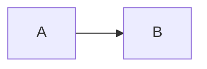

# ojitha.github.io

Source for the personal blog at <https://ojitha.github.io>, built with Jekyll (`github-pages` gem) and the `jekyll/minima` remote theme.

## Post series

Posts that belong to a series show a series card near the top. The card has the series title, "Part N of M", a progress bar and the list of posts, with the current post highlighted.

| Layer | File | Responsibility |
|---|---|---|
| Data | `_data/series.yml` | Each series' title and its posts in reading order |
| Markup | `_includes/series.html` | Finds the post's series and renders the card |
| Placement | `_layouts/post.html` | Injects the card right after `<!--more-->` |
| Style | `_sass/minima/custom-styles.scss` (section *Series box*) | Card styles, including dark mode |

### Adding a post to a series

Add the post's source path to its series in `_data/series.yml`. For a new series, add a new key:

```yaml
k8s-on-pi5:
  title: Kubernetes on Raspberry Pi 5
  posts:
    - _posts/2026-01-03-K8sIntro.md
    - _posts/2026-11-03-K8sObjectModel.md
    - _posts/2026-11-08-K8sAIML.md
```

That's all. Nothing needs to go into the post itself.

- The post layout runs `_includes/series.html`. It looks up `page.path` in every series, and the part number is the post's position in that list. Reordering the list renumbers the posts.
- If the post is in a series, the card is inserted immediately after the `<!--more-->` excerpt separator, so it never appears in excerpts. If a series post has no separator, the card goes at the top of the post body.
- If the post isn't in any series, no card is shown. A post listed in more than one series gets a card for each.
- If a listed post doesn't exist yet (for example, it's future-dated or still a draft), its entry shows as "Coming soon".
- Don't add `` to a post manually, because the card would then appear twice.

### Changing the look

Edit only the *Series box* section of `_sass/minima/custom-styles.scss`. Colours are CSS custom properties (`--series-accent`, `--series-bg`, …) at the top of `.series-box`. Their dark-mode values are in the `series-box-dark` mixin, which applies to both `[data-theme="dark"]` and an OS dark preference.

## Captions & cross-references

Figures, tables and code listings can have numbered captions ("Figure 1: …", "Table 2: …", "Listing 3: …"), and links to them get their numbers automatically. GitHub Pages builds in safe mode, which doesn't run custom plugins, so the numbering is done in the browser.

| Layer | File | Responsibility |
|---|---|---|
| Script | `_includes/captions.html` | Numbers tagged blocks, adds captions, fills in reference text |
| Placement | `_layouts/post.html` | Includes the script on every post (and notes page, which uses `layout: post`) |
| Mermaid | `_includes/mermaid.html` | Keeps the `id`/`caption` of a Mermaid block when it renders the diagram |
| Style | `_sass/minima/custom-styles.scss` (section *Captions & cross-references*) | Caption and missing-reference styles, including dark mode |

### Tagging a block

Put a kramdown attribute list on the line **directly after** the block, with no blank line in between. The id prefix sets the type, and `caption` sets the text:

````markdown
{: #fig-layout caption="tmux layout"}

| A | B |
|---|---|
| 1 | 2 |
{: #tbl-components caption="Components of the lab"}

```bash
brew install neovim
```
{: #lst-install caption="Installing prerequisites"}


{: #fig-flow caption="Data flow"}
````

| Prefix | Label | Caption position |
|---|---|---|
| `fig-` | Figure | Below (images, Mermaid diagrams) |
| `tbl-` | Table | Above, as a real `<caption>` |
| `lst-` | Listing | Above |

Each type is numbered separately, in the order the blocks appear in the post. `caption` is optional; without it, only the label ("Figure 1") is shown.

### Referencing a block

```markdown
See [](#fig-layout), [Table](#tbl-components) and [the install step](#lst-install).
```

- Empty link text becomes the label and number: "Figure 1".
- Text that is exactly the type word ("Figure", "Table", "Listing") gets the number added: "Table 1".
- Any other text is left as written.
- If the id doesn't exist, the link shows a red `??` and the browser console logs `[captions] missing reference target: #id`.

Without JavaScript, every block still renders normally, but `[](#fig-x)` links have no visible text. Write `[Figure](#fig-x)` if that matters.

### Adding a new type

Add one line to the `TYPES` map at the top of `_includes/captions.html`, for example:

```js
eqn: { label: 'Equation', pos: 'below' },
```

### Posts converted from notebooks

Posts synced from sibling repos by `make` are converted with `jupyter nbconvert`, which puts a blank line between notebook cells. kramdown attaches an attribute list that follows a blank line to the *next* block, so:

- Put the attribute list in the **same Markdown cell** as the table or image. This works.
- An attribute list in its own cell (for example, under a code cell or a plot output) tags the wrong element. Captioning code cells and outputs needs a post-processing step in the sibling repo's Makefile that removes the blank line before a `{: #fig-…}`/`{: #tbl-…}`/`{: #lst-…}` line. That step isn't implemented yet.

See `_posts/2026-11-10-NeovimMarkdownLab.md` for a worked example.
