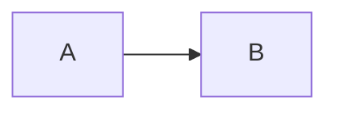

# ojitha.github.io

Source for the personal blog at <https://ojitha.github.io>, built with Jekyll (`github-pages` gem) and the `jekyll/minima` remote theme.

## Post series

Posts that belong to a series show a series card near the top. The card has the series title, "Part N of M", a progress bar and the list of posts, with the current post highlighted.

| Layer | File | Responsibility |
|---|---|---|
| Data | `_data/series.yml` | Each series' title and its posts in reading order |
| Markup | `_includes/series.html` | Finds the post's series and renders the card |
| Placement | `_layouts/post.html` | Injects the card right after `<!--more-->` |
| Style | `_sass/minima/custom-styles.scss` (section *Series box*) | Card styles, including dark mode |

### Adding a post to a series

Add the post's source path to its series in `_data/series.yml`. For a new series, add a new key:

```yaml
k8s-on-pi5:
  title: Kubernetes on Raspberry Pi 5
  posts:
    - _posts/2026-01-03-K8sIntro.md
    - _posts/2026-11-03-K8sObjectModel.md
    - _posts/2026-11-08-K8sAIML.md
```

That's all. Nothing needs to go into the post itself.

- The post layout runs `_includes/series.html`. It looks up `page.path` in every series, and the part number is the post's position in that list. Reordering the list renumbers the posts.
- If the post is in a series, the card is inserted immediately after the `<!--more-->` excerpt separator, so it never appears in excerpts. If a series post has no separator, the card goes at the top of the post body.
- If the post isn't in any series, no card is shown. A post listed in more than one series gets a card for each.
- If a listed post doesn't exist yet (for example, it's future-dated or still a draft), its entry shows as "Coming soon".
- Don't add `` to a post manually, because the card would then appear twice.

### Changing the look

Edit only the *Series box* section of `_sass/minima/custom-styles.scss`. Colours are CSS custom properties (`--series-accent`, `--series-bg`, …) at the top of `.series-box`. Their dark-mode values are in the `series-box-dark` mixin, which applies to both `[data-theme="dark"]` and an OS dark preference.

## Captions & cross-references

Figures, tables and code listings can have numbered captions ("Figure 1: …", "Table 2: …", "Listing 3: …"), and links to them get their numbers automatically. GitHub Pages builds in safe mode, which doesn't run custom plugins, so the numbering is done in the browser.

| Layer | File | Responsibility |
|---|---|---|
| Script | `_includes/captions.html` | Numbers tagged blocks, adds captions, fills in reference text |
| Placement | `_layouts/post.html` | Includes the script on every post (and notes page, which uses `layout: post`) |
| Mermaid | `_includes/mermaid.html` | Keeps the `id`/`caption` of a Mermaid block when it renders the diagram |
| Style | `_sass/minima/custom-styles.scss` (section *Captions & cross-references*) | Caption and missing-reference styles, including dark mode |

### Tagging a block

Put a kramdown attribute list on the line **directly after** the block, with no blank line in between. For a code block, it can also go on the line directly before the opening fence. The id prefix sets the type, and `caption` sets the text:

````markdown
{: #fig-layout caption="tmux layout"}

| A | B |
|---|---|
| 1 | 2 |
{: #tbl-components caption="Components of the lab"}

```bash
brew install neovim
```
{: #lst-install caption="Installing prerequisites"}


{: #fig-flow caption="Data flow"}
````

| Prefix | Label | Caption position |
|---|---|---|
| `fig-` | Figure | Below (images, Mermaid diagrams) |
| `tbl-` | Table | Above, as a real `<caption>` |
| `lst-` | Listing | Above |

Each type is numbered separately, in the order the blocks appear in the post. `caption` is optional; without it, only the label ("Figure 1") is shown.

### Referencing a block

```markdown
See [](#fig-layout), [Table](#tbl-components) and [the install step](#lst-install).
```

- Empty link text becomes the label and number: "Figure 1".
- Text that is exactly the type word ("Figure", "Table", "Listing") gets the number added: "Table 1".
- Any other text is left as written.
- If the id doesn't exist, the link shows a red `??` and the browser console logs `[captions] missing reference target: #id`.

Without JavaScript, every block still renders normally, but `[](#fig-x)` links have no visible text. Write `[Figure](#fig-x)` if that matters.

### Adding a new type

Add one line to the `TYPES` map at the top of `_includes/captions.html`, for example:

```js
eqn: { label: 'Equation', pos: 'below' },
```

### Posts converted from notebooks

Posts synced from sibling repos by `make` are converted with `jupyter nbconvert`, which puts a blank line between notebook cells. kramdown attaches an attribute list that follows a blank line to the *next* block, so:

- Put the attribute list in the **same Markdown cell** as the table or image. This works.
- An attribute list in its own cell (for example, under a code cell or a plot output) tags the wrong element. Captioning code cells and outputs needs a post-processing step in the sibling repo's Makefile that removes the blank line before a `{: #fig-…}`/`{: #tbl-…}`/`{: #lst-…}` line. That step isn't implemented yet.

See `_posts/2026-11-10-NeovimMarkdownLab.md` for a worked example.

## Callout boxes

Two CSS-only boxes for post content, both styled in `_sass/minima/custom-styles.scss` with light and dark variants (the dark values are in a mixin that applies to both `[data-theme="dark"]` and an OS dark preference). No JavaScript or include is needed.

| Box | Markup | Style section | Dark mixin |
|---|---|---|---|
| Expandable box | `<details markdown="1">` | *Expandable box* | `details-box-dark` |
| Callout box | `{:.ok}`, `{:.warn}`, `{:.note}`, `{:.bad}` on a block | *Callout boxes* (`$callouts` map) | `callout-colours` (dark entry in the map) |

### Expandable box

A light-blue card with a title row and a triangle that turns down when the box is opened. It's a plain HTML `<details>` element:

```markdown
<details markdown="1">
<summary>What does prepare-environment do? (Click to expand)</summary>

The `prepare-environment` command sets up your lab:

- **Repository Setup**: Downloads the workshop content
- **Cluster Reset**: Resets the sample app

</details>
```

- `markdown="1"` is required. kramdown doesn't parse Markdown inside HTML by default, so without it the body shows as raw text.
- Leave a blank line after `</summary>` and before `</details>`, or the body isn't treated as Markdown blocks.
- Add `open` (`<details markdown="1" open>`) to show the box expanded when the page loads.
- Only `<details>` inside `.post-content` gets this style.
- In a notebook-synced post, keep the whole `<details>` … `</details>` block in one Markdown cell.

### Callout boxes

Tag a block with a tone class on the line directly after it to get a coloured callout with an icon and a header:

| Class | Default header | Colour | Icon |
|---|---|---|---|
| `{:.ok}` | TIP | Green | Lightbulb |
| `{:.warn}` | WARNING | Amber | Triangle |
| `{:.note}` | NOTE | Grey | Info circle |
| `{:.bad}` | DANGER | Red | Stop sign |

```markdown
> Each module includes its own `prepare-environment` command.
{:.ok}

> This deletes the cluster.
{:.bad}
```

To change the header text, add a `data-label` attribute. The label is always shown in capitals:

```markdown
> Pin image tags in production.
{:.ok data-label="Best practice"}

> Requires Kubernetes 1.30 or later.
{:.warn data-label="Heads up"}
```

- It works on a blockquote, paragraph, `div` or whole list. A blockquote is the usual choice.
- Inline use (for example `*text*{:.warn}`) still renders as a small coloured pill, not a box.
- The icon follows the class, whatever the label says.
- The label uses `data-label` rather than `title`, because browsers show `title` as a hover tooltip.
- To change a colour, icon or default label, or to add a tone, edit its entry in the `$callouts` map. Each entry holds the label, the SVG icon paths, and `(accent, background, text)` colours for light and dark.
- `.info` isn't in the map, so a block tagged `{:.info}` keeps the older left-border style.

## Code blocks

`_includes/code-tools.html` (loaded from `custom-head.html`) adds a toolbar to every fenced code block, shown on hover:

| Button | What it does |
|---|---|
| Word wrap | Wraps long lines instead of scrolling sideways |
| `#` | Shows line numbers. Set `linenos: true` in front matter to show them by default |
| Copy | Copies the code. Line numbers and badges are never copied |

### Marking lines

To highlight lines and put a lettered badge beside them, add a `mark` attribute to the block's attribute list. The list can go on the line **directly before** the opening fence, together with a listing id and caption:

````markdown
{: #lst-cluster caption="Cluster config" mark="3-4:A, 6:B"}
```yaml
apiVersion: eksctl.io/v1alpha5
kind: ClusterConfig
availabilityZones:
  - ${AWS_REGION}a
metadata:
  name: ${EKS_CLUSTER_NAME}
```
````

The same list also works on the line directly after the closing fence. Either way, don't leave a blank line between the list and the fence.

- Each item is a line number or a range (`3-6`), separated by commas.
- `:LABEL` puts a badge on the first line of the item. The label can be any short text.
- An item without a label (`mark="5"`) is only highlighted.
- Line numbers count from 1 and include blank lines. Numbers past the end of the block are ignored.
- Marks don't work on blocks from the Liquid `highlight` tag with `linenos`, which have their own line numbers.

### Explaining the marks

To explain each badge under the block, write a list straight after it and tag the list with `{: .marks}`:

```markdown
- Create a VPC across three availability zones
- Create an EKS cluster, which default is named `eks-workshop`
- Create an IAM OIDC provider
{: .marks}
```

- Each item gets a badge instead of a bullet. The badges are taken in order from the labels in the code block above, so a block with `mark="3:A, 8:B, 15:C"` gives the items A, B and C.
- The list has to come right after the code block (or its listing caption), with nothing else in between.
- If there's no marked block above, the items are lettered A, B, C… in order.
- Bulleted (`-`) and numbered (`1.`) lists both work.
