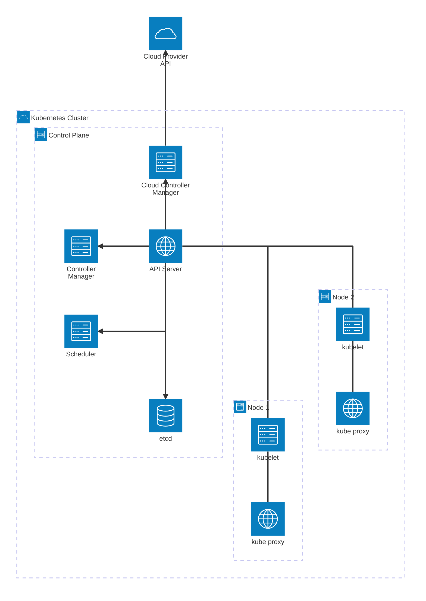

{% include video-summary.html
   id="K01W9t452iI"
   content="<p>Building a Kubernetes cluster on edge hardware like the <strong>Raspberry Pi 5</strong> requires looking beyond standard cloud-provider abstractions. This comprehensive guide covers the setup and operation of a 4-node cluster running <strong>Ubuntu 24.04 LTS</strong> and <strong>Vanilla Kubernetes v1.30.2</strong>. We detail low-level OS tuning—including kernel cgroups, Netplan static IP configuration, and hardware driver inspection alongside core control plane components. The guide explores container runtime integration using <code>containerd</code> and the <code>cri-dockerd</code> adapter for Docker Engine, followed by a deep dive into Software-Defined Networking using <strong>Flannel CNI</strong> (VXLAN overlay). Finally, we analyze service routing via <strong>kube-proxy</strong> (iptables mode), internal DNS with <strong>CoreDNS</strong>, cluster add-ons (<strong>Kubernetes Dashboard</strong> installed via Helm), and deployment management for workloads (Nginx, Redis, Echoserver) using runtime diagnostics via <code>crictl</code>, <code>ip route</code>, and <code>kubectl</code>.</p>" %}

<!--more-->


------

* TOC
{:toc}
------

## Introduction

**Containers**{:.hl}[^1] are an appliction-centric method to deliver 
- high-performing, 
- scalable applications on any infrastructure of your choice

**Container orchestrations**{:.hl} are tools that group systems together to form clusters (conferring the advantages of distributed systems such as *reliability, workload distribution and reduced latency*{:gtxt}) where containers' deployment and management are automated at scale while meeting the following requirements:

- Fault tolerance
- Scalability on-demand
- Optimal resource usage
- Auto-discovery
- Container-to-container communication
- Accessibility from the outside world
- Seamless updates/rollbacks without any downtime

Most container orchestrators can be deployed on infrastructure such as 
- on bare metal, 
- virtual machines, 
- on-premises, 
- on public and hybrid clouds.

### Kubernetes
According to the Kubernetes website[^2]:

> Kubernetes is an open-source system for automating deployment, scaling, and management of containerised applications.
{:.info-box}

K8S provide the following features:

- Automatic bin packing - schedules containers based on resource needs and constraints
- Extensibility - extend without modifying upstream source
- Self-healing - automatically replaces and reschedules containers for failed nodes
- Horizontal scaling
- Service discovery and load balancing
- Automatic rollouts and rollbacks
- Secret and configuration management
- Storage orchestration
- Batch execution
- IPv4/IPv6 dual-stack

### CNCF

Cloud Native Computing Foundation (CNCF) is a subproject of the Linux Foundation. CNCF hosts a multitude of projects. As of 1 Nov 2026, some of the [CNCF Graduated and Incubating Projects](https://www.cncf.io/projects-graduated/){:target="_blank" rel="noopener noreferrer} are:

| Project | Description | Maturity level |
|---|---|---|
| [Kubernetes](https://kubernetes.io){:target="_blank" rel="noopener noreferrer} | Container orchestrator | Graduated |
| [Argo](https://argoproj.github.io){:target="_blank" rel="noopener noreferrer} | Workflow engine for Kubernetes | Graduated |
| [etcd](https://etcd.io){:target="_blank" rel="noopener noreferrer} | Distributed key-value store | Graduated |
| [CoreDNS](https://coredns.io){:target="_blank" rel="noopener noreferrer} | DNS server | Graduated |
| [containerd](https://containerd.io){:target="_blank" rel="noopener noreferrer} | Container runtime | Graduated |
| [CRI-O](https://cri-o.io){:target="_blank" rel="noopener noreferrer} | Container runtime | Graduated |
| [Envoy](https://www.envoyproxy.io){:target="_blank" rel="noopener noreferrer} | Cloud native proxy | Graduated |
| [Fluentd](https://www.fluentd.org){:target="_blank" rel="noopener noreferrer} | Unified logging | Graduated |
| [Flux](https://fluxcd.io){:target="_blank" rel="noopener noreferrer} | Continuous delivery for Kubernetes | Graduated |
| [Harbor](https://goharbor.io){:target="_blank" rel="noopener noreferrer} | Container registry | Graduated |
| [Helm](https://helm.sh){:target="_blank" rel="noopener noreferrer} | Package management for Kubernetes | Graduated |
| [Linkerd](https://linkerd.io){:target="_blank" rel="noopener noreferrer} | Service mesh for Kubernetes | Graduated |
| [Open Policy Agent](https://www.openpolicyagent.org){:target="_blank" rel="noopener noreferrer} | Policy engine | Graduated |
| [Prometheus](https://prometheus.io){:target="_blank" rel="noopener noreferrer} | Monitoring system and time series DB | Graduated |
| [Rook](https://rook.io){:target="_blank" rel="noopener noreferrer} | Cloud native storage orchestrator for Kubernetes | Graduated |
| [Buildpacks.io](https://buildpacks.io){:target="_blank" rel="noopener noreferrer} | Builds application images | Graduated |
| [Knative](https://knative.dev){:target="_blank" rel="noopener noreferrer} | Serverless containers in Kubernetes | Graduated |
| [Contour](https://projectcontour.io){:target="_blank" rel="noopener noreferrer} | Ingress controller for Kubernetes | Incubating |
| [gRPC](https://grpc.io){:target="_blank" rel="noopener noreferrer} | Remote procedure call (RPC) framework | Incubating |
| [CNI](https://www.cni.dev){:target="_blank" rel="noopener noreferrer} | Networking for Linux containers | Incubating |
| [KubeVirt](https://kubevirt.io){:target="_blank" rel="noopener noreferrer} | Virtual machine manager built on Kubernetes | Incubating (reported in March 2026 as close to graduating) |
| [Notary](https://notaryproject.dev){:target="_blank" rel="noopener noreferrer} | Data security and supply-chain signing | Incubating |
| [rkt](https://github.com/rkt/rkt){:target="_blank" rel="noopener noreferrer} | Container runtime | Archived |
| [OpenTracing](https://opentracing.io){:target="_blank" rel="noopener noreferrer} | Distributed tracing API | Archived (merged into OpenTelemetry) |
| [Brigade](https://github.com/brigadecore/brigade){:target="_blank" rel="noopener noreferrer} | Event-driven automation tool | Archived |
| [Service Mesh Interface](https://smi-spec.io){:target="_blank" rel="noopener noreferrer} | Standard interface for service meshes | Archived |


### Kubernetes Architecture



**Control Plane Node**

- **What it is:** The "brain" of a Kubernetes cluster. It runs the control plane agents that manage the cluster's state. Users talk to it through the CLI (kubectl), the Web UI dashboard, or the API.
- **Why it must stay up:** <span>If you lose the control plane, you can get downtime and service outages</span>{:rtxt}. <span>To make it fault-tolerant, you can add control plane replicas in **High-Availability (HA) mode**</span>{:gtxt}. Only one node actively manages the cluster at a time, but all replicas stay in sync so another can take over if it fails (resiliency).
- **Cluster state storage:** All cluster configuration and state live in a distributed key-value store (etcd). It holds no application or workload data. There are two ways to set it up:
  - **Stacked topology:** etcd runs on the control plane nodes. The HA control plane replicas also make etcd resilient.
  - **External topology:** etcd runs on its own dedicated hosts, separate from the other control plane agents. This lowers the risk of losing the data store, but those hosts need their own replication for HA, which means more hardware and higher cost.


| Component | Description | Note |
|---|---|---|
| API Server (kube-apiserver) | Coordinates all administrative tasks. It receives RESTful calls from users, administrators, developers, operators and external agents, then validates and processes them. It reads the cluster's current state from the key-value store and saves the resulting state back after each call. | It is the only control plane component that talks to the key-value store, so other agents go through it. It can scale horizontally, and you can add custom secondary API Servers, which turns the primary one into a proxy. |
| Scheduler (kube-scheduler) | Assigns new workload objects, such as Pods, to nodes, usually worker nodes. It gets node resource data and workload requirements through the API Server, filters candidate nodes with predicates, scores them with priorities, and sends the chosen node back to the API Server. | It considers constraints such as labels (e.g. `disk==ssd`), QoS, data locality, affinity/anti-affinity, taints/tolerations and topology. You can configure it with policies, plugins and profiles. Custom schedulers are supported, and the default scheduler is used if none is named. The job is complex in multi-node clusters and simple in single-node ones. |
| Controller Managers | Run controllers or operators. These are watch loops that compare the desired state (from object configuration) with the current state (from the key-value store, via the API Server) and take corrective action until the two match. | There are two kinds: kube-controller-manager and cloud-controller-manager. |
| kube-controller-manager | Runs controllers that act when nodes become unavailable, keep Pod counts as expected, and create endpoints, service accounts and API access tokens. | Handles cluster-internal state. |
| cloud-controller-manager | Runs controllers that work with the cloud provider's infrastructure: handling unavailable nodes, managing cloud storage volumes, and managing load balancing and routing. | Specific to the cloud provider. |
| Key-Value Data Store (etcd) | A strongly consistent, distributed key-value store[^3] (a CNCF project) that saves the cluster's state. It also stores configuration details such as subnets, ConfigMaps and Secrets. | Only the API Server can talk to etcd. Data is only appended, never replaced, and old data is compacted periodically. `etcdctl` can save and restore snapshots. Production needs HA replication. Topologies are **stacked** (the kubeadm default, sharing the control plane node) or **external** (a dedicated host). It uses the **Raft** consensus algorithm with one leader and the rest followers, and it is written in Go. |

__workder nodes__

- **What a worker node does:** It's where client applications actually run. These apps are microservices packaged as containers.
- **Pods:** Kubernetes wraps containers in Pods. <span>A Pod is the smallest unit Kubernetes schedules, and it holds one or more containers</span>{:gtxt}. Kubernetes starts, stops or reschedules all the containers in a Pod together.
- **Who's in charge:** Agents on the control plane node decide which worker node each Pod runs on. The worker node supplies the Pod's compute, memory, storage and networking, so <span>Pods can talk to each other and to the outside world</span>{:gtxt}.
- **Traffic flow:** In a cluster with several worker nodes, traffic between users and the apps goes straight to the worker nodes. It doesn't pass through the control plane node.

> In short, the control plane decides where things run, and the worker nodes run them and handle their traffic.
{:.ok}

The CRI consists of protocol buffers, gRPC API, libraries, and additional specifications and tools. In order to connect to interchangeable container runtimes, kubelet uses a CRI shim, an application that provides a clear abstraction layer between kubelet and the container runtime.


Container Runtime Interface with cri-dockerd:

```mermaid
block-beta
  columns 9
  block:kubelet
    columns 1
    kt["Kubelet"]
    kc["grpc client"]
  end
  space
  block:shim
    columns 1
    st["cri-dockerd (CRI shim)"]
    ss["grpc server"]
  end
  space
  de(["Docker Engine (dockerd)"])
  space
  cd(["containerd"])
  space
  block:containers
    columns 1
    c1["container"]
    c2["container"]
    c3["container"]
  end
  kc -- "CRI protobuf" --> ss
  ss -- "Docker API" --> de
  de --> cd
  cd --> c1
  cd --> c2
  cd --> c3
  style kubelet fill:#1E9BE0,stroke:#000
  style kt fill:#1E9BE0,stroke:#1E9BE0,color:#fff
  style shim fill:#F7A31C,stroke:#000
  style st fill:#F7A31C,stroke:#F7A31C,color:#fff
  style de fill:#5BBE3C,stroke:#000,color:#fff
  style cd fill:#5BBE3C,stroke:#000,color:#fff
```



*Based on the diagram from [blog.kubernetes.io](http://blog.kubernetes.io/2017/11/containerd-container-runtime-options-kubernetes.html){:target="_blank" rel="noopener noreferrer}*

> Since Kubernetes v1.24, dockershim is no longer part of the kubelet. cri-dockerd[^5], maintained by Docker, Inc. and Mirantis, is the CRI adapter that keeps Docker Engine usable as a Kubernetes runtime.
{:.warn}


| Component | Description | Note |
|---|---|---|
| Container runtime | Manages the container lifecycle on the node; Kubernetes can't run containers directly, so it relies on a runtime wherever Pods are scheduled. | Needed on every node, control plane and worker alike, because control plane components are recommended to run as containers. Supported runtimes: CRI-O, containerd, Docker Engine, Mirantis Container Runtime. |
| Node agent – kubelet | Runs on each node and talks to the control plane. It receives Pod definitions (mostly from the API Server), works with the container runtime to run the Pod's containers, and monitors Pod health and resources. | Connects to runtimes through the <span>Container Runtime Interface (CRI)</span>{:.hl}, acting as the gRPC client to a CRI shim. The CRI has two services: ImageService (image operations) and RuntimeService (Pod and container operations). |
| kubelet – CRI shims | Runtime-specific CRI implementations (adapters) that sit as an abstraction layer between the kubelet and the container runtime. | Lets Kubernetes use any CRI-compliant runtime without recompiling. Examples: cri-containerd, CRI-O (for any OCI runtime such as runC), cri-dockerd. dockershim was removed in v1.24, and cri-dockerd (maintained by Docker, Inc. and Mirantis) replaces it. |
| Proxy – kube-proxy | Network agent on each node that keeps the node's networking rules up to date. It hides Pod networking details and forwards connection requests to the containers in Pods. | Handles TCP, UDP and SCTP forwarding across Pod backends based on Service API objects. Works together with the node's **iptables** (see `ip route show`). |
| Add-ons | Cluster features not yet built into Kubernetes, provided by third-party plugins and services. | Includes DNS (required for DNS records of objects), Dashboard (web UI), Monitoring (cluster-level metrics), Logging (cluster-level logs) and Device Plugins (expose GPU, FPGA and high-performance NIC hardware to Pods). |

> A runtime is required on each node of a Kubernetes cluster, both control plane and worker. The [recommendation](https://kubernetes.io/docs/setup/){:target="_blank" rel="noopener noreferrer}[^4] is to run the Kubernetes control plane components as containers, hence the necessity of a runtime on the control plane nodes.
- [CRI-O](https://cri-o.io/){:target="_blank" rel="noopener noreferrer}: A lightweight container runtime for Kubernetes that works with the quay.io and Docker Hub image registries.
- [containerd](https://containerd.io/){:target="_blank" rel="noopener noreferrer}: A simple, robust and portable container runtime.
- [Docker Engine](https://www.docker.com/){:target="_blank" rel="noopener noreferrer}: A popular, complex container platform that uses containerd as its container runtime.
- [Mirantis Container Runtime](https://www.mirantis.com/software/container-runtime/){:target="_blank" rel="noopener noreferrer}: Formerly called Docker Enterprise Edition.
{:.note}


### Configuration

Here are the possible Kubernetes installation configurations:

| Configuration | Control Plane | etcd | Worker Nodes | HA | Best For |
|---|---|---|---|---|---|
| All-in-One Single-Node | Everything on one node | On the same node | Same node | No | Learning, development, testing (not production) |
| Single Control Plane + Multi-Worker | 1 node | Stacked: runs on the control plane node | Multiple | No | Small or non-critical clusters |
| Single Control Plane + Single-Node etcd + Multi-Worker | 1 node | External: 1 separate etcd node | Multiple | No | Keeping etcd apart from the control plane |
| Multi-Control Plane + Multi-Worker | Multiple nodes (HA) | Stacked: one per control plane node, forming an HA etcd cluster | Multiple | Yes | Production |
| Multi-Control Plane + Multi-Node etcd + Multi-Worker | Multiple nodes (HA) | External: one etcd node paired with each control plane node, forming an HA etcd cluster | Multiple | Yes | Production (the most advanced setup, and the recommended one) |

> The more complex the cluster, the more hardware and resources it needs. A single host is fine for learning and testing. For production, the community recommends several hosts with an HA control plane and multiple worker nodes.
{:.note}

Following version of the `kubectl` use:


```bash
kubectl version --client
```

    Client Version: v1.30.2
    Kustomize Version: v5.0.4-0.20230601165947-6ce0bf390ce3


```bash
kubectl get nodes 
```

    NAME   STATUS   ROLES           AGE      VERSION
    rp1    Ready    control-plane   2y116d   v1.30.2
    rp2    Ready    <none>          2y116d   v1.30.2
    rp3    Ready    <none>          2y116d   v1.30.2
    rp4    Ready    <none>          2y116d   v1.30.2


```bash
kubectl get namespaces
```

    NAME                   STATUS   AGE
    default                Active   2y116d
    kube-flannel           Active   2y116d
    kube-node-lease        Active   2y116d
    kube-public            Active   2y116d
    kube-system            Active   2y116d
    kubernetes-dashboard   Active   2y116d


The startup process creates, by default, a configuration file, **config**, inside the **.kube** directory (often referred to as the **[kubeconfig](https://kubernetes.io/docs/concepts/configuration/organize-cluster-access-kubeconfig/){:target="_blank" rel="noopener noreferrer}**), which resides in the machine's **home** directory.

- **What it does:** kubectl needs two things to talk securely to the API Server on the control plane node: the server's address and credentials. It gets both from the kubeconfig.
- **Where it lives:** When you start K8s, it automatically creates the file at `~/.kube/config` in your home directory. kubectl reads this file by default. One kubectl client can also work with several kubeconfig files.
- **Viewing it:** Run `kubectl config view`, or open `~/.kube/config` directly on Linux. The file has three main parts:
  - **clusters:** the API Server address (e.g. `https://192.168.1.11:6443`) and the CA certificate.
  - **users:** the `kubernetes-admin` user's client certificate and key.
  - **contexts:** each one links a cluster to a user. `current-context` (here `kubernetes-admin@kubernetes`) is the one kubectl uses right now.
- **Checking the cluster:** `kubectl cluster-info` shows where the control plane and KubeDNS are running. For deeper troubleshooting, use `kubectl cluster-info dump`.
- **Key caveat:** k8s writes the kubeconfig for you, but other cluster setups often don't. In that case, you may have to create or adjust the file yourself to match your network and client/server setup.


```bash
kubectl config view
```

    apiVersion: v1
    clusters:
    - cluster:
        certificate-authority-data: DATA+OMITTED
        server: https://192.168.1.11:6443
      name: kubernetes
    contexts:
    - context:
        cluster: kubernetes
        user: kubernetes-admin
      name: kubernetes-admin@kubernetes
    current-context: kubernetes-admin@kubernetes
    kind: Config
    preferences: {}
    users:
    - name: kubernetes-admin
      user:
        client-certificate-data: DATA+OMITTED
        client-key-data: DATA+OMITTED


Use `kubectl proxy` to reach the Kubernetes API. When you run `kubectl proxy`, kubectl signs in to the API server on the control plane node and serves the API locally at 127.0.0.1 on the default port, 8001. It ties up the terminal while it runs unless you start it in the background with `kubectl proxy &`. 


```bash
kubectl proxy &
```

    [1] 72902


While the proxy is running, you can send requests to the API from another terminal or a browser without handling authentication yourself. For example, `curl http://localhost:8001/` lists all the available API endpoints, such as `/api`, `/apis`, `/metrics` and `/version`. You can also explore specific paths like `/api/v1`, `/apis/apps/v1`, `/healthz` and `/metrics`.


```bash
curl http://localhost:8001
```

      % Total    % Received % Xferd  Average Speed   Time    Time     Time  Current
                                     Dload  Upload   Total   Spent    Left  Speed
      0     0    0     0    0     0      0      0 --:--:-- --:--:-- --:--:--     0{
      "paths": [
        "/.well-known/openid-configuration",
        "/api",
        "/api/v1",
        "/apis",
        "/apis/",
        "/apis/admissionregistration.k8s.io",
        "/apis/admissionregistration.k8s.io/v1",
        "/apis/apiextensions.k8s.io",
        "/apis/apiextensions.k8s.io/v1",
        "/apis/apiregistration.k8s.io",
        "/apis/apiregistration.k8s.io/v1",
        "/apis/apps",
        "/apis/apps/v1",
        "/apis/authentication.k8s.io",
        "/apis/authentication.k8s.io/v1",
        "/apis/authorization.k8s.io",
        "/apis/authorization.k8s.io/v1",
        "/apis/autoscaling",
        "/apis/autoscaling/v1",
        "/apis/autoscaling/v2",
        "/apis/batch",
        "/apis/batch/v1",
        "/apis/certificates.k8s.io",
        "/apis/certificates.k8s.io/v1",
        "/apis/configuration.konghq.com",
        "/apis/configuration.konghq.com/v1",
        "/apis/configuration.konghq.com/v1alpha1",
        "/apis/configuration.konghq.com/v1beta1",
        "/apis/coordination.k8s.io",
        "/apis/coordination.k8s.io/v1",
        "/apis/discovery.k8s.io",
        "/apis/discovery.k8s.io/v1",
        "/apis/events.k8s.io",
        "/apis/events.k8s.io/v1",
        "/apis/flowcontrol.apiserver.k8s.io",
        "/apis/flowcontrol.apiserver.k8s.io/v1",
        "/apis/flowcontrol.apiserver.k8s.io/v1beta3",
        "/apis/networking.k8s.io",
        "/apis/networking.k8s.io/v1",
        "/apis/node.k8s.io",
        "/apis/node.k8s.io/v1",
        "/apis/policy",
        "/apis/policy/v1",
        "/apis/rbac.authorization.k8s.io",
        "/apis/rbac.authorization.k8s.io/v1",
        "/apis/scheduling.k8s.io",
        "/apis/scheduling.k8s.io/v1",
        "/apis/storage.k8s.io",
        "/apis/storage.k8s.io/v1",
        "/healthz",
        "/healthz/autoregister-completion",
        "/healthz/etcd",
        "/healthz/log",
        "/healthz/ping",
        "/healthz/poststarthook/aggregator-reload-proxy-client-cert",
        "/healthz/poststarthook/apiservice-discovery-controller",
        "/healthz/poststarthook/apiservice-openapi-controller",
        "/healthz/poststarthook/apiservice-openapiv3-controller",
        "/healthz/poststarthook/apiservice-registration-controller",
        "/healthz/poststarthook/apiservice-status-available-controller",
        "/healthz/poststarthook/bootstrap-controller",
        "/healthz/poststarthook/crd-informer-synced",
        "/healthz/poststarthook/generic-apiserver-start-informers",
        "/healthz/poststarthook/kube-apiserver-autoregistration",
        "/healthz/poststarthook/priority-and-fairness-config-consumer",
        "/healthz/poststarthook/priority-and-fairness-config-producer",
        "/healthz/poststarthook/priority-and-fairness-filter",
        "/healthz/poststarthook/rbac/bootstrap-roles",
        "/healthz/poststarthook/scheduling/bootstrap-system-priority-classes",
        "/healthz/poststarthook/start-apiextensions-controllers",
        "/healthz/poststarthook/start-apiextensions-informers",
        "/healthz/poststarthook/start-apiserver-admission-initializer",
        "/healthz/poststarthook/start-cluster-authentication-info-controller",
        "/healthz/poststarthook/start-kube-aggregator-informers",
        "/healthz/poststarthook/start-kube-apiserver-identity-lease-controller",
        "/healthz/poststarthook/start-kube-apiserver-identity-lease-garbage-collector",
        "/healthz/poststarthook/start-legacy-token-tracking-controller",
        "/healthz/poststarthook/start-service-ip-repair-controllers",
        "/healthz/poststarthook/start-system-namespaces-controller",
        "/healthz/poststarthook/storage-object-count-tracker-hook",
        "/livez",
        "/livez/autoregister-completion",
        "/livez/etcd",
        "/livez/log",
        "/livez/ping",
        "/livez/poststarthook/aggregator-reload-proxy-client-cert",
        "/livez/poststarthook/apiservice-discovery-controller",
        "/livez/poststarthook/apiservice-openapi-controller",
        "/livez/poststarthook/apiservice-openapiv3-controller",
        "/livez/poststarthook/apiservice-registration-controller",
        "/livez/poststarthook/apiservice-status-available-controller",
        "/livez/poststarthook/bootstrap-controller",
        "/livez/poststarthook/crd-informer-synced",
        "/livez/poststarthook/generic-apiserver-start-informers",
        "/livez/poststarthook/kube-apiserver-autoregistration",
        "/livez/poststarthook/priority-and-fairness-config-consumer",
        "/livez/poststarthook/priority-and-fairness-config-producer",
        "/livez/poststarthook/priority-and-fairness-filter",
        "/livez/poststarthook/rbac/bootstrap-roles",
        "/livez/poststarthook/scheduling/bootstrap-system-priority-classes",
        "/livez/poststarthook/start-apiextensions-controllers",
        "/livez/poststarthook/start-apiextensions-informers",
        "/livez/poststarthook/start-apiserver-admission-initializer",
        "/livez/poststarthook/start-cluster-authentication-info-controller",
        "/livez/poststarthook/start-kube-aggregator-informers",
        "/livez/poststarthook/start-kube-apiserver-identity-lease-controller",
        "/livez/poststarthook/start-kube-apiserver-identity-lease-garbage-collector",
        "/livez/poststarthook/start-legacy-token-tracking-controller",
        "/livez/poststarthook/start-service-ip-repair-controllers",
        "/livez/poststarthook/start-system-namespaces-controller",
        "/livez/poststarthook/storage-object-count-tracker-hook",
        "/logs",
        "/metrics",
        "/metrics/slis",
        "/openapi/v2",
        "/openapi/v3",
        "/openapi/v3/",
        "/openid/v1/jwks",
        "/readyz",
        "/readyz/autoregister-completion",
        "/readyz/etcd",
        "/readyz/etcd-readiness",
        "/readyz/informer-sync",
        "/readyz/log",
        "/readyz/ping",
        "/readyz/poststarthook/aggregator-reload-proxy-client-cert",
        "/readyz/poststarthook/apiservice-discovery-controller",
        "/readyz/poststarthook/apiservice-openapi-controller",
        "/readyz/poststarthook/apiservice-openapiv3-controller",
        "/readyz/poststarthook/apiservice-registration-controller",
        "/readyz/poststarthook/apiservice-status-available-controller",
        "/readyz/poststarthook/bootstrap-controller",
        "/readyz/poststarthook/crd-informer-synced",
        "/readyz/poststarthook/generic-apiserver-start-informers",
        "/readyz/poststarthook/kube-apiserver-autoregistration",
        "/readyz/poststarthook/priority-and-fairness-config-consumer",
        "/readyz/poststarthook/priority-and-fairness-config-producer",
        "/readyz/poststarthook/priority-and-fairness-filter",
        "/readyz/poststarthook/rbac/bootstrap-roles",
        "/readyz/poststarthook/scheduling/bootstrap-system-priority-classes",
        "/readyz/poststarthook/start-apiextensions-controllers",
        "/readyz/poststarthook/start-apiextensions-informers",
        "/readyz/poststarthook/start-apiserver-admission-initializer",
        "/readyz/poststarthook/start-cluster-authentication-info-controller",
        "/readyz/poststarthook/start-kube-aggregator-informers",
        "/readyz/poststarthook/start-kube-apiserver-identity-lease-controller",
        "/readyz/poststarthook/start-kube-apiserver-identity-lease-garbage-collector",
        "/readyz/poststarthook/start-legacy-token-tracking-controller",
        "/readyz/poststarthook/start-service-ip-repair-controllers",
        "/readyz/poststarthook/start-system-namespaces-controller",
        "/readyz/poststarthook/storage-object-count-tracker-hook",
        "/readyz/shutdown",
        "/version"
      ]
    100  7128    0  7128    0     0   376k      0 --:--:-- --:--:-- --:--:--  386k
    [1]+  Exit 255                kubectl proxy


> Without the kubectl proxy, every request to the Kubernetes API Server has to be authenticated, either with a set of keys and certificates or with a Bearer Token passed in the curl command. A Bearer Token is an access token that the API Server on the control plane node generates when the client asks for one. With it, the client can talk to the API Server securely and access resources without sending any other credentials. The token may have to be sent again with later requests.
{:.ok}

To kill the above poxy binding process use the following command.


```bash
'pkill -f "kubectl proxy"'
```

## Networking
There are four types of networking possibilities in Kubernetes:
1. Container to container: Inside a Pod, containers talk to each other by sharing one network namespace. The container runtime uses the host kernel's virtualisation features to give each container its own isolated network space; on Linux this is called a *network namespace*{:.hl}, and it can be shared between containers or with the host. When a Pod starts, the runtime first launches a special "Pause" container whose only job is to create the Pod's network namespace. <span>Every other container in the Pod joins that namespace, so they can all reach each other over `localhost`</span>{:gtxt}.
2. Pod to pod: Pods can land on any node, so Kubernetes requires every Pod to be able to reach every other Pod in the cluster without Network Address Translation (NAT). It meets this with the **"IP-per-Pod"** model: each Pod is treated like a VM on a network and gets its own unique IP address. Containers inside a Pod share its network namespace, so they talk over `localhost` and must coordinate which ports they use, just as applications on one VM would. The Container Network Interface (CNI) connects containers to this model. CNI is a set of specifications and libraries that lets plugins configure container networking. Most of these plugins are third-party Software Defined Networking (SDN) solutions, such as Flannel[^6], Weave, Calico and Cilium, and some also support Network Policies. When a container needs an IP address, the container runtime asks CNI, CNI gets an address from the configured plugin (such as Bridge or MACvlan), and then passes it back to the runtime.
3. Pod to service: handled by kube-proxy and packet filters on the node
4. External to service: handled by kube-proxy and node-based packet filters. Apps running in Pods often need to be reachable from outside the cluster. Kubernetes handles this with Services: sets of network routing rules that are stored in iptables on the cluster nodes. The kube-proxy agents on those nodes put the rules into effect. A Service exposed this way makes the application reachable from outside through a virtual IP address and a dedicated port number.


| Component | Description | Note |
|---|---|---|
| Network Namespace | An isolated network space the container runtime creates for each container, using the host kernel's virtualisation features | Can be shared across containers, or with the host operating system |
| Pause Container | A special infrastructure container the container runtime starts only to create the Pod's network namespace | All other containers in the Pod share its namespace, so they can talk to each other over `localhost` |
| Container Runtime | Starts containers and creates an isolated network space for each one | Hands IP address assignment off to CNI |
| Container Network Interface (CNI) | A set of specifications and libraries that let plugins configure networking for containers | Gets the IP from the configured plugin and passes it back to the container runtime |
| CNI Core Plugins (e.g. Bridge, MACvlan) | Supply the IP address that CNI asks for | Only a few core plugins exist; most CNI plugins come from third parties |
| SDN Solutions (Flannel, Weave, Calico, Cilium) | Third-party Software Defined Networking CNI plugins that implement the Kubernetes networking model | Some also support Network Policies |
| IP-per-Pod Model | Treats each Pod like a VM on a network, with its own unique IP address | Pods must reach every other Pod in the cluster **without NAT**, which is a basic requirement. Containers in a Pod must coordinate port use among themselves |
| Services | Bundles of network routing rules, stored in iptables on cluster nodes, that expose applications | Make apps reachable from outside the cluster through a virtual IP address and a dedicated port |
| kube-proxy | The agent on each node that implements the Services' routing rules | Makes Services reachable from outside the cluster |

> The pod is the smallest managed entity in Kubernetes. Within a pod, one or more containers can be started within the same namespace. IP addresses are assigned to Pods.  All networks should support direct communication between pods and nodes without network address translation (NAT).

Although a single-container pod is standard, there can be multi-container pods that are deployed with:
- sidecar: extends and enhances the functionality of containers, such as a service mesh
- ambassador: represents data generated by a container
- adapter: adapts a container to a required format
- An **init container** is a container that prepares something for the main container, which is started from the same Pod
  
The network is implemented using Kubernetes plugins, such as Flannel[^6].

Kubernetes manages networking across a cluster of machines. We can look at two core components: the **CNI (Container Network Interface)**, which sets up the network connections, and the **Overlay Network**, which is the "virtual road" traffic actually travels on.

Think of the **CNI (Container Network Interface)** as a standard "plug" or a set of rules. Kubernetes itself doesn't actually know how to "do" networking; instead, it provides a specification that says, "If you want to provide networking for my pods, you must follow these steps."

When a new Pod is scheduled on a node, the **kubelet** (the node agent) calls the CNI plugin to perform two main tasks:
1.  **Interface Creation:** It creates a virtual network interface (like a virtual Ethernet cable) for the pod.
2.  **IP Address Management (IPAM):** It assigns a unique IP address to that pod from a pre-defined range.

Because CNI is a standard, you can swap in different networking providers (such as **Flannel**, **Calico**, or **Cilium**) depending on whether you need simple connectivity or advanced security.

> I am using **Flannel** as a CNI plugin.

An **Overlay Network** is a virtual network built on top of an existing physical network (the "underlay").

When Pod A on Node 1 wants to talk to Pod B on Node 2:

1.  **Encapsulation:** The CNI plugin takes the original packet and wraps it inside a new packet that the physical network understands. This is often done using the VXLAN (Virtual Extensible LAN) protocol 📦.
2.  **Transit:** The physical network moves the packet between the nodes using their actual IP addresses.
3.  **Decapsulation:** When the packet arrives at Node 2, the CNI plugin "unwraps" the outer envelope and delivers the original packet to the destination Pod.

Why use an Overlay?
-   **Simplicity:** You don't have to reconfigure your physical routers every time you add a new pod.
-   **Scale:** It allows thousands of pods to have their own unique IPs even if the underlying network is small.

**SDN (Software-Defined Networking)** is the broader architectural philosophy that enables everything we just discussed.

| Component | Role in SDN | Real-World Kubernetes Equivalent |
| --- | --- | --- |
| **Control Plane** | The "Manager" | The **CNI Controller** (e.g., Flannel daemon or Calico's `felix`). It watches the K8S API for new pods and decides what IP and routes they need. |
| **Data Plane** | The "Worker" | The **Overlay Network** (VXLAN tunnels) or routing tables on each node that actually move the bits. |

💡 Why does this matter?

Without the "Software-Defined" part, every time a developer wanted to launch a new app, a network engineer would have to manually log in to a physical router and update the routing table. In Kubernetes, the SDN (via the CNI) does this automatically in milliseconds.

The `lspci -k` command is used to see which kernel drivers are currently managing your hardware devices.

In Linux, while the basic `lspci` command lists the hardware, the `-k` flag adds crucial "behind-the-scenes" information about the software (drivers) interacting with that hardware.


```bash
lspci -k
```

    00:00.0 PCI bridge: Broadcom Inc. and subsidiaries BCM2712 PCIe Bridge (rev 21)
    	Kernel driver in use: pcieport
    01:00.0 Ethernet controller: Raspberry Pi Ltd RP1 PCIe 2.0 South Bridge
    	Kernel driver in use: rp1


Breaking Down Your Output

Looking at your sample, we can see two distinct layers of information:

| Output Line | Meaning |
| --- | --- |
| `00:00.0` or `01:00.0` | The **PCI Address** (Bus:Device.Function). This is the hardware's unique "address" on your motherboard. |
| `Ethernet controller...` | The **Hardware Name**. This identifies the physical chip. |
| `Kernel driver in use` | The **Active Driver**. This is the specific piece of kernel software currently talking to and controlling that device. |

The ip link show command displays the status of all network interfaces (both physical and virtual) currently recognised by the Linux kernel. If `lspci -k` shows us the "hardware and drivers," `ip link shows` us the actual "plugs" and their current state.


```bash
ip link show
```

    1: lo: <LOOPBACK,UP,LOWER_UP> mtu 65536 qdisc noqueue state UNKNOWN mode DEFAULT group default qlen 1000
        link/loopback 00:00:00:00:00:00 brd 00:00:00:00:00:00
    2: eth0: <BROADCAST,MULTICAST,UP,LOWER_UP> mtu 1500 qdisc pfifo_fast state UP mode DEFAULT group default qlen 1000
        link/ether 2c:cf:67:5a:49:e4 brd ff:ff:ff:ff:ff:ff
    3: wlan0: <BROADCAST,MULTICAST> mtu 1500 qdisc noop state DOWN mode DEFAULT group default qlen 1000
        link/ether 2c:cf:67:5a:49:e5 brd ff:ff:ff:ff:ff:ff
    4: docker0: <NO-CARRIER,BROADCAST,MULTICAST,UP> mtu 1500 qdisc noqueue state DOWN mode DEFAULT group default 
        link/ether 02:42:4e:b3:ea:9c brd ff:ff:ff:ff:ff:ff
    5: flannel.1: <BROADCAST,MULTICAST,UP,LOWER_UP> mtu 1450 qdisc noqueue state UNKNOWN mode DEFAULT group default 
        link/ether ca:a8:7c:5e:26:fc brd ff:ff:ff:ff:ff:ff
    6: cni0: <BROADCAST,MULTICAST,UP,LOWER_UP> mtu 1450 qdisc noqueue state UP mode DEFAULT group default qlen 1000
        link/ether 76:9f:44:0e:41:3b brd ff:ff:ff:ff:ff:ff
    7: vethfccce663@if2: <BROADCAST,MULTICAST,UP,LOWER_UP> mtu 1450 qdisc noqueue master cni0 state UP mode DEFAULT group default 
        link/ether 12:a2:1e:dd:72:b9 brd ff:ff:ff:ff:ff:ff link-netns cni-25b891f2-869a-bdea-5ed6-36e960b51de8
    8: veth60c50de6@if2: <BROADCAST,MULTICAST,UP,LOWER_UP> mtu 1450 qdisc noqueue master cni0 state UP mode DEFAULT group default 
        link/ether 66:79:81:09:a4:49 brd ff:ff:ff:ff:ff:ff link-netns cni-c36472cf-9222-05d5-256b-96ec6f5377d1


Let’s break down your output into three logical groups to see how they relate to your Kubernetes cluster.

1. Physical & Standard Interfaces 🏠
    -   **`lo` (Loopback):** A virtual interface used by the computer to talk to itself.
    -   **`eth0`:** Your primary physical Ethernet connection. It is `UP`, meaning it's actively connected to the network.
    -   **`wlan0`:** Your Wi-Fi interface. It is currently `DOWN` (not connected).
    
    > I used a wired connection only for this cluster, with no Wi-Fi.


2. Kubernetes & Docker "Infrastructure" 🏗️
    This is where your **SDN** and **CNI** have been busy building that "virtual highway" we discussed earlier.
    -   **`docker0`:** A virtual bridge used by Docker to connect containers.
    -   **`flannel.1`:** This is your **Overlay Network** interface (specifically for the Flannel CNI). It acts as a "tunnel" that encapsulates pod traffic so it can travel between different nodes.
    -   **`cni0`:** A virtual bridge created by the CNI. Think of this as a virtual "power strip" where all the pods on this specific node are plugged in.
    
3. The Pod Connections (veth pairs) 🔌
    Interfaces 7 and 8 (`vethba2f...` and `veth2cac...`) are the most interesting for Kubernetes:
    -   **`veth` (Virtual Ethernet):** These are the individual "patch cables" connecting specific Pods to the `cni0` bridge.
    -   **`master cni0`:** This indicates these cables are plugged into the `cni0` bridge.
    -   **`link-netns`:** This confirms that the other end of the cable is tucked inside a specific Pod's private network space.


In Linux, the command `ip route show` (or simply `ip route`) displays the system's **Routing Table**. This table serves as a lookup table that the operating system uses to determine where to send network packets based on their destination IP address.

|Component   |Meaning                                                                                                      |
|------------|-------------------------------------------------------------------------------------------------------------|
|default     |The "catch-all" route. If no other specific route matches, traffic goes here (usually your internet gateway).|
|via         |The IP address of the gateway (router) that will handle the traffic.                                         |
|dev         |The specific network interface (e.g., eth0, wlan0, ens3) being used.                                         |
|proto kernel|Indicates this route was created automatically by the kernel during configuration.                           |
|scope link  |Means these destination IPs are valid only on this specific network link (your local subnet).                |
|src         |The local IP address the system will use when sending traffic on this route.                                 |


```bash
ip route show
```

    default via 192.168.1.1 dev eth0 proto static 
    10.244.0.0/24 dev cni0 proto kernel scope link src 10.244.0.1 
    10.244.1.0/24 via 10.244.1.0 dev flannel.1 onlink 
    10.244.2.0/24 via 10.244.2.0 dev flannel.1 onlink 
    10.244.3.0/24 via 10.244.3.0 dev flannel.1 onlink 
    172.17.0.0/16 dev docker0 proto kernel scope link src 172.17.0.1 linkdown 
    192.168.1.0/24 dev eth0 proto kernel scope link src 192.168.1.11 


Above broadcasting is based on the folloing configuration:

    [sudo] password for oj: # This file is generated from information provided by the datasource.  Changes
    # to it will not persist across an instance reboot.  To disable cloud-init's
    # network configuration capabilities, write a file
    # /etc/cloud/cloud.cfg.d/99-disable-network-config.cfg with the following:
    # network: {config: disabled}
    network:
      ethernets:
        eth0:
          dhcp4: no
          dhcp6: no  
          optional: false
          addresses:
            - 192.168.1.11/24
          routes:
            - via: 192.168.1.1
              to: default
          nameservers:
              addresses: [192.168.1.1]     
      version: 2
      renderer: networkd  


And the worker 2 configuration is

    [sudo] password for oj: # This file is generated from information provided by the datasource.  Changes
    # to it will not persist across an instance reboot.  To disable cloud-init's
    # network configuration capabilities, write a file
    # /etc/cloud/cloud.cfg.d/99-disable-network-config.cfg with the following:
    # network: {config: disabled}
    network:
      ethernets:
        eth0:
          dhcp4: no
          dhcp6: no  
          optional: true
          addresses:
            - 192.168.1.12/24
          routes:
            - via: 192.168.1.1
              to: default
          nameservers:
              addresses: [192.168.1.1]      
      version: 2
      renderer: networkd  


Since I am using containerd as a runtime (standard for modern Kubernetes clusters), I cannot use the docker ps command. Instead, I use `crictl` (the Container Runtime Interface CLI) or ctr (the native containerd CLI).

> In a Kubernetes environment, crictl is the recommended tool because it is designed to be "Kubernetes-aware."


```bash
"echo '$SSHPASS' | sudo -S crictl ps"
```

    [sudo] password for oj: time="2026-01-03T17:41:15+11:00" level=warning msg="runtime connect using default endpoints: [unix:///run/containerd/containerd.sock unix:///run/crio/crio.sock unix:///var/run/cri-dockerd.sock]. As the default settings are now deprecated, you should set the endpoint instead."
    time="2026-01-03T17:41:15+11:00" level=warning msg="image connect using default endpoints: [unix:///run/containerd/containerd.sock unix:///run/crio/crio.sock unix:///var/run/cri-dockerd.sock]. As the default settings are now deprecated, you should set the endpoint instead."
    CONTAINER           IMAGE               CREATED             STATE               NAME                      ATTEMPT             POD ID              POD
    2b9b48fb5898e       2437cf7621777       3 hours ago         Running             coredns                   5                   614acd6612d21       coredns-7db6d8ff4d-4md4v
    f6aeae6fa0512       2437cf7621777       3 hours ago         Running             coredns                   5                   0548191f48e32       coredns-7db6d8ff4d-79shl
    a3edfac794de3       01235e17cb305       3 hours ago         Running             kube-flannel              6                   9fb2a08dfc59a       kube-flannel-ds-5k5nx
    034eb2029b3df       66dbb96a9149f       3 hours ago         Running             kube-proxy                5                   306ae41485829       kube-proxy-mhk25
    89d3db48a666e       84c601f3f72c8       3 hours ago         Running             kube-apiserver            6                   bc9cdba66a7fa       kube-apiserver-rp1
    a5347b4388c3e       c7dd04b1bafeb       3 hours ago         Running             kube-scheduler            6                   0c66c8194afa2       kube-scheduler-rp1
    7db4d578dcae3       e1dcc3400d3ea       3 hours ago         Running             kube-controller-manager   6                   ee2972849003e       kube-controller-manager-rp1
    870bc93f843b4       014faa467e297       3 hours ago         Running             etcd                      6                   f0bcda2de34cf       etcd-rp1


It will show you the Pod ID and the Image clearly. Finding a specific container's logs via crictl:


```bash
"echo '$SSHPASS' | sudo -S crictl logs 2b9b48fb5898e"
```

    [sudo] password for oj: time="2026-01-03T17:45:41+11:00" level=warning msg="runtime connect using default endpoints: [unix:///run/containerd/containerd.sock unix:///run/crio/crio.sock unix:///var/run/cri-dockerd.sock]. As the default settings are now deprecated, you should set the endpoint instead."
    .:53
    [INFO] plugin/reload: Running configuration SHA512 = 591cf328cccc12bc490481273e738df59329c62c0b729d94e8b61db9961c2fa5f046dd37f1cf888b953814040d180f52594972691cd6ff41be96639138a43908
    CoreDNS-1.11.1
    linux/arm64, go1.20.7, ae2bbc2


Find the cluster information:


```bash
kubectl cluster-info
```

    Kubernetes control plane is running at https://192.168.1.11:6443
    CoreDNS is running at https://192.168.1.11:6443/api/v1/namespaces/kube-system/services/kube-dns:dns/proxy
    
    To further debug and diagnose cluster problems, use 'kubectl cluster-info dump'.


You can enable kubectl bash completion: `kubectl completion -h | less`. For the Linux environment:

```bash
 source <(kubectl completion bash)
```

To list all the api resources


```bash
kubectl api-resources
```

    NAME                                SHORTNAMES   APIVERSION                          NAMESPACED   KIND
    bindings                                         v1                                  true         Binding
    componentstatuses                   cs           v1                                  false        ComponentStatus
    configmaps                          cm           v1                                  true         ConfigMap
    endpoints                           ep           v1                                  true         Endpoints
    events                              ev           v1                                  true         Event
    limitranges                         limits       v1                                  true         LimitRange
    namespaces                          ns           v1                                  false        Namespace
    nodes                               no           v1                                  false        Node
    persistentvolumeclaims              pvc          v1                                  true         PersistentVolumeClaim
    persistentvolumes                   pv           v1                                  false        PersistentVolume
    pods                                po           v1                                  true         Pod
    podtemplates                                     v1                                  true         PodTemplate
    replicationcontrollers              rc           v1                                  true         ReplicationController
    resourcequotas                      quota        v1                                  true         ResourceQuota
    secrets                                          v1                                  true         Secret
    serviceaccounts                     sa           v1                                  true         ServiceAccount
    services                            svc          v1                                  true         Service
    mutatingwebhookconfigurations                    admissionregistration.k8s.io/v1     false        MutatingWebhookConfiguration
    validatingadmissionpolicies                      admissionregistration.k8s.io/v1     false        ValidatingAdmissionPolicy
    validatingadmissionpolicybindings                admissionregistration.k8s.io/v1     false        ValidatingAdmissionPolicyBinding
    validatingwebhookconfigurations                  admissionregistration.k8s.io/v1     false        ValidatingWebhookConfiguration
    customresourcedefinitions           crd,crds     apiextensions.k8s.io/v1             false        CustomResourceDefinition
    apiservices                                      apiregistration.k8s.io/v1           false        APIService
    controllerrevisions                              apps/v1                             true         ControllerRevision
    daemonsets                          ds           apps/v1                             true         DaemonSet
    deployments                         deploy       apps/v1                             true         Deployment
    replicasets                         rs           apps/v1                             true         ReplicaSet
    statefulsets                        sts          apps/v1                             true         StatefulSet
    selfsubjectreviews                               authentication.k8s.io/v1            false        SelfSubjectReview
    tokenreviews                                     authentication.k8s.io/v1            false        TokenReview
    localsubjectaccessreviews                        authorization.k8s.io/v1             true         LocalSubjectAccessReview
    selfsubjectaccessreviews                         authorization.k8s.io/v1             false        SelfSubjectAccessReview
    selfsubjectrulesreviews                          authorization.k8s.io/v1             false        SelfSubjectRulesReview
    subjectaccessreviews                             authorization.k8s.io/v1             false        SubjectAccessReview
    horizontalpodautoscalers            hpa          autoscaling/v2                      true         HorizontalPodAutoscaler
    cronjobs                            cj           batch/v1                            true         CronJob
    jobs                                             batch/v1                            true         Job
    certificatesigningrequests          csr          certificates.k8s.io/v1              false        CertificateSigningRequest
    ingressclassparameterses                         configuration.konghq.com/v1alpha1   true         IngressClassParameters
    kongclusterplugins                  kcp          configuration.konghq.com/v1         false        KongClusterPlugin
    kongconsumergroups                  kcg          configuration.konghq.com/v1beta1    true         KongConsumerGroup
    kongconsumers                       kc           configuration.konghq.com/v1         true         KongConsumer
    kongingresses                       ki           configuration.konghq.com/v1         true         KongIngress
    konglicenses                        kl           configuration.konghq.com/v1alpha1   false        KongLicense
    kongplugins                         kp           configuration.konghq.com/v1         true         KongPlugin
    kongupstreampolicies                kup          configuration.konghq.com/v1beta1    true         KongUpstreamPolicy
    kongvaults                          kv           configuration.konghq.com/v1alpha1   false        KongVault
    tcpingresses                                     configuration.konghq.com/v1beta1    true         TCPIngress
    udpingresses                                     configuration.konghq.com/v1beta1    true         UDPIngress
    leases                                           coordination.k8s.io/v1              true         Lease
    endpointslices                                   discovery.k8s.io/v1                 true         EndpointSlice
    events                              ev           events.k8s.io/v1                    true         Event
    flowschemas                                      flowcontrol.apiserver.k8s.io/v1     false        FlowSchema
    prioritylevelconfigurations                      flowcontrol.apiserver.k8s.io/v1     false        PriorityLevelConfiguration
    ingressclasses                                   networking.k8s.io/v1                false        IngressClass
    ingresses                           ing          networking.k8s.io/v1                true         Ingress
    networkpolicies                     netpol       networking.k8s.io/v1                true         NetworkPolicy
    runtimeclasses                                   node.k8s.io/v1                      false        RuntimeClass
    poddisruptionbudgets                pdb          policy/v1                           true         PodDisruptionBudget
    clusterrolebindings                              rbac.authorization.k8s.io/v1        false        ClusterRoleBinding
    clusterroles                                     rbac.authorization.k8s.io/v1        false        ClusterRole
    rolebindings                                     rbac.authorization.k8s.io/v1        true         RoleBinding
    roles                                            rbac.authorization.k8s.io/v1        true         Role
    priorityclasses                     pc           scheduling.k8s.io/v1                false        PriorityClass
    csidrivers                                       storage.k8s.io/v1                   false        CSIDriver
    csinodes                                         storage.k8s.io/v1                   false        CSINode
    csistoragecapacities                             storage.k8s.io/v1                   true         CSIStorageCapacity
    storageclasses                      sc           storage.k8s.io/v1                   false        StorageClass
    volumeattachments                                storage.k8s.io/v1                   false        VolumeAttachment


You can use the help using `explain`:


```bash
kubectl explain pod
```

    KIND:       Pod
    VERSION:    v1
    
    DESCRIPTION:
        Pod is a collection of containers that can run on a host. This resource is
        created by clients and scheduled onto hosts.
        
    FIELDS:
      apiVersion	<string>
        APIVersion defines the versioned schema of this representation of an object.
        Servers should convert recognized schemas to the latest internal value, and
        may reject unrecognized values. More info:
        https://git.k8s.io/community/contributors/devel/sig-architecture/api-conventions.md#resources
    
      kind	<string>
        Kind is a string value representing the REST resource this object
        represents. Servers may infer this from the endpoint the client submits
        requests to. Cannot be updated. In CamelCase. More info:
        https://git.k8s.io/community/contributors/devel/sig-architecture/api-conventions.md#types-kinds
    
      metadata	<ObjectMeta>
        Standard object's metadata. More info:
        https://git.k8s.io/community/contributors/devel/sig-architecture/api-conventions.md#metadata
    
      spec	<PodSpec>
        Specification of the desired behavior of the pod. More info:
        https://git.k8s.io/community/contributors/devel/sig-architecture/api-conventions.md#spec-and-status
    
      status	<PodStatus>
        Most recently observed status of the pod. This data may not be up to date.
        Populated by the system. Read-only. More info:
        https://git.k8s.io/community/contributors/devel/sig-architecture/api-conventions.md#spec-and-status
    
    


> Further, you can get more explanation, for example, about the spec `kubectl explain pod.spec`. To find information in recursively: `kubectl explain --recursive pod.spec`

To list the default namespaces

Simple diagnostics for the cluster:


```bash
kubectl get componentstatuses
```

    Warning: v1 ComponentStatus is deprecated in v1.19+
    NAME                 STATUS    MESSAGE   ERROR
    scheduler            Healthy   ok        
    controller-manager   Healthy   ok        
    etcd-0               Healthy   ok        


For example, to generate more information about `rp2`


```bash
kubectl describe nodes rp2
```

    Name:               rp2
    Roles:              <none>
    Labels:             beta.kubernetes.io/arch=arm64
                        beta.kubernetes.io/os=linux
                        kubernetes.io/arch=arm64
                        kubernetes.io/hostname=rp2
                        kubernetes.io/os=linux
    Annotations:        flannel.alpha.coreos.com/backend-data: {"VNI":1,"VtepMAC":"5e:92:2b:d0:95:57"}
                        flannel.alpha.coreos.com/backend-type: vxlan
                        flannel.alpha.coreos.com/kube-subnet-manager: true
                        flannel.alpha.coreos.com/public-ip: 192.168.1.12
                        kubeadm.alpha.kubernetes.io/cri-socket: unix:///var/run/containerd/containerd.sock
                        node.alpha.kubernetes.io/ttl: 0
                        volumes.kubernetes.io/controller-managed-attach-detach: true
    CreationTimestamp:  Tue, 09 Jul 2024 20:59:39 +1000
    Taints:             <none>
    Unschedulable:      false
    Lease:
      HolderIdentity:  rp2
      AcquireTime:     <unset>
      RenewTime:       Sat, 03 Jan 2026 18:16:21 +1100
    Conditions:
      Type                 Status  LastHeartbeatTime                 LastTransitionTime                Reason                       Message
      ----                 ------  -----------------                 ------------------                ------                       -------
      NetworkUnavailable   False   Sat, 03 Jan 2026 15:07:52 +1100   Sat, 03 Jan 2026 15:07:52 +1100   FlannelIsUp                  Flannel is running on this node
      MemoryPressure       False   Sat, 03 Jan 2026 18:11:42 +1100   Sat, 03 Jan 2026 15:07:40 +1100   KubeletHasSufficientMemory   kubelet has sufficient memory available
      DiskPressure         False   Sat, 03 Jan 2026 18:11:42 +1100   Sat, 03 Jan 2026 15:07:40 +1100   KubeletHasNoDiskPressure     kubelet has no disk pressure
      PIDPressure          False   Sat, 03 Jan 2026 18:11:42 +1100   Sat, 03 Jan 2026 15:07:40 +1100   KubeletHasSufficientPID      kubelet has sufficient PID available
      Ready                True    Sat, 03 Jan 2026 18:11:42 +1100   Sat, 03 Jan 2026 15:07:40 +1100   KubeletReady                 kubelet is posting ready status
    Addresses:
      InternalIP:  192.168.1.12
      Hostname:    rp2
    Capacity:
      cpu:                4
      ephemeral-storage:  61008072Ki
      hugepages-1Gi:      0
      hugepages-2Mi:      0
      hugepages-32Mi:     0
      hugepages-64Ki:     0
      memory:             8128200Ki
      pods:               110
    Allocatable:
      cpu:                4
      ephemeral-storage:  56225039063
      hugepages-1Gi:      0
      hugepages-2Mi:      0
      hugepages-32Mi:     0
      hugepages-64Ki:     0
      memory:             8025800Ki
      pods:               110
    System Info:
      Machine ID:                 ffd13d3d2a3c4c088d71dbbfe300a2c6
      System UUID:                ffd13d3d2a3c4c088d71dbbfe300a2c6
      Boot ID:                    c1e62281-75e8-48e7-8597-5a05aa486ec3
      Kernel Version:             6.8.0-1018-raspi
      OS Image:                   Ubuntu 24.04 LTS
      Operating System:           linux
      Architecture:               arm64
      Container Runtime Version:  containerd://1.7.18
      Kubelet Version:            v1.30.2
      Kube-Proxy Version:         v1.30.2
    PodCIDR:                      10.244.1.0/24
    PodCIDRs:                     10.244.1.0/24
    Non-terminated Pods:          (5 in total)
      Namespace                   Name                                                     CPU Requests  CPU Limits  Memory Requests  Memory Limits  Age
      ---------                   ----                                                     ------------  ----------  ---------------  -------------  ---
      default                     nginx-daemon-7wnmv                                       0 (0%)        0 (0%)      0 (0%)           0 (0%)         539d
      kube-flannel                kube-flannel-ds-c4rfk                                    100m (2%)     0 (0%)      50Mi (0%)        0 (0%)         542d
      kube-system                 kube-proxy-rlggn                                         0 (0%)        0 (0%)      0 (0%)           0 (0%)         542d
      kubernetes-dashboard        kubernetes-dashboard-api-dbf9794fd-66662                 100m (2%)     250m (6%)   200Mi (2%)       400Mi (5%)     542d
      kubernetes-dashboard        kubernetes-dashboard-metrics-scraper-5485b64c47-l26jx    100m (2%)     250m (6%)   200Mi (2%)       400Mi (5%)     542d
    Allocated resources:
      (Total limits may be over 100 percent, i.e., overcommitted.)
      Resource           Requests    Limits
      --------           --------    ------
      cpu                300m (7%)   500m (12%)
      memory             450Mi (5%)  800Mi (10%)
      ephemeral-storage  0 (0%)      0 (0%)
      hugepages-1Gi      0 (0%)      0 (0%)
      hugepages-2Mi      0 (0%)      0 (0%)
      hugepages-32Mi     0 (0%)      0 (0%)
      hugepages-64Ki     0 (0%)      0 (0%)
    Events:              <none>


In a Kubernetes cluster, kube-proxy is a network agent that runs on every node. Its primary job is to implement the "Service" abstraction, ensuring that traffic sent to a Service's Virtual IP (ClusterIP) actually reaches the correct Pods.

### How kube-proxy Works

When you create a Kubernetes Service, it is assigned a static IP address. However, Pods are ephemeral—they are made and destroyed frequently, and their IP addresses change. `kube-proxy` bridges this gap.

When you create a Kubernetes Service, it is assigned a static IP address. However, Pods are ephemeral—they are created and destroyed frequently, and their IP addresses change. Kube-proxy bridges this gap.

#### 1\. Watching the API Server

`kube-proxy` constantly monitors the Kubernetes API server for changes to **Service** and **EndpointSlice** objects. When a new Service is created, or a Pod is added to a Service (via labels), `kube-proxy` receives an update.

#### 2\. Managing Network Rules

Based on those updates, `kube-proxy` programs the network rules on the local node. It doesn't actually "proxy" the traffic itself in modern setups; instead, it configures the Linux kernel to do the heavy lifting.

### The Three Modes of kube-proxy

`kube-proxy` can operate in different modes, which determine how it handles traffic:

| Mode | Technology | Performance | Description |
| --- | --- | --- | --- |
| **IPtables** | Linux Netfilter | **Standard** | The default mode. It creates rules in the node's iptables to catch traffic to a Service IP and redirect it to a Pod IP using random load balancing. |
| **IPVS** | IP Virtual Server | **High** | Designed for massive clusters. It uses hash tables and supports more advanced load-balancing algorithms (like Least Connection). |
| **Userspace** | Process-level | **Low** | The oldest mode. Traffic is actually proxied through the `kube-proxy` process. It is rarely used today because of overhead. |

Since I am using `containerd` and likely a standard `kubeadm` install on my machine (`192.168.1.11`), I will almost certainly use **IPtables mode**. If you ever encounter "Connection Refused" when connecting to a service, checking the `kube-proxy` logs on the remote machine is a key troubleshooting step.

#### 1\. Check the Status of kube-proxy Pods

First, verify that the pods are running and see which nodes they are on:

Find about pod `redis-db-7c5bd788fd-7vxjv`:


```bash
kubectl get pod #-A
```

    NAME                            READY   STATUS    RESTARTS      AGE
    nginx-daemon-48l6g              1/1     Running   8 (22h ago)   543d
    nginx-daemon-7wnmv              1/1     Running   8 (22h ago)   543d
    nginx-daemon-g84rj              1/1     Running   8 (22h ago)   543d
    redis-db-7c5bd788fd-7vxjv       1/1     Running   4 (22h ago)   4d
    web-frontend-5f4cd56f87-t5srs   1/1     Running   4 (22h ago)   4d
    web-frontend-5f4cd56f87-vvbd4   1/1     Running   4 (22h ago)   4d
    web-frontend-5f4cd56f87-z2drx   1/1     Running   4 (22h ago)   4d


```bash
kubectl get pod redis-db-7c5bd788fd-7vxjv -n default  
```

    NAME                        READY   STATUS    RESTARTS      AGE
    redis-db-7c5bd788fd-7vxjv   1/1     Running   4 (22h ago)   4d


To find out what is going on in this pod:


```bash
kubectl get pod redis-db-7c5bd788fd-7vxjv -n default  -o yaml
```

    apiVersion: v1
    kind: Pod
    metadata:
      creationTimestamp: "2026-01-03T10:25:32Z"
      generateName: redis-db-7c5bd788fd-
      labels:
        app: redis-db
        pod-template-hash: 7c5bd788fd
      name: redis-db-7c5bd788fd-7vxjv
      namespace: default
      ownerReferences:
      - apiVersion: apps/v1
        blockOwnerDeletion: true
        controller: true
        kind: ReplicaSet
        name: redis-db-7c5bd788fd
        uid: 515ec193-7c17-4fed-b13e-e9fa4e397942
      resourceVersion: "296818"
      uid: b743d426-6ccb-4c23-b70e-c3743d884165
    spec:
      containers:
      - image: redis
        imagePullPolicy: Always
        name: redis
        resources: {}
        terminationMessagePath: /dev/termination-log
        terminationMessagePolicy: File
        volumeMounts:
        - mountPath: /var/run/secrets/kubernetes.io/serviceaccount
          name: kube-api-access-jr4lt
          readOnly: true
      dnsPolicy: ClusterFirst
      enableServiceLinks: true
      nodeName: rp4
      preemptionPolicy: PreemptLowerPriority
      priority: 0
      restartPolicy: Always
      schedulerName: default-scheduler
      securityContext: {}
      serviceAccount: default
      serviceAccountName: default
      terminationGracePeriodSeconds: 30
      tolerations:
      - effect: NoExecute
        key: node.kubernetes.io/not-ready
        operator: Exists
        tolerationSeconds: 300
      - effect: NoExecute
        key: node.kubernetes.io/unreachable
        operator: Exists
        tolerationSeconds: 300
      volumes:
      - name: kube-api-access-jr4lt
        projected:
          defaultMode: 420
          sources:
          - serviceAccountToken:
              expirationSeconds: 3607
              path: token
          - configMap:
              items:
              - key: ca.crt
                path: ca.crt
              name: kube-root-ca.crt
          - downwardAPI:
              items:
              - fieldRef:
                  apiVersion: v1
                  fieldPath: metadata.namespace
                path: namespace
    status:
      conditions:
      - lastProbeTime: null
        lastTransitionTime: "2026-01-07T03:20:26Z"
        status: "True"
        type: PodReadyToStartContainers
      - lastProbeTime: null
        lastTransitionTime: "2026-01-03T10:25:32Z"
        status: "True"
        type: Initialized
      - lastProbeTime: null
        lastTransitionTime: "2026-01-07T03:20:26Z"
        status: "True"
        type: Ready
      - lastProbeTime: null
        lastTransitionTime: "2026-01-07T03:20:26Z"
        status: "True"
        type: ContainersReady
      - lastProbeTime: null
        lastTransitionTime: "2026-01-03T10:25:32Z"
        status: "True"
        type: PodScheduled
      containerStatuses:
      - containerID: containerd://89f6a38b5108cbb8624b56d6a752f3a7bd0439c57574ac49898ad4d42cd1d7a4
        image: docker.io/library/redis:latest
        imageID: docker.io/library/redis@sha256:47200b04138293fae39737e50878a238b13ec0781083126b1b0c63cf5d992e8d
        lastState:
          terminated:
            containerID: containerd://9cdb76f7c07f119a6a47ae1f9b910850b06cf42d42805568271de6ec7e1c6377
            exitCode: 255
            finishedAt: "2026-01-06T12:14:23Z"
            reason: Unknown
            startedAt: "2026-01-06T02:53:42Z"
        name: redis
        ready: true
        restartCount: 4
        started: true
        state:
          running:
            startedAt: "2026-01-07T03:20:26Z"
      hostIP: 192.168.1.14
      hostIPs:
      - ip: 192.168.1.14
      phase: Running
      podIP: 10.244.3.33
      podIPs:
      - ip: 10.244.3.33
      qosClass: BestEffort
      startTime: "2026-01-03T10:25:32Z"


Describe the pod is more readable than the above:


```bash
kubectl describe pod redis-db-7c5bd788fd-7vxjv
```

    Name:             redis-db-7c5bd788fd-7vxjv
    Namespace:        default
    Priority:         0
    Service Account:  default
    Node:             rp4/192.168.1.14
    Start Time:       Sat, 03 Jan 2026 21:25:32 +1100
    Labels:           app=redis-db
                      pod-template-hash=7c5bd788fd
    Annotations:      <none>
    Status:           Running
    IP:               10.244.3.33
    IPs:
      IP:           10.244.3.33
    Controlled By:  ReplicaSet/redis-db-7c5bd788fd
    Containers:
      redis:
        Container ID:   containerd://89f6a38b5108cbb8624b56d6a752f3a7bd0439c57574ac49898ad4d42cd1d7a4
        Image:          redis
        Image ID:       docker.io/library/redis@sha256:47200b04138293fae39737e50878a238b13ec0781083126b1b0c63cf5d992e8d
        Port:           <none>
        Host Port:      <none>
        State:          Running
          Started:      Wed, 07 Jan 2026 14:20:26 +1100
        Last State:     Terminated
          Reason:       Unknown
          Exit Code:    255
          Started:      Tue, 06 Jan 2026 13:53:42 +1100
          Finished:     Tue, 06 Jan 2026 23:14:23 +1100
        Ready:          True
        Restart Count:  4
        Environment:    <none>
        Mounts:
          /var/run/secrets/kubernetes.io/serviceaccount from kube-api-access-jr4lt (ro)
    Conditions:
      Type                        Status
      PodReadyToStartContainers   True 
      Initialized                 True 
      Ready                       True 
      ContainersReady             True 
      PodScheduled                True 
    Volumes:
      kube-api-access-jr4lt:
        Type:                    Projected (a volume that contains injected data from multiple sources)
        TokenExpirationSeconds:  3607
        ConfigMapName:           kube-root-ca.crt
        ConfigMapOptional:       <nil>
        DownwardAPI:             true
    QoS Class:                   BestEffort
    Node-Selectors:              <none>
    Tolerations:                 node.kubernetes.io/not-ready:NoExecute op=Exists for 300s
                                 node.kubernetes.io/unreachable:NoExecute op=Exists for 300s
    Events:                      <none>


```bash
kubectl get pods -n kube-system -l k8s-app=kube-proxy -o wide
```

    NAME               READY   STATUS    RESTARTS       AGE    IP             NODE   NOMINATED NODE   READINESS GATES
    kube-proxy-jtjsl   1/1     Running   5              542d   192.168.1.14   rp4    <none>           <none>
    kube-proxy-lznzz   1/1     Running   5              542d   192.168.1.13   rp3    <none>           <none>
    kube-proxy-mhk25   1/1     Running   5 (293d ago)   542d   192.168.1.11   rp1    <none>           <none>
    kube-proxy-rlggn   1/1     Running   5              542d   192.168.1.12   rp2    <none>           <none>


#### 2\. View kube-proxy Logs

If you are experiencing network issues (e.g., services not routing correctly), the logs will indicate whether `kube-proxy` is failing to sync iptables or IPVS rules.

**To see the logs for a specific proxy pod:**


```bash
# Replace <pod-name> with a name from the command above
kubectl logs -n kube-system kube-proxy-jtjsl
```

    I0103 04:14:59.136893       1 server_linux.go:69] "Using iptables proxy"
    I0103 04:14:59.199021       1 server.go:1062] "Successfully retrieved node IP(s)" IPs=["192.168.1.14"]
    I0103 04:14:59.200268       1 conntrack.go:119] "Set sysctl" entry="net/netfilter/nf_conntrack_max" value=131072
    I0103 04:14:59.200333       1 conntrack.go:59] "Setting nf_conntrack_max" nfConntrackMax=131072
    I0103 04:14:59.200453       1 conntrack.go:119] "Set sysctl" entry="net/netfilter/nf_conntrack_tcp_timeout_established" value=86400
    I0103 04:14:59.200533       1 conntrack.go:119] "Set sysctl" entry="net/netfilter/nf_conntrack_tcp_timeout_close_wait" value=3600
    I0103 04:14:59.276283       1 server.go:659] "kube-proxy running in dual-stack mode" primary ipFamily="IPv4"
    I0103 04:14:59.276343       1 server_linux.go:165] "Using iptables Proxier"
    I0103 04:14:59.282694       1 server_linux.go:511] "Detect-local-mode set to ClusterCIDR, but no cluster CIDR for family" ipFamily="IPv6"
    I0103 04:14:59.282722       1 server_linux.go:528] "Defaulting to no-op detect-local"
    I0103 04:14:59.284183       1 proxier.go:243] "Setting route_localnet=1 to allow node-ports on localhost; to change this either disable iptables.localhostNodePorts (--iptables-localhost-nodeports) or set nodePortAddresses (--nodeport-addresses) to filter loopback addresses"
    I0103 04:14:59.284554       1 server.go:872] "Version info" version="v1.30.2"
    I0103 04:14:59.284583       1 server.go:874] "Golang settings" GOGC="" GOMAXPROCS="" GOTRACEBACK=""
    I0103 04:14:59.289578       1 config.go:101] "Starting endpoint slice config controller"
    I0103 04:14:59.291489       1 shared_informer.go:313] Waiting for caches to sync for endpoint slice config
    I0103 04:14:59.291552       1 config.go:319] "Starting node config controller"
    I0103 04:14:59.291545       1 config.go:192] "Starting service config controller"
    I0103 04:14:59.291563       1 shared_informer.go:313] Waiting for caches to sync for node config
    I0103 04:14:59.291572       1 shared_informer.go:313] Waiting for caches to sync for service config
    I0103 04:14:59.392300       1 shared_informer.go:320] Caches are synced for endpoint slice config
    I0103 04:14:59.392386       1 shared_informer.go:320] Caches are synced for service config
    I0103 04:14:59.392400       1 shared_informer.go:320] Caches are synced for node config


#### 3\. Check the "Mode" and Sync Status

You can search the logs to confirm which mode (iptables or IPVS) your cluster is currently using:


```bash
"kubectl logs -n kube-system -l k8s-app=kube-proxy"
```

    I0103 03:48:12.275059       1 server.go:874] "Golang settings" GOGC="" GOMAXPROCS="" GOTRACEBACK=""
    I0103 03:48:12.282542       1 config.go:101] "Starting endpoint slice config controller"
    I0103 03:48:12.282569       1 config.go:319] "Starting node config controller"
    I0103 03:48:12.282577       1 shared_informer.go:313] Waiting for caches to sync for endpoint slice config
    I0103 03:48:12.282582       1 shared_informer.go:313] Waiting for caches to sync for node config
    I0103 03:48:12.282542       1 config.go:192] "Starting service config controller"
    I0103 03:48:12.282614       1 shared_informer.go:313] Waiting for caches to sync for service config
    I0103 03:48:12.382918       1 shared_informer.go:320] Caches are synced for node config
    I0103 03:48:12.382997       1 shared_informer.go:320] Caches are synced for service config
    I0103 03:48:12.383008       1 shared_informer.go:320] Caches are synced for endpoint slice config
    I0103 04:07:48.632461       1 server.go:874] "Golang settings" GOGC="" GOMAXPROCS="" GOTRACEBACK=""
    I0103 04:07:48.731735       1 config.go:192] "Starting service config controller"
    I0103 04:07:48.731800       1 config.go:319] "Starting node config controller"
    I0103 04:07:48.745083       1 shared_informer.go:313] Waiting for caches to sync for service config
    I0103 04:07:48.745089       1 shared_informer.go:313] Waiting for caches to sync for node config
    I0103 04:07:48.731729       1 config.go:101] "Starting endpoint slice config controller"
    I0103 04:07:48.745144       1 shared_informer.go:313] Waiting for caches to sync for endpoint slice config
    I0103 04:07:48.845260       1 shared_informer.go:320] Caches are synced for endpoint slice config
    I0103 04:07:48.845285       1 shared_informer.go:320] Caches are synced for node config
    I0103 04:07:48.845266       1 shared_informer.go:320] Caches are synced for service config
    I0103 04:14:59.284583       1 server.go:874] "Golang settings" GOGC="" GOMAXPROCS="" GOTRACEBACK=""
    I0103 04:14:59.289578       1 config.go:101] "Starting endpoint slice config controller"
    I0103 04:14:59.291489       1 shared_informer.go:313] Waiting for caches to sync for endpoint slice config
    I0103 04:14:59.291552       1 config.go:319] "Starting node config controller"
    I0103 04:14:59.291545       1 config.go:192] "Starting service config controller"
    I0103 04:14:59.291563       1 shared_informer.go:313] Waiting for caches to sync for node config
    I0103 04:14:59.291572       1 shared_informer.go:313] Waiting for caches to sync for service config
    I0103 04:14:59.392300       1 shared_informer.go:320] Caches are synced for endpoint slice config
    I0103 04:14:59.392386       1 shared_informer.go:320] Caches are synced for service config
    I0103 04:14:59.392400       1 shared_informer.go:320] Caches are synced for node config
    I0103 04:12:21.218742       1 server.go:874] "Golang settings" GOGC="" GOMAXPROCS="" GOTRACEBACK=""
    I0103 04:12:21.223049       1 config.go:192] "Starting service config controller"
    I0103 04:12:21.223146       1 config.go:101] "Starting endpoint slice config controller"
    I0103 04:12:21.224017       1 shared_informer.go:313] Waiting for caches to sync for endpoint slice config
    I0103 04:12:21.224154       1 config.go:319] "Starting node config controller"
    I0103 04:12:21.224340       1 shared_informer.go:313] Waiting for caches to sync for node config
    I0103 04:12:21.224017       1 shared_informer.go:313] Waiting for caches to sync for service config
    I0103 04:12:21.324198       1 shared_informer.go:320] Caches are synced for endpoint slice config
    I0103 04:12:21.324718       1 shared_informer.go:320] Caches are synced for node config
    I0103 04:12:21.325821       1 shared_informer.go:320] Caches are synced for service config


To verify that **kube-proxy** is functioning correctly, we will create a temporary "Network Debugging" pod. This pod will allow us to test DNS resolution and service connectivity from within a cluster container.

Step 1: Launch a Test Pod

We'll use the `fortio` or `dnsutils` image, as they come preloaded with networking tools such as `curl`, `nslookup`, and `nc`.

```bash
# Start a temporary pod and jump into a shell
kubectl run network-test --image=busybox -i --tty --rm
```

Test DNS Resolution: This confirms that CoreDNS is working and kube-proxy entries exist.


```bash
kubectl exec network-test -- nslookup kubernetes.default.svc.cluster.local
```

    Server:		10.96.0.10
    Address:	10.96.0.10:53
    
    
    Name:	kubernetes.default.svc.cluster.local
    Address: 10.96.0.1
    


### Inspecting kube-proxy Metrics

If you want to see how fast `kube-proxy` is syncing rules, you can query its internal metrics endpoint. Most clusters have this enabled on port `10249`.

**Check sync performance via your remote proxy:**


```bash
"curl -s http://localhost:10249/metrics | grep kubeproxy_sync_proxy_rules_duration_seconds"
```

    # HELP kubeproxy_sync_proxy_rules_duration_seconds [ALPHA] SyncProxyRules latency in seconds
    # TYPE kubeproxy_sync_proxy_rules_duration_seconds histogram
    kubeproxy_sync_proxy_rules_duration_seconds_bucket{le="0.001"} 0
    kubeproxy_sync_proxy_rules_duration_seconds_bucket{le="0.002"} 0
    kubeproxy_sync_proxy_rules_duration_seconds_bucket{le="0.004"} 0
    kubeproxy_sync_proxy_rules_duration_seconds_bucket{le="0.008"} 0
    kubeproxy_sync_proxy_rules_duration_seconds_bucket{le="0.016"} 2
    kubeproxy_sync_proxy_rules_duration_seconds_bucket{le="0.032"} 25
    kubeproxy_sync_proxy_rules_duration_seconds_bucket{le="0.064"} 31
    kubeproxy_sync_proxy_rules_duration_seconds_bucket{le="0.128"} 32
    kubeproxy_sync_proxy_rules_duration_seconds_bucket{le="0.256"} 33
    kubeproxy_sync_proxy_rules_duration_seconds_bucket{le="0.512"} 33
    kubeproxy_sync_proxy_rules_duration_seconds_bucket{le="1.024"} 33
    kubeproxy_sync_proxy_rules_duration_seconds_bucket{le="2.048"} 33
    kubeproxy_sync_proxy_rules_duration_seconds_bucket{le="4.096"} 33
    kubeproxy_sync_proxy_rules_duration_seconds_bucket{le="8.192"} 33
    kubeproxy_sync_proxy_rules_duration_seconds_bucket{le="16.384"} 33
    kubeproxy_sync_proxy_rules_duration_seconds_bucket{le="+Inf"} 33
    kubeproxy_sync_proxy_rules_duration_seconds_sum 1.089470682
    kubeproxy_sync_proxy_rules_duration_seconds_count 33


**`kubeproxy_sync_proxy_rules_duration_seconds`**: If this number is very high (seconds instead of milliseconds), your node is struggling to update its network rules, which causes "connection timeouts" during deployments.

[^1]: [Introduction to Kubernetes (LFS158) - Container Orchestration \| The Linux Foundation](https://trainingportal.linuxfoundation.org/learn/course/introduction-to-kubernetes/container-orchestration-1/container-orchestration?page=1){:target="_blank" rel="noopener noreferrer}

[^2]: [Kubernetes website](https://kubernetes.io/){:target="_blank" rel="noopener noreferrer}

[^3]: [Raft Consensus Algorithm](https://raft.github.io/){:target="_blank" rel="noopener noreferrer}

[^4]: [Introduction to Kubernetes (LFS158) - Kubernetes Architecture \| The Linux Foundation](https://trainingportal.linuxfoundation.org/learn/course/introduction-to-kubernetes/kubernetes-architecture-1/kubernetes-architecture?page=5){:target="_blank" rel="noopener noreferrer}

[^5]: [Install CRI-Dockerd and Migrate from Dockershim](https://www.mirantis.com/blog/how-to-install-cri-dockerd-and-migrate-nodes-from-dockershim/){:target="_blank" rel="noopener noreferrer}

[^6]: [Flannel](https://github.com/coreos/flannel/){:target="_blank" rel="noopener noreferrer}

[^7]: [Kubernetes Raspberry Pi 5 Cluster Installaton](){:target="_blank" rel="noopener noreferrer}

{:gtxt: .message color="green"}
{:ytxt: .message color="yellow"}
{:rtxt: .message color="red"}
