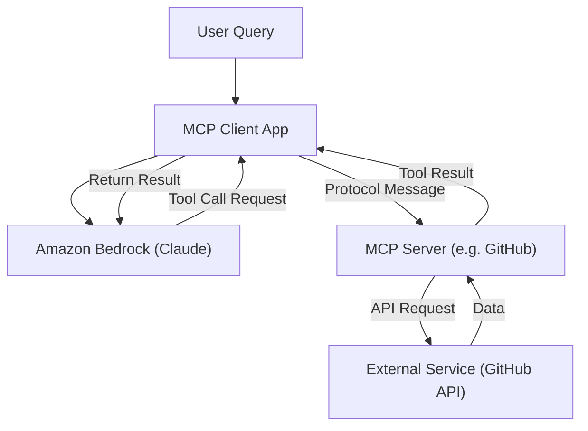
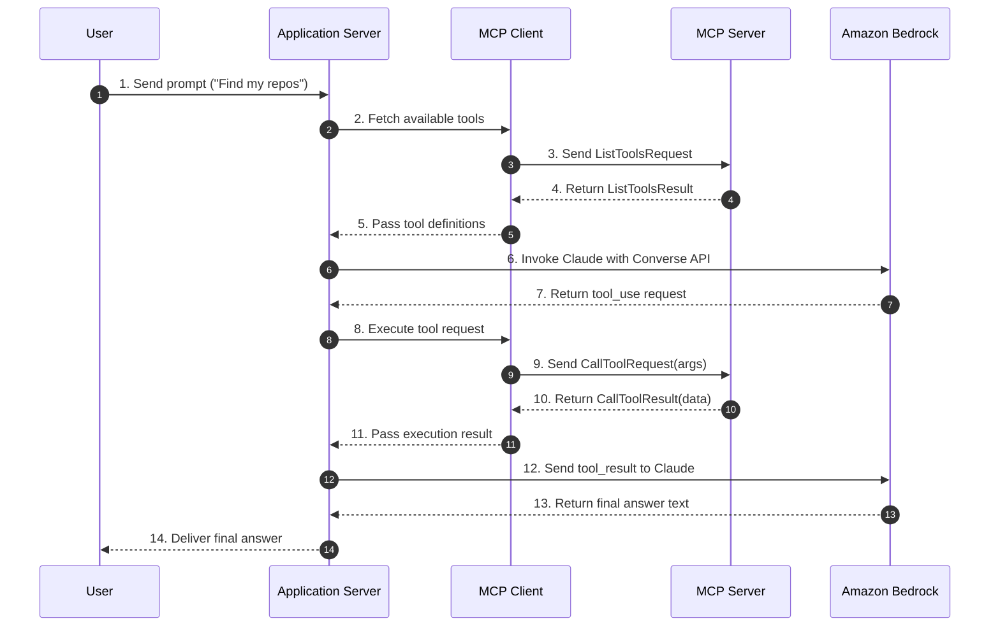
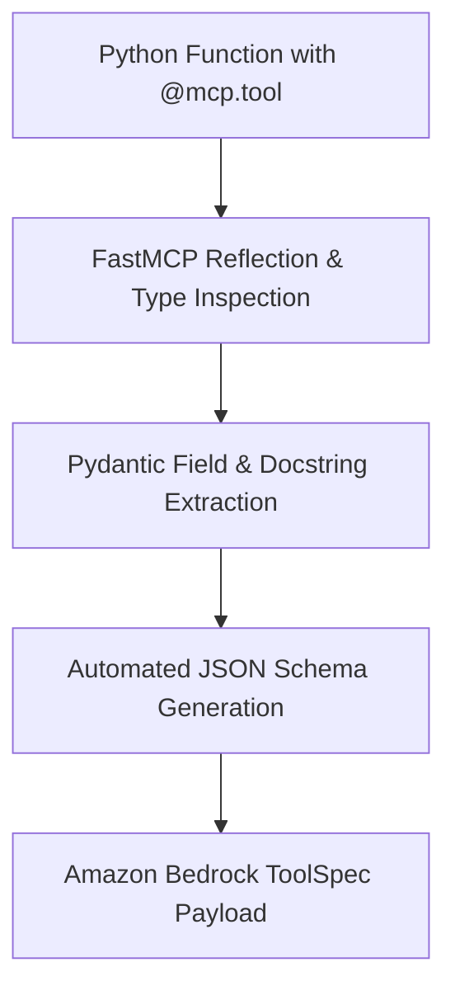
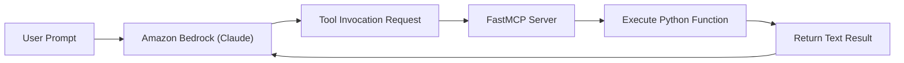
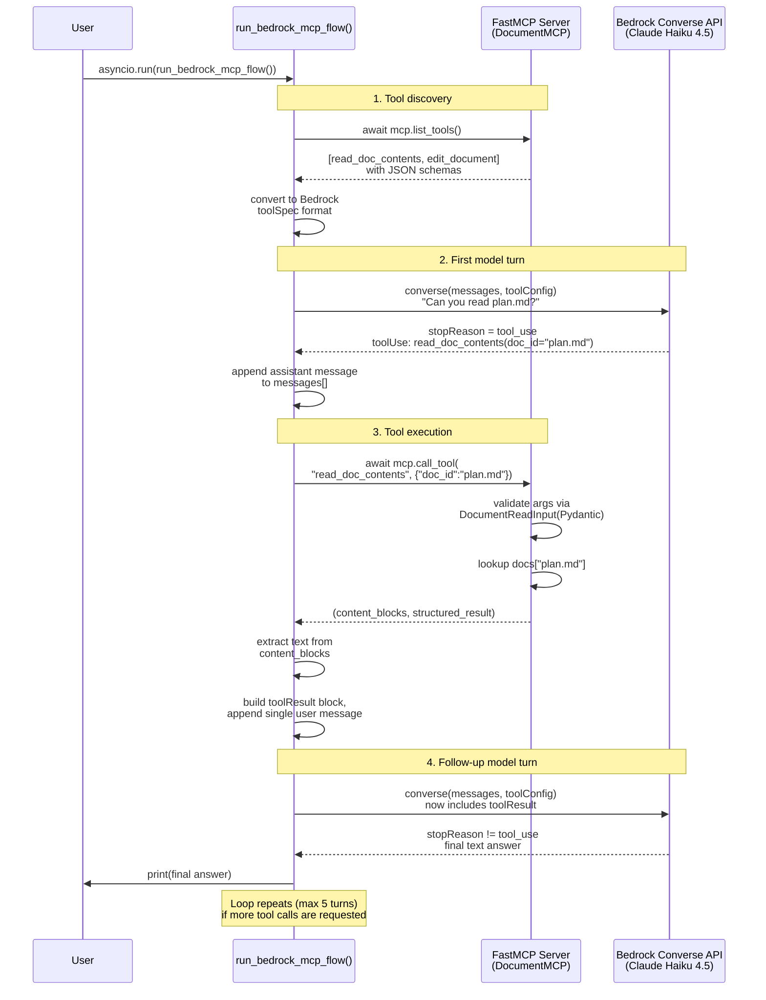
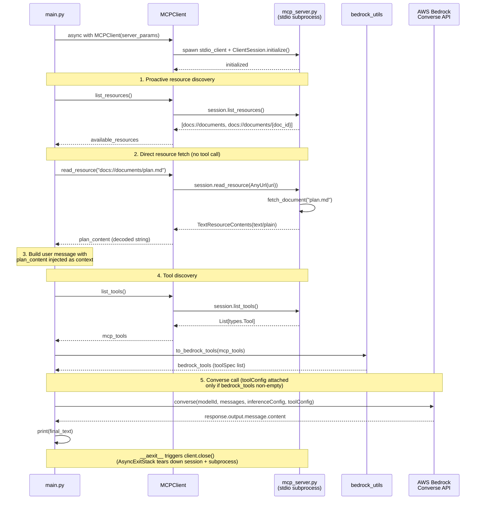
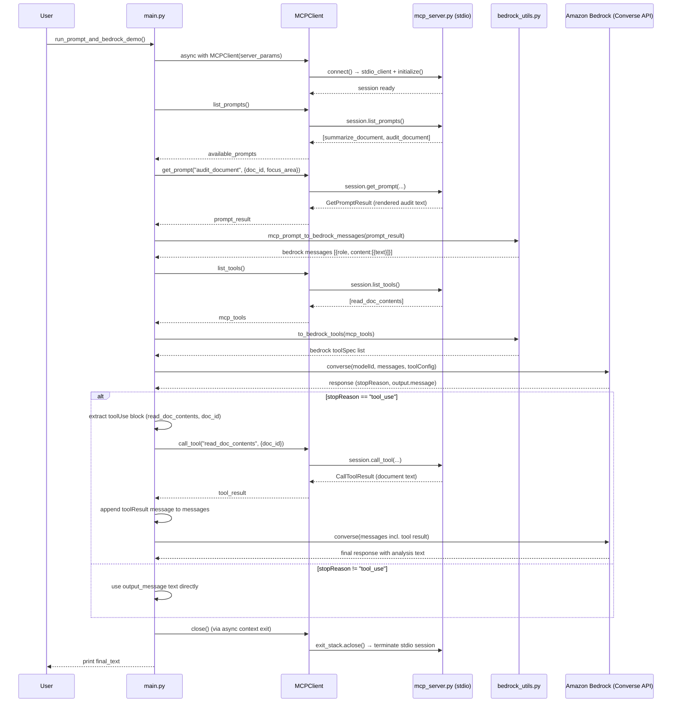

{% include video-summary.html
   id="c7RJ9a9c-vU"
   content="<p>This post details the implementation of the <strong>Model Context Protocol (MCP)</strong> to connect external capabilities with Claude models running on <strong>Amazon Bedrock</strong>. It explains how the architecture decouples integration code by leveraging <strong>MCP servers</strong> and <strong>clients</strong> that communicate via flexible transport layers like standard input/output or network protocols. Through practical code examples, it demonstrates how to translate tool definitions into Bedrock&#39;s required format for dynamic function execution. Furthermore, the texts contrast three foundational primitives: <strong>tools</strong> driven autonomously by the model, <strong>resources</strong> fetched proactively by application code, and <strong>prompts</strong> triggered explicitly by users. Ultimately, these components establish a standardized, secure, and maintainable framework for building sophisticated agentic applications.</p>" 
%}

<!--more-->

* TOC
{:toc}

---

## MCP
Model Context Protocol (MCP) establishes an open, standardized communication protocol that decouples tool definitions and context retrieval from core application code. Instead of hand-crafting schema definitions and custom API handlers for every external integration, we connect our application to specialized MCP servers that manage external tool ecosystems. This architectural separation drastically cuts development overhead, simplifies maintenance, and standardizes how Claude interacts with enterprise data stores and third-party APIs on Amazon Bedrock.

> MCP Servers and tool use are complementary but different concepts. Tool use is about Claude calling functions to accomplish tasks. MCP is about who provides those functions - instead of you writing them, someone else has already implemented them in an MCP Server[^course].
{:.note}

## How It Works

When building LLM-powered applications that interact with external systems, traditional tool use requires developers to manually author JSON schemas for every function, parse model output choices, and write custom invocation logic. MCP eliminates this coupling by defining a standardized client-server architecture.

In an MCP-enabled architecture, our application acts as the **MCP Client**. It connects to one or more **MCP Servers**, each acting as a dedicated gateway to a specific external service, such as GitHub, PostgreSQL, or AWS resources. The MCP server exposes available tools, resource schemas, and prompt templates through a unified protocol interface.

When a user submits a prompt, the client queries connected MCP servers to retrieve active tool definitions and forwards those schemas to Claude running on Amazon Bedrock via the Converse API. When Claude decides to call a tool, it returns a structured tool call request to the client. The client routes this request to the corresponding MCP server, which executes the actual operation against the external service and returns the result back through the client to Claude.[^mcp-spec]



Architectural separation of tool execution between the MCP client, MCP server, and external APIs.[^course]

By offloading tool definitions and execution handlers, our application code remains completely agnostic to the underlying service implementation details.


## MCP Client

Integrating Model Context Protocol (MCP) clients with Amazon Bedrock separates tool definition and execution from core application code. Instead of writing custom function wrappers for every service, the application server delegates tool discovery and tool execution to specialized MCP servers. The client abstraction handles JSON-RPC message passing over transport layers like STDIO or HTTP, allowing Claude to interact dynamically with external systems.

- The role of the MCP client as an orchestration bridge
- Transport-agnostic communication patterns (STDIO, HTTP, WebSockets)
- Primary JSON-RPC protocol message types (`ListToolsRequest` and `CallToolRequest`)
- End-to-end message flow between User, Application Server, MCP Client, MCP Server, and Bedrock


## Decoupling Tool Execution with MCP Clients

In standard LLM application development, integrating external tools requires authoring function signatures, validating input parameters, invoking remote endpoints, and mapping responses back into conversational context. As systems integrate dozens of APIs, maintaining these monolithic integration layers becomes unsustainable.

The Model Context Protocol solves this architectural friction by introducing a client-server boundary. The MCP client acts as the "communication bridge between your server and MCP servers."[^course-mcp-clients] Rather than embedding service-specific client logic inside the application, the application server uses an MCP client to interact with standalone MCP servers. These servers wrap target endpoints—such as databases, version control platforms, or AWS infrastructure—and expose standardized tool interfaces.

### Transport-Agnostic Communication Models

A core architectural feature of MCP is transport independence[^course-mcp-clients]. The protocol specifies JSON-RPC message payloads without mandating a specific physical transport layer.

- **Standard Input/Output (STDIO):** The most common local pattern[^course-mcp-clients]. The host launches the MCP server as a subprocess and communicates through standard input and output streams. This offers sub-millisecond local latency, strict process isolation, and simplified secret management.
- **Network Transports (HTTP / WebSockets):** Suitable for remote or microservice environments[^course-mcp-clients]. Network transports enable distributed MCP servers operating across container clusters, allowing centralized tool hosting behind corporate firewalls.

## MCP Protocol Message Mechanics

Communication between an MCP client and server relies on structured message types defined in the MCP specification[^course-mcp-clients]. When connecting an application to Claude on Amazon Bedrock, two primary request-response pairs dictate runtime interaction.

### Tool Discovery Protocol

Before sending a user query to Amazon Bedrock, the application server must inform Claude about available capabilities. The MCP client issues a `ListToolsRequest` to the MCP server, which responds with a `ListToolsResult` containing JSON Schema definitions for every exposed tool[^course-mcp-clients]. The application server transforms these definitions into Bedrock tool specifications.

### Tool Execution Protocol

When Claude evaluates a prompt and determines that an external action is required, it returns a `tool_use` content block through Bedrock. The application server intercepts this block and instructs the MCP client to issue a `CallToolRequest` containing the tool name and argument payload[^course-mcp-clients]. The MCP server executes the underlying logic and returns a `CallToolResult`, which the application server routes back to Bedrock as a `tool_result` message block.

## The End-to-End Orchestration Loop

Orchestrating an MCP-enabled agent involves a coordinated multi-turn loop spanning five distinct components: the User, Application Server, MCP Client, MCP Server, and Amazon Bedrock[^course-mcp-clients].


*End-to-end message orchestration flow between user application, MCP client, MCP server, and Amazon Bedrock.[^course-mcp-clients]*

From an architectural standpoint, total request latency for an agentic multi-turn interaction can be modeled as:

$$T_{total} = T_{discovery} + T_{llm1} + T_{exec} + T_{llm2}$$

Where $$T_{discovery}$$ is the initial tool listing latency, $$T_{llm1}$$ is the initial Claude inference time on Bedrock, $$T_{exec}$$ is the MCP tool execution duration over the chosen transport, and $$T_{llm2}$$ is the final response generation latency. In production workflows, caching tool definitions eliminates $$T_{discovery}$$ on subsequent requests.

## MCP Client example

This is a small “Bedrock + tool calling” example that mimics an MCP-style workflow. It does not implement a full MCP server; instead, it defines a tool in MCP-like schema form, passes it to Claude through Amazon Bedrock, and then simulates the tool result.

The main goal is:

- ask Claude a question
- tell Claude about an available tool
- let Claude decide whether it needs to call that tool
- return the tool result to Claude
- get the final answer

### High-level flow

Import the necessary packages:


```python
from typing import Any, Dict, List
import boto3
from botocore.exceptions import ClientError
from pydantic import BaseModel, Field
from pydantic_settings import BaseSettings, SettingsConfigDict
```

1\. Load configuration

- `AppConfig` / `BedrockSettings` reads AWS region and model details from environment settings.
- This keeps the runtime configuration structured and validated.


```python
class AppConfig(BaseSettings):
    """Guards environment variables and default runtime settings."""
    model_config = SettingsConfigDict(env_file=".env", extra="ignore")
    
    aws_region: str = Field(default="ap-southeast-2", description="AWS Region")
    bedrock_model_id: str = Field(
        default="au.anthropic.claude-haiku-4-5-20251001-v1:0",
        description="Amazon Bedrock Model ID"
    )
```

2\. Define a tool schema

- `MCPToolSpec` describes the interface for a tool.
- Example tool: `get_user_repositories`
- Input: `username`
- Output: repository list


```python
class MCPToolSpec(BaseModel):
    """Validates incoming MCP tool definitions against expected schemas."""
    name: str
    description: str
    inputSchema: Dict[str, Any]
```


```python
MCPToolSpec.model_json_schema()
```


    {'description': 'Validates incoming MCP tool definitions against expected schemas.',
     'properties': {'name': {'title': 'Name', 'type': 'string'},
      'description': {'title': 'Description', 'type': 'string'},
      'inputSchema': {'additionalProperties': True,
       'title': 'Inputschema',
       'type': 'object'}},
     'required': ['name', 'description', 'inputSchema'],
     'title': 'MCPToolSpec',
     'type': 'object'}


3\. Convert MCP schema to Bedrock schema

- `convert_mcp_to_bedrock_tool()` transforms:
  - name
  - description
  - inputSchema
into Bedrock’s expected format:
- `toolSpec.name`
- `toolSpec.description`
- `toolSpec.inputSchema.json`


```python
def convert_mcp_to_bedrock_tool(mcp_tool: MCPToolSpec) -> Dict[str, Any]:
    """Transforms an MCP Tool specification into Bedrock Converse API format."""
    return {
        "toolSpec": {
            "name": mcp_tool.name,
            "description": mcp_tool.description,
            "inputSchema": {
                "json": mcp_tool.inputSchema
            }
        }
    }
```


4\. Send first Bedrock call

- `bedrock.converse(...)` is invoked with:
  - model ID
  - user message
  - available tools
- Claude decides whether it needs to use a tool.

5\. Handle `tool_use`

- If Bedrock responds with `stopReason == "tool_use"`, the script extracts:
  - `toolUseId`
  - the tool name and arguments
- It then injects a fake result such as:
  - `{"repositories": ["repo-alpha", "repo-beta", "mcp-bedrock-demo"]}`

6\. Send second Bedrock call

- The tool result is added back to the message list as a `toolResult`
- Bedrock is called again so Claude can use the result to produce the final answer


```python
def run_mcp_bedrock_loop(user_query: str) -> str:
    """Coordinates tool discovery, Bedrock Converse invocation, and tool execution."""
    config = AppConfig()
    bedrock = boto3.client("bedrock-runtime", region_name=config.aws_region)

    raw_mcp_tools = [
        {
            "name": "get_user_repositories",
            "description": "Retrieves public and private repositories for a user.",
            "inputSchema": {
                "type": "object",
                "properties": {
                    "username": {"type": "string", "description": "GitHub username"}
                },
                "required": ["username"]
            }
        }
    ]

    mcp_tools = [MCPToolSpec(**t) for t in raw_mcp_tools]
    bedrock_tools = [convert_mcp_to_bedrock_tool(t) for t in mcp_tools]

    messages: List[Dict[str, Any]] = [
        {
            "role": "user",
            "content": [{"text": user_query}]
        }
    ]

    try:
        response = bedrock.converse(
            modelId=config.bedrock_model_id,
            messages=messages,
            toolConfig={"tools": bedrock_tools}
        )

        output_message = response["output"]["message"]
        messages.append(output_message)

        if response.get("stopReason") == "tool_use":
            for block in output_message["content"]:
                if "toolUse" in block:
                    tool_use = block["toolUse"]
                    tool_use_id = tool_use["toolUseId"]

                    mock_tool_result = {"repositories": ["repo-alpha", "repo-beta", "mcp-bedrock-demo"]}

                    messages.append({
                        "role": "user",
                        "content": [
                            {
                                "toolResult": {
                                    "toolUseId": tool_use_id,
                                    "content": [{"json": mock_tool_result}]
                                }
                            }
                        ]
                    })

            final_response = bedrock.converse(
                modelId=config.bedrock_model_id,
                messages=messages,
                toolConfig={"tools": bedrock_tools}
            )
            return final_response["output"]["message"]["content"][0]["text"]

        return output_message["content"][0]["text"]

    except ClientError as err:
        return f"AWS Bedrock ClientError: {err.response['Error']['Message']}"


```

### Key pieces

- `AppConfig` / `BedrockSettings`
    These are Pydantic settings classes that validate configuration values.

    Example values:
    - AWS region
    - model ID
    - max tokens
    - thinking settings

This keeps runtime setup consistent and reduces configuration mistakes.

- `MCPToolSpec`
    This validates the structure of a tool definition before it is sent to Bedrock.

    It ensures the tool has:
    - `name`
    - `description`
    - `inputSchema`

- `convert_mcp_to_bedrock_tool()`
    This is the translation layer.

    Bedrock wants tool definitions in a slightly different JSON shape than a raw MCP tool description. This function adapts the schema so Bedrock accepts it.

- `run_mcp_bedrock_loop()`
    This is the orchestration function.

    It performs the full sequence:
    - build config
    - prepare tools
    - send user prompt
    - detect tool call
    - return simulated tool output
    - request final answer from Claude

### Why this is useful

This pattern is the core concept behind tool-augmented LLM applications:

- The LLM does not need hardcoded function logic in app code
- Tool interfaces can be exposed as structured metadata
- Claude decides when external execution is needed
- The app executes the tool and feeds the result back into the model

That is exactly the kind of design MCP is meant to standardize.


## Important limitation in this demo

This script is a simplified example. It does not actually call a real MCP server or GitHub API.

Instead, it uses a hardcoded mock result:

```python
mock_tool_result = {"repositories": ["repo-alpha", "repo-beta", "mcp-bedrock-demo"]}
```

In a real production app, you would replace that with:
- a real GitHub API call
- a real MCP server tool execution
- database lookup
- AWS service call
- etc.

> Jupyter Notebooks run inside an active `asyncio` event loop managed by the IPython kernel. Calling `asyncio.run()` inside an already running event loop triggers a `RuntimeError: asyncio.run() cannot be called from a running event loop`. As well as, `boto3` is a synchronous SDK, the original function didn't actually contain any asynchronous calls (`await`). _Removing `async` and `asyncio` entirely makes the code simpler and compatible with both Jupyter notebooks and standard Python scripts_{:rtxt}.
{:.warn}


```python
# Execution in Jupyter cell
result = run_mcp_bedrock_loop("What repositories do I have on GitHub for 'dev-user'?")
print("Response:", result)
```

    Response: The GitHub user 'dev-user' has the following 3 repositories:
    
    1. **repo-alpha**
    2. **repo-beta**
    3. **mcp-bedrock-demo**
    
    Would you like more information about any of these repositories?


### What the `result` means

The final value:

```python
"The GitHub user 'dev-user' has the following repositories:
...
3. mcp-bedrock-demo"
```

means:

- Claude first saw the user question
- Claude recognized that it needed a repository list
- It called the tool
- The tool returned repository names
- Claude formatted that into a natural language answer

So this script is effectively a minimal “LLM decides to use a tool, app executes it, model answers” loop.

If you want, I can also explain this script line by line or rewrite it into a clearer “real MCP server + Bedrock client” version.

In this implementation, `AppConfig` enforces environment settings validation, while `MCPToolSpec` validates raw MCP schema parameters before transforming them into Bedrock's required `toolSpec` JSON structure. Using synchronous `boto3` calls avoids `asyncio` event loop conflicts, making the snippet directly executable in both command-line scripts and Jupyter notebooks. Catching `ClientError` prevents unhandled AWS SDK failure modes.

### PROD need more

Production deployments require further considerations around schema translation, process security, and dynamic tooling.

- **Schema Mapping Discrepancies:** The native MCP specification defines tool schemas using JSON Schema Draft-07. Amazon Bedrock's Converse API expects input schemas wrapped inside a `{"json": schema}` dictionary under `toolSpec` [^aws-converse-doc]. Applications must translate MCP tool schemas to Bedrock syntax before payload submission.
- **Process Isolation and Sandboxing:** When running MCP servers via STDIO transports, host application servers execute local binary sub-processes. Production runtime environments (such as AWS Fargate or Kubernetes pods) should restrict process capabilities using non-root system users, read-only root file systems, and strict outbound network security groups.
- **Dynamic Tool Caching:** Querying `ListToolsRequest` on every incoming user request introduces redundant network overhead. Enterprise application architectures should cache tool definitions with a short TTL and flush the cache upon receiving transport disconnection events.


## MCP SDK (Python)

Building tools for Claude on Amazon Bedrock no longer requires writing verbose, hand-crafted JSON Schemas for every function. By leveraging the official Model Context Protocol (MCP) Python SDK and its `FastMCP` helper, we can turn Python functions into fully typed, validated tools using simple decorators and type hints. Parameter metadata is declared directly via Pydantic field annotations, allowing the SDK to generate compliant tool schemas automatically while enforcing strict input validation at runtime[^course-mcp-server].

The Model Context Protocol (MCP) establishes a clean boundary between the language model orchestrator and external system capabilities. When building applications with Claude on Amazon Bedrock, tools allow the model to interact with databases, local filesystems, or enterprise web services. Historically, defining these tools meant manually drafting complex JSON Schema dictionaries detailing object types, required attributes, and nested parameter descriptions.

The MCP Python SDK streamlines this process through `FastMCP` from the `mcp.server.fastmcp` module.[^course] Rather than maintaining decoupled schema definitions alongside implementation logic, `FastMCP` extracts parameter names, Python type hints, docstrings, and `pydantic.Field` descriptors directly from function signatures.[^course]


Figure 1: FastMCP inspects decorated Python functions to generate standardized JSON Schema definitions for Amazon Bedrock.[^course]

When we decorate a Python function with `@mcp.tool`[^mcp_tool], `FastMCP` registers the function and automatically constructs its underlying JSON Schema. Field descriptions provided via `pydantic.Field` become property descriptions in the schema, which Claude reads to determine when and how to invoke the tool[^course-mcp-server].

The course highlights a key architectural distinction between SDK abstractions: the MCP Python SDK uses `@mcp.tool` with Pydantic field annotations on the function signature, whereas the Claude Agent SDK uses a separate `@tool` decorator that expects an explicit `input_schema` argument.[^course] Understanding this distinction ensures we do not confuse signature-driven schema generation with explicit dictionary definitions when reviewing codebase implementations.


Figure 2: Workflow illustrating Claude issuing tool requests to a FastMCP server and receiving execution results.

## MCP server example

Below is a complete, runnable Python 3.11+ example demonstrating how to define an MCP server with read and edit document tools, validate configurations using Pydantic v2, and invoke Claude via the AWS Bedrock Runtime Converse API.

We use the `boto3` Bedrock Runtime Converse API alongside `FastMCP` because `boto3` provides native AWS authentication and standardized ToolSpec structures required by Bedrock runtime endpoints.


```python
"""
Requirements:
    pip install "mcp<2" boto3 pydantic pydantic-settings

Note: mcp>=2.0 renamed FastMCP -> MCPServer and changed the import path,
so this script requires mcp<2 (the v1 API used below).
"""

import asyncio
from typing import Any, Dict, List
import boto3
from botocore.exceptions import ClientError
from mcp.server.fastmcp import FastMCP
from pydantic import BaseModel, Field
from pydantic_settings import BaseSettings, SettingsConfigDict


class BedrockSettings(BaseSettings):
    """Runtime environment configuration for Amazon Bedrock access.

    Override via env vars AWS_REGION_NAME / AWS_MODEL_ID (note: these are
    NOT the standard boto3 AWS_REGION / AWS_DEFAULT_REGION env vars).
    """
    model_config = SettingsConfigDict(env_prefix="AWS_")

    region_name: str = Field(default="ap-southeast-2", description="AWS Region")
    model_id: str = Field(
        default="au.anthropic.claude-haiku-4-5-20251001-v1:0",
        description="Bedrock Model ID"
    )


class DocumentReadInput(BaseModel):
    """Schema for validating document reading requests."""
    doc_id: str = Field(..., description="Unique document identifier to read")


class DocumentEditInput(BaseModel):
    """Schema for validating document replacement operations."""
    doc_id: str = Field(..., description="Unique document identifier to edit")
    old_str: str = Field(..., description="Exact string content to replace")
    new_str: str = Field(..., description="New string content to insert")


# Instantiate the FastMCP server
mcp = FastMCP("DocumentMCP", log_level="ERROR")

# In-memory document storage
docs: Dict[str, str] = {
    "deposition.md": "This deposition covers the testimony of Angela Smith, P.E.",
    "report.pdf": "The report details the state of a 20m condenser tower.",
    "plan.md": "The plan outlines the steps for the project implementation."
}


@mcp.tool(
    name="read_doc_contents",
    description="Read the contents of a document and return it as a string."
)
def read_document(
    doc_id: str = Field(description="Id of the document to read")
) -> str:
    """Retrieve document text by identifier."""
    validated = DocumentReadInput(doc_id=doc_id)
    if validated.doc_id not in docs:
        raise ValueError(f"Doc with id '{validated.doc_id}' not found")
    return docs[validated.doc_id]


@mcp.tool(
    name="edit_document",
    description="Edit a document by replacing a string in the document content with a new string."
)
def edit_document(
    doc_id: str = Field(description="Id of the document that will be edited"),
    old_str: str = Field(description="The text to replace. Must match exactly, including whitespace."),
    new_str: str = Field(description="The new text to insert in place of the old text.")
) -> str:
    """Perform substring replacement on a document."""
    validated = DocumentEditInput(doc_id=doc_id, old_str=old_str, new_str=new_str)
    if validated.doc_id not in docs:
        raise ValueError(f"Doc with id '{validated.doc_id}' not found")

    docs[validated.doc_id] = docs[validated.doc_id].replace(
        validated.old_str, validated.new_str
    )
    return f"Successfully updated document '{validated.doc_id}'."


async def export_mcp_tools_for_bedrock(mcp_server: FastMCP) -> List[Dict[str, Any]]:
    """Dynamically pull tools and schemas from FastMCP and format for Bedrock Converse API."""
    mcp_tools = await mcp_server.list_tools()
    bedrock_tools = []

    for tool in mcp_tools:
        bedrock_tools.append({
            "toolSpec": {
                "name": tool.name,
                "description": tool.description,
                "inputSchema": {
                    "json": tool.inputSchema
                }
            }
        })
    return bedrock_tools


def _extract_text(content_blocks: Any) -> str:
    """Pull plain text out of the content blocks returned by mcp.call_tool()."""
    return "\n".join(
        block.text for block in content_blocks if hasattr(block, "text")
    )


async def run_bedrock_mcp_flow() -> None:
    """Demonstrate end-to-end dynamic tool registration and execution using FastMCP and Bedrock."""
    settings = BedrockSettings()
    bedrock_client = boto3.client("bedrock-runtime", region_name=settings.region_name)

    # 1. Dynamically pull tool specs generated by FastMCP decorators
    tools_config = {"tools": await export_mcp_tools_for_bedrock(mcp)}

    messages = [
        {
            "role": "user",
            "content": [{"text": "Can you read the content of plan.md?"}]
        }
    ]

    try:
        # Loop until Claude stops requesting tools and gives a final answer.
        # Guard against runaway loops with a simple max-turns cap.
        for _ in range(5):
            response = await asyncio.to_thread(
                bedrock_client.converse,
                modelId=settings.model_id,
                messages=messages,
                inferenceConfig={"temperature": 0.0, "maxTokens": 1000},
                toolConfig=tools_config
            )

            output_message = response["output"]["message"]
            messages.append(output_message)

            if response.get("stopReason") != "tool_use":
                # Model gave its final answer; print all text blocks and stop.
                final_text = "\n".join(
                    block["text"]
                    for block in output_message.get("content", [])
                    if "text" in block
                )
                print("\n[Final Claude Response]:")
                print(final_text)
                return

            # 2. Collect results for every tool Claude requested this turn.
            tool_result_blocks = []
            for content_block in output_message.get("content", []):
                if "toolUse" not in content_block:
                    continue

                tool_use = content_block["toolUse"]
                tool_name = tool_use["name"]
                tool_args = tool_use["input"]
                tool_use_id = tool_use["toolUseId"]

                print(f"[Bedrock Requested Tool Call]: '{tool_name}' with args {tool_args}")

                # 3. Execute the tool call dynamically using FastMCP executor
                try:
                    content_blocks, _structured = await mcp.call_tool(tool_name, tool_args)
                    tool_text = _extract_text(content_blocks)
                    tool_result_blocks.append({
                        "toolResult": {
                            "toolUseId": tool_use_id,
                            "content": [{"text": tool_text}]
                        }
                    })
                except ValueError as tool_err:
                    # Surface tool errors back to the model instead of crashing.
                    tool_result_blocks.append({
                        "toolResult": {
                            "toolUseId": tool_use_id,
                            "content": [{"text": str(tool_err)}],
                            "status": "error"
                        }
                    })

            # 4. All tool results for this turn go back in a single user message.
            messages.append({"role": "user", "content": tool_result_blocks})

        print("\n[Stopped after reaching max tool-call turns without a final answer]")

    except ClientError as err:
        print(f"AWS Bedrock ClientError encountered: {err}")
    except ValueError as err:
        print(f"Validation or FastMCP execution error: {err}")


if __name__ == "__main__":
    asyncio.run(run_bedrock_mcp_flow())
```


```bash
%%bash
uv run BedrockClaude_6/example_1/MCP_example_1.py
```

    [Bedrock Requested Tool Call]: 'read_doc_contents' with args {'doc_id': 'plan.md'}
    
    [Final Claude Response]:
    The content of plan.md is:
    
    **"The plan outlines the steps for the project implementation."**
    
    This appears to be a brief summary. If you'd like me to help you edit or expand this document, or if you need more specific information about the project plan, please let me know!




### What the script does

It's a bridge between a **local MCP tool server** (FastMCP, running in-process — no actual network MCP transport is used) and **Amazon Bedrock's Converse API**, so a Bedrock-hosted Claude model can discover and call your Python functions as tools.

### The pieces

**`BedrockSettings`** — a `pydantic-settings` config object that picks `region_name` and `model_id` from env vars (prefixed `AWS_`), defaulting to Sydney (`ap-southeast-2`) and the AU cross-region inference profile for Claude Haiku 4.5.

**`docs` dict** — a fake in-memory "document store": three documents keyed by filename, standing in for a real database or file system.

**Two MCP tools**, registered via `@mcp.tool(...)`:
- `read_document` — looks up a doc by ID, raises `ValueError` if missing.
- `edit_document` — does a plain string replace inside a doc.

Both re-validate their arguments with a `pydantic.BaseModel` (`DocumentReadInput` / `DocumentEditInput`) even though FastMCP already validated them against the schema it derived from the `Field(...)`-annotated function signature — belt-and-suspenders, technically redundant but harmless.

**`export_mcp_tools_for_bedrock`** — calls `mcp.list_tools()` (the FastMCP server's own introspection method) to get each tool's name, description, and JSON Schema, then reshapes that into the `toolSpec` format Bedrock's `converse()` expects under `toolConfig`.

**`run_bedrock_mcp_flow`** — the orchestration loop, shown in the diagram above:
1. Builds the tool config and sends the user's question to Bedrock.
2. If Bedrock's `stopReason` is `tool_use`, it means the model wants to call one or more of your tools instead of answering directly.
3. For each requested tool call, the script invokes `mcp.call_tool(name, args)` directly on the FastMCP server object — this runs your Python function in-process and returns `(content_blocks, structured_result)`.
4. It extracts the plain text from `content_blocks`, packages all tool results from that turn into **one** `toolResult`-bearing user message, and sends that back to Bedrock.
5. This repeats (capped at 5 rounds) until Bedrock returns a final answer (`stopReason != "tool_use"`), which gets printed.

### Why the loop matters
Claude Haiku 4.5 can ask for **multiple tools in a single turn**, and Bedrock expects all their results bundled into one follow-up message, not several. The loop also lets the conversation go multiple rounds (e.g., read a doc, then decide to edit it) rather than assuming one tool call is always enough — something the original single-pass version couldn't do.

## Decoupled MCP Client/Server Architecture

Normally, you'd implement either an MCP client or an MCP server - not both. Above script being divieded as `mcp_client.py` and `mcp_server.py`. MCP client consists of two main components working together:

1.  **Client Session (`ClientSession`)**: The official SDK class that manages RPC message framing, request/response matching, and protocol state over low-level communication channels (like `stdio` or `HTTP/SSE`).
2.  **MCP Client Wrapper (`MCPClient`)**: A custom class that encapsulates the session to manage connection initialization and ensure automatic resource cleanup when the program exits.


```python
"""
MCP Client implementation wrapping ClientSession and managing connection lifecycles.
"""

import asyncio
from contextlib import AsyncExitStack
from typing import Any, Dict, List, Optional

from mcp import ClientSession, StdioServerParameters
from mcp.client.stdio import stdio_client
import mcp.types as types


class MCPClient:
    """Manages stdio connection and ClientSession lifecycle to an MCP server."""

    def __init__(self, server_params: StdioServerParameters):
        self.server_params = server_params
        self._session: Optional[ClientSession] = None
        self._exit_stack = AsyncExitStack()

    async def __aenter__(self):
        await self.connect()
        return self

    async def __aexit__(self, exc_type, exc_val, exc_tb):
        await self.close()

    async def connect(self) -> None:
        """Establish stdio transport streams and initialize ClientSession."""
        read_stream, write_stream = await self._exit_stack.enter_async_context(
            stdio_client(self.server_params)
        )
        self._session = await self._exit_stack.enter_async_context(
            ClientSession(read_stream, write_stream)
        )
        await self._session.initialize()

    async def list_tools(self) -> List[types.Tool]:
        """Request available tool definitions from the MCP server."""
        if not self._session:
            raise RuntimeError("MCP client is not connected.")
        result = await self._session.list_tools()
        return result.tools

    async def call_tool(
        self, tool_name: str, tool_input: Dict[str, Any]
    ) -> types.CallToolResult:
        """Execute a tool call on the MCP server."""
        if not self._session:
            raise RuntimeError("MCP client is not connected.")
        return await self._session.call_tool(tool_name, tool_input)

    async def close(self) -> None:
        """Clean up connection streams and exit stack context."""
        await self._exit_stack.aclose()
```


### Core Client Methods 

An MCP client must expose two fundamental functions to drive AI tool integration:

-   **Tool Discovery (`list_tools`)**: Asks the server what tools are registered so they can be exposed to the AI model.
-   **Tool Execution (`call_tool`)**: Accepts a tool name and argument dictionary, passes them to the server, and returns the result.

Inside `mcp_client.py`, these methods wrap the underlying `ClientSession`.

### Utils, Server and the Orchestrator

In `bedrock_utils.py`, `to_bedrock_tools()` translates MCP `Tool` objects into Bedrock's expected `toolSpec` wrapper:


```python
"""
Schema conversion helper for translating MCP tool specs to Amazon Bedrock Converse API specs.
"""

from typing import Any, Dict, List
import mcp.types as types


def to_bedrock_tools(mcp_tools: List[types.Tool]) -> List[Dict[str, Any]]:
    """Convert MCP Tool definitions into Bedrock Converse toolSpec objects."""
    bedrock_tools = []
    for tool in mcp_tools:
        bedrock_tools.append({
            "toolSpec": {
                "name": tool.name,
                "description": tool.description or "",
                "inputSchema": {
                    "json": tool.inputSchema
                }
            }
        })
    return bedrock_tools
```


In `bedrock_utils.py`, `to_bedrock_tools()` translates MCP `Tool` objects into Bedrock's expected `toolSpec` wrapper.

The client ties together the full interaction loop between Claude, Amazon Bedrock, and the MCP Server.

Here the MCP server:


```python
"""
MCP Document Server running via stdio transport.
"""

from typing import Dict
from mcp.server.fastmcp import FastMCP
from pydantic import BaseModel, Field

mcp = FastMCP("DocumentMCP", log_level="ERROR")

docs: Dict[str, str] = {
    "deposition.md": "This deposition covers the testimony of Angela Smith, P.E.",
    "report.pdf": "The report details the state of a 20m condenser tower.",
    "plan.md": "The plan outlines the steps for the project implementation."
}

class DocumentReadInput(BaseModel):
    doc_id: str = Field(..., description="Unique document identifier to read")

class DocumentEditInput(BaseModel):
    doc_id: str = Field(..., description="Unique document identifier to edit")
    old_str: str = Field(..., description="Exact string content to replace")
    new_str: str = Field(..., description="New string content to insert")


@mcp.tool(
    name="read_doc_contents",
    description="Read the contents of a document and return it as a string."
)
def read_document(doc_id: str) -> str:
    validated = DocumentReadInput(doc_id=doc_id)
    if validated.doc_id not in docs:
        raise ValueError(f"Doc with id '{validated.doc_id}' not found")
    return docs[validated.doc_id]


@mcp.tool(
    name="edit_document",
    description="Edit a document by replacing a string in the document content with a new string."
)
def edit_document(doc_id: str, old_str: str, new_str: str) -> str:
    validated = DocumentEditInput(doc_id=doc_id, old_str=old_str, new_str=new_str)
    if validated.doc_id not in docs:
        raise ValueError(f"Doc with id '{validated.doc_id}' not found")

    docs[validated.doc_id] = docs[validated.doc_id].replace(
        validated.old_str, validated.new_str
    )
    return f"Successfully updated document '{validated.doc_id}'."


if __name__ == "__main__":
    mcp.run(transport="stdio")
```


> You can use `uv run --with mcp mcp dev BedrockClaude_6/example_2/mcp_server.py` to test the sever using mcp dev tool.
{:.ok}

End to end interatction loop:

```
[User Prompt] ➔ [Bedrock/Claude] ➔ Requests "tool_use"
                                       │
                                       ▼
 [User Response] [Bedrock/Claude] [MCP Client executes mcp_server tool]
```

the orchestrator `main.py`:


```python
"""
Main entry point demonstrating Claude + Amazon Bedrock tool execution over MCP client.
"""

import asyncio
import sys
from typing import Any

import boto3
from botocore.exceptions import ClientError
from mcp import StdioServerParameters
from pydantic import Field
from pydantic_settings import BaseSettings, SettingsConfigDict


from bedrock_utils import to_bedrock_tools
from mcp_client import MCPClient


class BedrockSettings(BaseSettings):
    model_config = SettingsConfigDict(env_prefix="AWS_")

    region_name: str = Field(default="ap-southeast-2", description="AWS Region")
    model_id: str = Field(
        default="au.anthropic.claude-haiku-4-5-20251001-v1:0",
        description="Bedrock Model ID"
    )


def extract_tool_result_text(call_result: Any) -> str:
    """Extract text from MCP CallToolResult content blocks."""
    if not call_result or not hasattr(call_result, "content"):
        return ""
    text_parts = []
    for block in call_result.content:
        if hasattr(block, "text"):
            text_parts.append(block.text)
    return "\n".join(text_parts)


async def run_bedrock_mcp_flow() -> None:
    settings = BedrockSettings()
    bedrock_client = boto3.client("bedrock-runtime", region_name=settings.region_name)

    # Launch mcp_server.py as a subprocess via stdio transport
    server_params = StdioServerParameters(
        command=sys.executable,
        args=["BedrockClaude_6/example_2/mcp_server.py"]
    )

    # Use context manager for automatic connection and session cleanup
    async with MCPClient(server_params) as client:
        # 1. Fetch tool definitions via MCPClient and convert for Bedrock
        mcp_tools = await client.list_tools()
        bedrock_tools = to_bedrock_tools(mcp_tools)
        tools_config = {"tools": bedrock_tools}

        messages = [
            {
                "role": "user",
                "content": [{"text": "Can you read the content of plan.md?"}]
            }
        ]

        try:
            for _ in range(5):
                response = await asyncio.to_thread(
                    bedrock_client.converse,
                    modelId=settings.model_id,
                    messages=messages,
                    inferenceConfig={"temperature": 0.0, "maxTokens": 1000},
                    toolConfig=tools_config
                )

                output_message = response["output"]["message"]
                messages.append(output_message)

                if response.get("stopReason") != "tool_use":
                    final_text = "\n".join(
                        block["text"]
                        for block in output_message.get("content", [])
                        if "text" in block
                    )
                    print("\n[Final Claude Response]:")
                    print(final_text)
                    return

                tool_result_blocks = []
                for content_block in output_message.get("content", []):
                    if "toolUse" not in content_block:
                        continue

                    tool_use = content_block["toolUse"]
                    tool_name = tool_use["name"]
                    tool_args = tool_use["input"]
                    tool_use_id = tool_use["toolUseId"]

                    print(f"[Bedrock Requested Tool Call]: '{tool_name}' with args {tool_args}")

                    # 2. Execute requested tool via MCPClient
                    try:
                        result = await client.call_tool(tool_name, tool_args)
                        tool_text = extract_tool_result_text(result)
                        is_error = getattr(result, "isError", False)

                        tool_result_blocks.append({
                            "toolResult": {
                                "toolUseId": tool_use_id,
                                "content": [{"text": tool_text}],
                                **({"status": "error"} if is_error else {})
                            }
                        })
                    except Exception as err:
                        tool_result_blocks.append({
                            "toolResult": {
                                "toolUseId": tool_use_id,
                                "content": [{"text": str(err)}],
                                "status": "error"
                            }
                        })

                # 3. Pass tool results back to Bedrock as user message content
                messages.append({"role": "user", "content": tool_result_blocks})

            print("\n[Stopped after reaching max tool-call turns without a final answer]")

        except ClientError as err:
            print(f"AWS Bedrock ClientError encountered: {err}")


if __name__ == "__main__":
    asyncio.run(run_bedrock_mcp_flow())
```


When you execute the orchestator:


```bash
%%bash
python BedrockClaude_6/example_2/main.py
```

    [Bedrock Requested Tool Call]: 'read_doc_contents' with args {'doc_id': 'plan.md'}
    
    [Final Claude Response]:
    The content of plan.md is:
    
    **"The plan outlines the steps for the project implementation."**
    
    This appears to be a brief summary. If you'd like me to help you edit or expand this document, or if you need more specific information about the project plan, please let me know!


## Resources

Resources in MCP servers allow you to expose data to clients where they need to be fetched instead of perform action.

In MCP, it is essential to distinguish between **Tools** and **Resources**:

| Feature | MCP Tools | MCP Resources |
| --- | --- | --- |
| **Analogy** | REST `POST`/`PUT` endpoints (Actions) | REST `GET` endpoints (Read-only data) |
| **Execution** | **Reactive**: Claude decides during a turn when/if to invoke a tool. | **Proactive**: The client/user fetches data and injects it upfront. |
| **Addressing** | Called by function `name` and JSON arguments | Fetched by **URI** (e.g., `docs://documents/plan.md`) |
| **Latency** | Requires an extra Bedrock turn (`tool_use` → execute → `toolResult`) | Zero extra turns; content is embedded directly in the initial prompt |

### Defining Resources on the Server (`mcp_server.py`)

The **Defining Resources** lesson teaches how to expose read-only data using the `@mcp.resource()` decorator. MCP supports two types of resources:

1.  **Direct Resources**: Static URIs without parameters (e.g., `docs://documents`). Great for autocomplete or listing index items.
2.  **Templated Resources**: Parameterized URIs (e.g., `docs://documents/{doc_id}`). The MCP SDK automatically parses the URI parameter and passes it to your Python function argument


```python
"""
mcp_server.py: MCP Server with both Tools and Resources defined.
"""

from typing import Dict, List
from mcp.server.fastmcp import FastMCP

mcp = FastMCP("DocumentMCP", log_level="ERROR")

docs: Dict[str, str] = {
    "deposition.md": "This deposition covers the testimony of Angela Smith, P.E.",
    "report.pdf": "The report details the state of a 20m condenser tower.",
    "plan.md": "The plan outlines the steps for the project implementation."
}

# -------------------------------------------------------------------
# 1. DIRECT RESOURCE: List available document IDs
# -------------------------------------------------------------------
@mcp.resource("docs://documents", mime_type="application/json")
def list_documents() -> List[str]:
    """Return a list of all available document IDs for UI autocomplete."""
    return list(docs.keys())


# -------------------------------------------------------------------
# 2. TEMPLATED RESOURCE: Fetch specific document content by ID
# -------------------------------------------------------------------
@mcp.resource("docs://documents/{doc_id}", mime_type="text/plain")
def fetch_document(doc_id: str) -> str:
    """Read document text by doc_id parameter parsed from the URI."""
    if doc_id not in docs:
        raise ValueError(f"Document '{doc_id}' not found")
    return docs[doc_id]


if __name__ == "__main__":
    mcp.run(transport="stdio")
```


### Accessing Resources in the Client (`mcp_client.py`)

The **Accessing Resources** lesson explains how the client queries resources using `read_resource(uri)` and handles different MIME content types (`application/json` vs. `text/plain`).


```python
"""
mcp_client.py: Added resource discovery and reading capabilities.
"""

import json
from contextlib import AsyncExitStack
from typing import Any, Dict, List, Optional
from pydantic import AnyUrl

from mcp import ClientSession, StdioServerParameters
from mcp.client.stdio import stdio_client
import mcp.types as types


class MCPClient:
    def __init__(self, server_params: StdioServerParameters):
        self.server_params = server_params
        self._session: Optional[ClientSession] = None
        self._exit_stack = AsyncExitStack()

    async def __aenter__(self):
        await self.connect()
        return self

    async def __aexit__(self, exc_type, exc_val, exc_tb):
        await self.close()

    async def connect(self) -> None:
        read_stream, write_stream = await self._exit_stack.enter_async_context(
            stdio_client(self.server_params)
        )
        self._session = await self._exit_stack.enter_async_context(
            ClientSession(read_stream, write_stream)
        )
        await self._session.initialize()

    # --- Tool Methods ---
    async def list_tools(self) -> List[types.Tool]:
        return (await self._session.list_tools()).tools

    async def call_tool(self, tool_name: str, tool_input: Dict[str, Any]) -> types.CallToolResult:
        return await self._session.call_tool(tool_name, tool_input)

    # --- Resource Methods (New) ---
    async def list_resources(self) -> List[types.Resource]:
        """Fetch list of available direct resources from server."""
        if not self._session:
            raise RuntimeError("MCP client is not connected.")
        result = await self._session.list_resources()
        return result.resources

    async def read_resource(self, uri: str) -> Any:
        """Fetch a resource by URI and decode based on MIME type."""
        if not self._session:
            raise RuntimeError("MCP client is not connected.")
            
        result = await self._session.read_resource(AnyUrl(uri))
        resource = result.contents[0]

        # Inspect resource content type and decode appropriately
        if isinstance(resource, types.TextResourceContents):
            if resource.mimeType == "application/json":
                return json.loads(resource.text)
            return resource.text
            
        raise ValueError(f"Unsupported resource content type: {type(resource)}")

    async def close(self) -> None:
        await self._exit_stack.aclose()
```


### Orchestration

In `main.py`, instead of asking Claude to call the `read_doc_contents` tool (which takes an extra round-trip API call), the client **proactively reads the resource** via `client.read_resource("docs://documents/plan.md")` and embeds the content straight into the initial prompt.


```python
"""
main.py: Demonstrates proactive resource retrieval vs. tool execution.
"""

import asyncio
import sys
import boto3
from mcp import StdioServerParameters
from bedrock_utils import to_bedrock_tools
from mcp_client import MCPClient


async def run_resource_and_bedrock_demo():
    bedrock_client = boto3.client("bedrock-runtime", region_name="ap-southeast-2")
    server_params = StdioServerParameters(command=sys.executable, args=["BedrockClaude_6/example_3/mcp_server.py"])

    async with MCPClient(server_params) as client:
            # 1. Proactively list available direct resources
            available_resources = await client.list_resources()
            print(f"[Client Available Resources]: {[r.uri for r in available_resources]}")

            # 2. Fetch document content directly via Templated Resource URI
            plan_content = await client.read_resource("docs://documents/plan.md")
            print(f"\n[Client Fetched Resource 'docs://documents/plan.md']:\n{plan_content}")

            # 3. Inject the fetched resource content directly into the user message
            messages = [
                {
                    "role": "user",
                    "content": [{
                        "text": (
                            f"Here is the project plan context:\n"
                            f"<context>\n{plan_content}\n</context>\n\n"
                            f"Can you summarize the main steps outlined in the plan?"
                        )
                    }]
                }
            ]

            # 4. Fetch available tools from the server
            mcp_tools = await client.list_tools()
            bedrock_tools = to_bedrock_tools(mcp_tools)

            # 5. Build Bedrock Converse kwargs dynamically
            converse_kwargs = {
                "modelId": "au.anthropic.claude-haiku-4-5-20251001-v1:0",
                "messages": messages,
                "inferenceConfig": {"temperature": 0.0, "maxTokens": 1000},
            }

            # ONLY attach toolConfig if there is at least 1 tool registered
            if bedrock_tools:
                converse_kwargs["toolConfig"] = {"tools": bedrock_tools}

            response = await asyncio.to_thread(
                bedrock_client.converse,
                **converse_kwargs
            )

            final_text = response["output"]["message"]["content"][0]["text"]
            print("\n[Final Claude Response]:")
            print(final_text)


if __name__ == "__main__":
    asyncio.run(run_resource_and_bedrock_demo())
```


when you execute:


```bash
%%bash
python BedrockClaude_6/example_3/main.py
```

    [Client Available Resources]: [AnyUrl('docs://documents')]
    
    [Client Fetched Resource 'docs://documents/plan.md']:
    The plan outlines the steps for the project implementation.
    
    [Final Claude Response]:
    I appreciate your question, but I'm unable to provide a summary because the context you've shared doesn't contain the actual project plan details. 
    
    The context only states: "The plan outlines the steps for the project implementation," which is a general description rather than the specific steps themselves.
    
    To help you effectively, I would need:
    
    1. **The actual project plan document** or its contents
    2. **Specific steps, phases, or milestones** listed in the plan
    3. **Timeline or sequence information** if relevant
    
    Could you please share the detailed project plan or the specific steps you'd like me to summarize?


Here the orchestration in a sequence diagram: 




A few things worth calling out about the flow the diagram shows:

- **Resources vs. tools are handled differently.** Steps 1–2 (`list_resources`/`read_resource`) never touch Bedrock at all — `plan_content` is fetched directly from the server and spliced into the user message as plain text context. This is the "proactive retrieval" pattern the file's docstring references, as opposed to letting the model decide to call a tool.
- **Tools only enter the picture afterward**, when `list_tools()` pulls the MCP tool specs, `to_bedrock_tools()` reshapes them into Bedrock's `toolSpec` format, and `toolConfig` is conditionally attached to the `converse()` call — but note this demo never actually loops on a `tool_use` response from Bedrock, so if Claude decided to call a tool here, `main.py` wouldn't currently handle that turn.
- **The subprocess lifecycle** is managed entirely through `AsyncExitStack` inside `MCPClient`, spawned on `__aenter__` and torn down on `__aexit__` — that's why everything happens inside the `async with MCPClient(...)` block.

## MCP Prompts

**MCP Prompts**—reusable, parameterized prompt templates served by an MCP server to standardize interactions with Claude. Instead of hardcoding prompt engineering templates (such as document review templates or multi-step analysis prompts) inside application code, MCP servers export them as managed templates. Clients can list available prompts, populate parameters, and immediately send structured messages to Amazon Bedrock.

## Comparing the Core MCP Primitives

| Primitive | Purpose | Triggered By | Output |
| --- | --- | --- | --- |
| **Tools** | Execute actions or fetch live state dynamically | Claude (via `tool_use` turn) | Function call results |
| **Resources** | Expose static/read-only data endpoints | Client (via URI `@mention`) | Raw document content / JSON |
| **Prompts** | Reusable prompt templates & multi-turn workflows | Client / User Selection | Pre-formatted `messages` array |


### Server
In `mcp_server.py`, the `@mcp.prompt()` decorator registers prompt templates. Functions can return plain strings, formatted strings, or structured lists of `types.PromptMessage` objects.


```python
"""
mcp_server.py: MCP Server exposing Tools, Resources, and Prompts.
"""

from typing import Dict, List
from mcp.server.fastmcp import FastMCP
from pydantic import BaseModel, Field

mcp = FastMCP("DocumentMCP", log_level="ERROR")

docs: Dict[str, str] = {
    "deposition.md": "This deposition covers the testimony of Angela Smith, P.E.",
    "report.pdf": "The report details the state of a 20m condenser tower.",
    "plan.md": "The plan outlines the steps for the project implementation."
}


# --- 1. MCP PROMPTS ---
@mcp.prompt(
    name="summarize_document",
    description="Generate a standardized prompt to summarize a document."
)
def summarize_document_prompt(doc_id: str) -> str:
    """Returns a parameterized prompt for summarizing a specific document."""
    return (
        f"Please read the document '{doc_id}' and provide a concise summary. "
        f"Highlight key findings, risks, and next steps."
    )


@mcp.prompt(
    name="audit_document",
    description="Generate a document audit template with target focus areas."
)
def audit_document_prompt(doc_id: str, focus_area: str = "compliance") -> str:
    """Returns an audit prompt template with dynamic arguments."""
    return (
        f"Perform an in-depth audit of document '{doc_id}'. "
        f"Focus specifically on {focus_area}. List any discrepancies or missing details."
    )


# --- 2. MCP RESOURCES ---
@mcp.resource("docs://documents", mime_type="application/json")
def list_documents() -> List[str]:
    return list(docs.keys())


@mcp.resource("docs://documents/{doc_id}", mime_type="text/plain")
def fetch_document(doc_id: str) -> str:
    if doc_id not in docs:
        raise ValueError(f"Document '{doc_id}' not found")
    return docs[doc_id]


# --- 3. MCP TOOLS ---
class DocumentReadInput(BaseModel):
    doc_id: str = Field(..., description="Unique document identifier to read")


@mcp.tool(
    name="read_doc_contents",
    description="Read the contents of a document and return it as a string."
)
def read_document(doc_id: str) -> str:
    validated = DocumentReadInput(doc_id=doc_id)
    if validated.doc_id not in docs:
        raise ValueError(f"Doc with id '{validated.doc_id}' not found")
    return docs[validated.doc_id]


if __name__ == "__main__":
    mcp.run(transport="stdio")
```


### Client Implementation (`mcp_client.py`)

In `mcp_client.py`, two methods interact with the MCP server prompt registry:

-   `list_prompts()`: Returns metadata (`name`, `description`, `arguments`) for available prompt templates.
-   `get_prompt(prompt_name, arguments)`: Evaluates the prompt template on the server and returns a `GetPromptResult` containing `messages`.


```python
"""
mcp_client.py: Extended with MCP Prompt methods.
"""

import json
from contextlib import AsyncExitStack
from typing import Any, Dict, List, Optional
from pydantic import AnyUrl

from mcp import ClientSession, StdioServerParameters
from mcp.client.stdio import stdio_client
import mcp.types as types


class MCPClient:
    def __init__(self, server_params: StdioServerParameters):
        self.server_params = server_params
        self._session: Optional[ClientSession] = None
        self._exit_stack = AsyncExitStack()

    async def __aenter__(self):
        await self.connect()
        return self

    async def __aexit__(self, exc_type, exc_val, exc_tb):
        await self.close()

    async def connect(self) -> None:
        read_stream, write_stream = await self._exit_stack.enter_async_context(
            stdio_client(self.server_params)
        )
        self._session = await self._exit_stack.enter_async_context(
            ClientSession(read_stream, write_stream)
        )
        await self._session.initialize()

    # --- Tool Methods ---
    async def list_tools(self) -> List[types.Tool]:
        return (await self._session.list_tools()).tools

    async def call_tool(self, tool_name: str, tool_input: Dict[str, Any]) -> types.CallToolResult:
        return await self._session.call_tool(tool_name, tool_input)

    # --- Resource Methods ---
    async def list_resources(self) -> List[types.Resource]:
        return (await self._session.list_resources()).resources

    async def read_resource(self, uri: str) -> Any:
        result = await self._session.read_resource(AnyUrl(uri))
        resource = result.contents[0]
        if isinstance(resource, types.TextResourceContents):
            if resource.mimeType == "application/json":
                return json.loads(resource.text)
            return resource.text
        raise ValueError(f"Unsupported content type: {type(resource)}")

    # --- Prompt Methods (New) ---
    async def list_prompts(self) -> List[types.Prompt]:
        """Fetch all prompt templates registered on the MCP server."""
        if not self._session:
            raise RuntimeError("MCP client is not connected.")
        result = await self._session.list_prompts()
        return result.prompts

    async def get_prompt(
        self, prompt_name: str, arguments: Optional[Dict[str, str]] = None
    ) -> types.GetPromptResult:
        """Render a server prompt template given argument values."""
        if not self._session:
            raise RuntimeError("MCP client is not connected.")
        return await self._session.get_prompt(prompt_name, arguments=arguments)

    async def close(self) -> None:
        await self._exit_stack.aclose()
```


### Bedrock Converter Updates (`bedrock_utils.py`)

Add a helper function to convert MCP prompt messages into Bedrock Converse API `messages` array structure:


```python
display_script_as_markdown("BedrockClaude_6/example_4/bedrock_utils.py")
```


```python
"""
bedrock_utils.py: Translates MCP tools and prompt messages to Amazon Bedrock formats.
"""

from typing import Any, Dict, List
import mcp.types as types


def to_bedrock_tools(mcp_tools: List[types.Tool]) -> List[Dict[str, Any]]:
    """Convert MCP Tool definitions into Bedrock Converse toolSpec objects."""
    bedrock_tools = []
    for tool in mcp_tools:
        bedrock_tools.append({
            "toolSpec": {
                "name": tool.name,
                "description": tool.description or "",
                "inputSchema": {
                    "json": tool.inputSchema
                }
            }
        })
    return bedrock_tools


def mcp_prompt_to_bedrock_messages(prompt_result: types.GetPromptResult) -> List[Dict[str, Any]]:
    """Convert MCP GetPromptResult messages to Bedrock Converse messages format."""
    bedrock_messages = []
    for msg in prompt_result.messages:
        role = "user" if msg.role == "user" else "assistant"
        
        # Extract text from content block
        text_content = ""
        if hasattr(msg.content, "text"):
            text_content = msg.content.text
        elif isinstance(msg.content, str):
            text_content = msg.content

        bedrock_messages.append({
            "role": role,
            "content": [{"text": text_content}]
        })
    return bedrock_messages
```


### Main Orchestration (`main.py`)

`main.py` demonstrates the prompt workflow:

1.  Fetch available prompts (`list_prompts()`).
2.  Evaluate a template on the server (`get_prompt()`).
3.  Convert the generated prompt to Bedrock format (`mcp_prompt_to_bedrock_messages()`).
4.  Execute via Bedrock `converse()` while enabling tools if Claude needs to read the document content to complete the prompt request.


```python
display_script_as_markdown("BedrockClaude_6/example_4/main.py")
```


```python
"""
main.py: Demonstrates MCP Prompts combined with Amazon Bedrock Converse execution.
"""

import asyncio
import sys
import boto3
from mcp import StdioServerParameters

from bedrock_utils import mcp_prompt_to_bedrock_messages, to_bedrock_tools
from mcp_client import MCPClient


async def run_prompt_and_bedrock_demo():
    bedrock_client = boto3.client("bedrock-runtime", region_name="ap-southeast-2")
    server_params = StdioServerParameters(command=sys.executable, args=["BedrockClaude_6/example_4/mcp_server.py"])

    async with MCPClient(server_params) as client:
        # 1. List available prompt templates
        available_prompts = await client.list_prompts()
        print(f"[Available MCP Prompts]: {[p.name for p in available_prompts]}")

        # 2. Get evaluated prompt template from MCP Server
        prompt_result = await client.get_prompt(
            prompt_name="audit_document",
            arguments={"doc_id": "report.pdf", "focus_area": "safety & structural integrity"}
        )

        # 3. Convert prompt messages into Bedrock format
        messages = mcp_prompt_to_bedrock_messages(prompt_result)
        print(f"\n[Generated Prompt Message for Bedrock]:\n{messages[0]['content'][0]['text']}\n")

        # 4. Prepare available tools so Claude can fetch document content if needed
        mcp_tools = await client.list_tools()
        bedrock_tools = to_bedrock_tools(mcp_tools)

        converse_kwargs = {
            "modelId": "au.anthropic.claude-haiku-4-5-20251001-v1:0",
            "messages": messages,
            "inferenceConfig": {"temperature": 0.0, "maxTokens": 1000},
        }

        if bedrock_tools:
            converse_kwargs["toolConfig"] = {"tools": bedrock_tools}

        # 5. Run initial turn with Bedrock
        response = await asyncio.to_thread(
            bedrock_client.converse,
            **converse_kwargs
        )

        output_message = response["output"]["message"]
        messages.append(output_message)

        # Handle tool call if Claude requests read_doc_contents
        if response.get("stopReason") == "tool_use":
            tool_result_blocks = []
            for block in output_message.get("content", []):
                if "toolUse" in block:
                    tool_use = block["toolUse"]
                    tool_result = await client.call_tool(tool_use["name"], tool_use["input"])
                    tool_text = tool_result.content[0].text if tool_result.content else ""
                    
                    tool_result_blocks.append({
                        "toolResult": {
                            "toolUseId": tool_use["toolUseId"],
                            "content": [{"text": tool_text}]
                        }
                    })

            messages.append({"role": "user", "content": tool_result_blocks})

            # Follow-up turn to get final analysis
            response = await asyncio.to_thread(
                bedrock_client.converse,
                **converse_kwargs
            )
            final_text = response["output"]["message"]["content"][0]["text"]
        else:
            final_text = output_message["content"][0]["text"]

        print("[Final Claude Response]:")
        print(final_text)


if __name__ == "__main__":
    asyncio.run(run_prompt_and_bedrock_demo())
```


1.  **Centralized Prompt Engineering**: Prompt definitions live on the MCP server alongside the data and tools they interact with, preventing prompt duplication across frontend clients.
2.  **Dynamic Templating**: Arguments (like `doc_id` and `focus_area`) are supplied by the client UI, allowing non-technical users to trigger complex prompt workflows via slash commands or UI buttons.
3.  **Seamless Integration**: `mcp_prompt_to_bedrock_messages()` bridges standard MCP prompt structures directly into Amazon Bedrock's Converse API.

When you execute `main.py` orchestrator:


```bash
%%bash
uv run BedrockClaude_6/example_4/main.py
```

    [Available MCP Prompts]: ['summarize_document', 'audit_document']
    
    [Generated Prompt Message for Bedrock]:
    Perform an in-depth audit of document 'report.pdf'. Focus specifically on safety & structural integrity. List any discrepancies or missing details.
    
    [Final Claude Response]:
    Based on the document content retrieved, here's my in-depth audit of the condenser tower report:
    
    ## AUDIT REPORT: Safety & Structural Integrity Analysis
    
    ### Document Summary
    The document provides information about a **20-meter condenser tower**, but the content is minimal.
    
    ---
    
    ### **CRITICAL DISCREPANCIES & MISSING DETAILS**
    
    #### **1. STRUCTURAL INTEGRITY ASSESSMENT**
    - ❌ **Missing:** Detailed structural analysis (load calculations, stress testing results)
    - ❌ **Missing:** Foundation assessment and soil bearing capacity data
    - ❌ **Missing:** Material specifications and quality certifications
    - ❌ **Missing:** Corrosion assessment and protective coating status
    - ❌ **Missing:** Vibration analysis and dynamic load testing
    
    #### **2. SAFETY COMPLIANCE**
    - ❌ **Missing:** Safety certifications (ASME, API, or relevant standards)
    - ❌ **Missing:** Pressure vessel inspection reports
    - ❌ **Missing:** Non-destructive testing (NDT) results
    - ❌ **Missing:** Hazard analysis and risk assessment
    - ❌ **Missing:** Emergency shutdown procedures
    
    #### **3. OPERATIONAL SPECIFICATIONS**
    - ❌ **Missing:** Design pressure and temperature ratings
    - ❌ **Missing:** Capacity specifications and performance data
    - ❌ **Missing:** Maintenance schedule and history
    - ❌ **Missing:** Inspection intervals and last inspection date
    - ❌ **Missing:** Operational limits and safety margins
    
    #### **4. DOCUMENTATION GAPS**
    - ❌ **Missing:** As-built drawings and schematics
    - ❌ **Missing:** Installation and commissioning records
    - ❌ **Missing:** Previous inspection/audit reports
    - ❌ **Missing:** Maintenance logs and repair history
    - ❌ **Missing:** Regulatory compliance documentation
    
    #### **5. ENVIRONMENTAL & DURABILITY**
    - ❌ **Missing:** Environmental exposure assessment
    - ❌ **Missing:** Weather resistance specifications
    - ❌ **Missing:** Thermal stress analysis
    - ❌ **Missing:** Fatigue life assessment
    
    ---
    
    ### **RECOMMENDATIONS**
    1. **Immediate Action:** Obtain complete technical specifications and design documentation
    2. **Conduct:** Full structural engineering assessment
    3. **Perform:** Comprehensive NDT inspection
    4. **Verify:** Compliance with applicable safety standards
    5. **Document:** All findings in a formal safety assessment report
    
    **Status:** ⚠️ **INCOMPLETE - CANNOT CERTIFY SAFETY & STRUCTURAL INTEGRITY**




Now let me build the sequence diagram and render it.The diagram traces the full flow from `main.py`:

1. **Setup**: `main.py` spins up an `MCPClient`, which launches `mcp_server.py` as a stdio subprocess and initializes the session.
2. **Prompt retrieval**: it lists then fetches the `audit_document` prompt template from the server, and `bedrock_utils.mcp_prompt_to_bedrock_messages` converts that into Bedrock's `messages` format.
3. **Tool setup**: it lists the server's tools (`read_doc_contents`) and `to_bedrock_tools` converts them into Bedrock `toolSpec` objects.
4. **First Bedrock call**: `converse()` runs with the prompt + tool config. If Claude decides it needs the document, `stopReason` comes back `"tool_use"`.
5. **Tool round-trip**: `main.py` extracts the `toolUse` block, calls it back through `MCPClient.call_tool` → the MCP server executes `read_doc_contents`, and the result is appended as a `toolResult` message.
6. **Second Bedrock call**: `converse()` runs again with the tool result included, producing the final analysis text, which gets printed.

One thing worth flagging separately from the diagram: `main.py` reuses the same `converse_kwargs["messages"]` reference for both calls without ever adding the tool-result-following `output_message` object correctly matched to the same list — worth a quick look if you hit message-ordering errors, since Bedrock expects strict `user`/`assistant` alternation.

The Model Context Protocol (MCP) by categorizing its three core server primitives based on **who or what controls them** within the application stack:

## The 3 MCP Server Primitives

### 1. Tools: Model-Controlled

* **Controller:** **Claude (the LLM)**
* **How It Works:** Claude autonomously evaluates incoming prompts and determines when, if, and how to execute a tool without direct intervention from the user or host application.
* **When to Use:** Use tools when you need to **extend Claude's capabilities** with dynamic actions or computations (e.g., running code, querying a live database, or calling external APIs).

### 2. Resources: App-Controlled

* **Controller:** **Application Code**
* **How It Works:** The host application queries resource endpoints to fetch read-only data, display it in the user interface, or inject content into prompt contexts before calling Bedrock.
* **When to Use:** Use resources when you need to **get data into your application UI** (e.g., populating autocomplete dropdowns, powering document pickers, or attaching context via `@mentions`).

### 3. Prompts: User-Controlled

* **Controller:** **End User**
* **How It Works:** Users explicitly initiate predefined prompt templates through UI actions such as slash commands (`/`), workflow buttons, or dropdown menus.
* **When to Use:** Use prompts when you want to **offer standardized, reusable workflows** that users can easily trigger (e.g., a "Summarize Document" template or a "Code Review" shortcut).

---

## Primitive Selection Matrix

| MCP Primitive | Controlled By | Target Goal | Real-World Analog |
| --- | --- | --- | --- |
| **Tools** | **Model** (Claude) | Perform dynamic actions or computations | REST `POST`/`PUT` endpoints invoked by Claude |
| **Resources** | **Application** | Supply read-only context to app UI or prompt | REST `GET` endpoints for file pickers / `@` options |
| **Prompts** | **User** | Execute parameterized, reusable workflows | UI buttons, slash commands, or template menus |

---

[^course]: Anthropic Academy, ["Introducing MCP," Claude with Amazon Bedrock](https://academy.claude.com/courses/claude-with-amazon-bedrock/introducing-mcp){:target="_blank" rel="noopener noreferrer"}.

[^course-mcp-clients]: Anthropic, ["MCP clients," Claude with Amazon Bedrock](https://academy.claude.com/courses/claude-with-amazon-bedrock/mcp-clients){:target="_blank" rel="noopener noreferrer"}

[^course-mcp-server]: Anthropic Academy, ["Defining tools with MCP," Claude with Amazon Bedrock](https://academy.claude.com/courses/claude-with-amazon-bedrock/defining-tools-with-mcp){:target="_blank" rel="noopener noreferrer"}

[^aws-converse-doc]: AWS, [Converse - Amazon Bedrock](https://docs.aws.amazon.com/bedrock/latest/APIReference/API_runtime_Converse.html){:target="_blank" rel="noopener noreferrer"}.

[^mcp_tool]: [Give Claude custom tools - Claude Code Docs](https://code.claude.com/docs/en/agent-sdk/custom-tools){:target="_blank" rel="noopener noreferrer"}


{:gtxt: .message color="green"}

{:ytxt: .message color="yellow"}

{:rtxt: .message color="red"}
