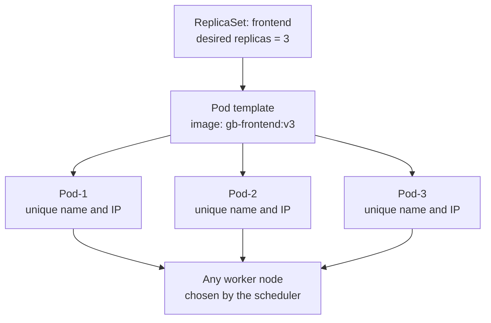
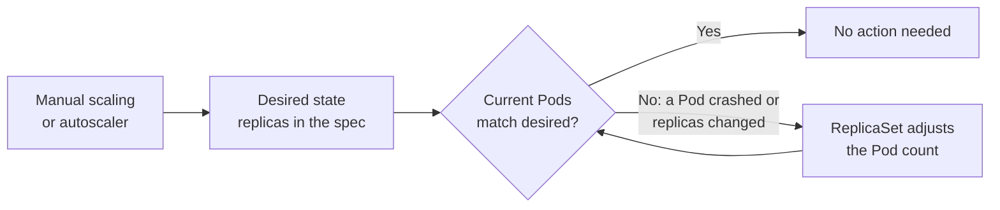
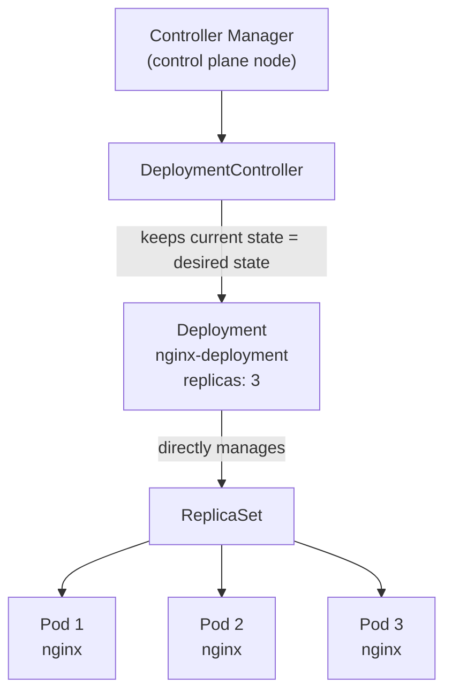
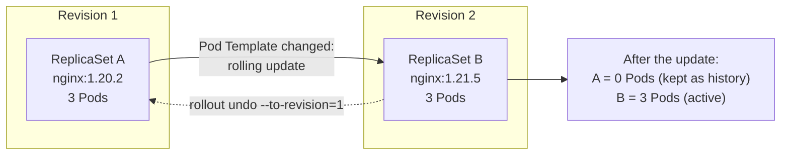
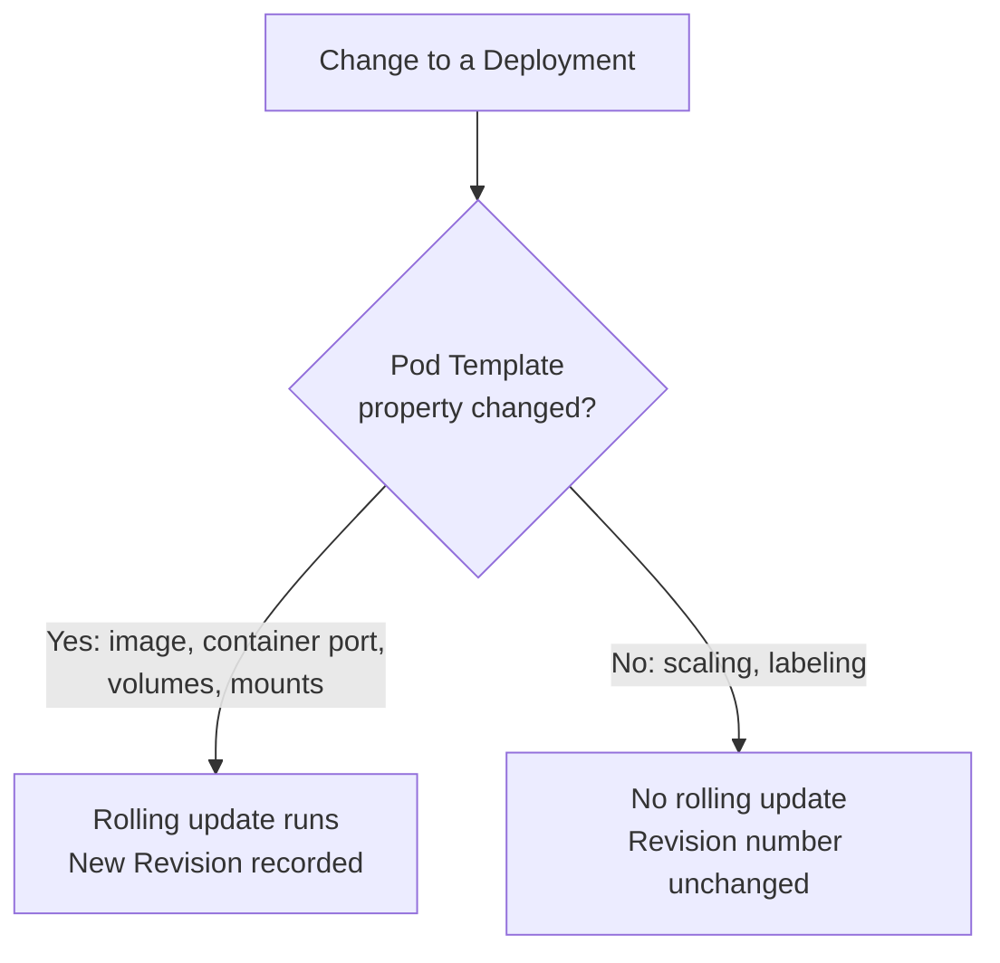

<p>The provided text details the core <strong>Object Model</strong> and API abstractions of <strong>Kubernetes</strong> within the context of a 4-node <strong>Raspberry Pi 5</strong> cluster. It explains how the control plane continuously reconciles the actual state with the desired state specified in declarative <strong>YAML</strong> or JSON manifests. Furthermore, the material breaks down essential architectural building blocks such as <strong>nodes</strong>, <strong>namespaces</strong>, <strong>pods</strong>, <strong>labels</strong>, <strong>replica sets</strong>, and <strong>deployments</strong>. Practical operations are also demonstrated, including how to handle rolling updates, configure internal service discovery, and troubleshoot container environments using <strong>kubectl</strong>.</p>

<!--more-->




------

* TOC
{:toc}
------

## Introduction

In Part 1[^1] of this series, we built a 4-node **Raspberry Pi 5** cluster running Vanilla Kubernetes (v1.30.2), examining control plane components, container runtimes (`cri-dockerd` and `containerd`), and low-level overlay networking with **Flannel CNI**.

While understanding cluster infrastructure and networking is essential, day-to-day operations require mastering Kubernetes API abstractions. This post covers the foundational Kubernetes Building Blocks, aligning with the Linux Foundation's Introduction to Kubernetes (LFS158) course curriculum[^2].

### The Declarative Object Model

Kubernetes operates on a declarative **Object Model**. Rather than executing imperative commands to run containers, you declare the _desired state_ of your application using JSON or YAML manifests. The Kubernetes control plane continuously runs control loops (reconciliation) to drive the _current state_ of the cluster toward the _desired state_ stored in `etcd`.


The **Kubernetes Object Model**, which defines persistent entities in a cluster to manage containerized applications, host nodes, resource consumption, and operational policies.

**Desired vs. Actual State**:
* `spec`: Declarative section where you define the intended or desired state of an object.
* `status`: Section managed continuously by the Kubernetes Control Plane to record the real-time actual state, working to match it to the desired state.

> At any given point in time, the Control Plane tries to match the object's actual state to the object's desired state.
{:.ok}

**Core Object Manifest Fields**:
* `apiVersion`: Specifies the API version being referenced.
* `kind`: Identifies the type of object (e.g., Pod, Node, Namespace, ReplicaSet, Deployment, DaemonSet).
* `metadata`: Holds accounting and organizational data (such as names, labels, and namespaces).
* `data` / `stringData`: Alternative sections that replace `spec` in specific objects (e.g., ConfigMaps or Secrets) to store raw configuration data.


> **Deployment Workflow**: Object manifests are typically written in YAML format. When submitted via `kubectl`, the tool converts the manifest into a JSON payload sent to the Kubernetes API Server.
{:.note}

### Node
A node is a unique identity Kubernetes assigns to each system in a cluster, whether that system is a VM, bare-metal machine, or container. The cluster uses these identities for resource accounting and monitoring, which helps it manage workloads.

What runs on every node:
- **Container runtime:** runs all containerized workloads, including control plane agents and user workloads.
- **kubelet and kube-proxy:** handle local workload management. They work with the runtime to 
    - run containers, 
    - monitor 
        - container and 
        - node health, 
    - report status to the API Server, and 
    - manage network traffic to containers
- **Add-ons:** provide container networking, monitoring, logging, DNS, and similar services.

**Node types**
- **Control plane nodes:** also run the API Server, Scheduler, Controller Managers, and etcd. A cluster needs at least one, and more can be added for high availability.
- **Worker nodes:** have no control plane agents. A cluster has one or more, which provide resource redundancy.
- **Hybrid (all-in-one) nodes:** a single node hosts both the control plane agents and user workloads. This suits setups where high availability and redundancy don't matter.

**Bootstrapping**
- Node identities are created and assigned when the cluster is bootstrapped.
- My 4-node Raspberry Pi 5 cluster is bootstrapped with kubeadm. `kubeadm init` sets up the control plane on `rp1`, and `kubeadm join` adds `rp2`, `rp3` and `rp4` as worker nodes.

> - Control plane and worker nodes all run the kubelet, kube-proxy, a container runtime and add-ons, but only control plane nodes also run the API Server, Scheduler, Controller Managers and etcd. 
> - Together, the control plane and worker nodes form the cluster. They can sit on the same private network, across different networks, or across different cloud networks.
{:.note}


### Namespaces in Kubernetes

Namespaces split one cluster into virtual sub-clusters, so multiple users and teams can share it. Resource names must be unique within a Namespace, but not across the cluster.

**Default Namespaces**

| Namespace | Purpose |
|---|---|
| `default` | Holds objects created by administrators and developers, unless another Namespace is specified |
| `kube-system` | Holds objects created by the Kubernetes system, mostly control plane agents |
| `kube-public` | Unsecured and readable by anyone; used for things like exposing non-sensitive cluster information |
| `kube-node-lease` | Holds node lease objects used for node heartbeat data |


```bash
kubectl get namespaces
```

    NAME                   STATUS   AGE
    default                Active   2y116d
    kube-flannel           Active   2y116d
    kube-node-lease        Active   2y116d
    kube-public            Active   2y116d
    kube-system            Active   2y116d
    kubernetes-dashboard   Active   2y116d


To get all in the namespace


```bash
# 📋️
kubectl get all -n kube-flannel
```

    NAME                        READY   STATUS    RESTARTS         AGE
    pod/kube-flannel-ds-5k5nx   1/1     Running   13 (40h ago)     2y116d
    pod/kube-flannel-ds-c4rfk   1/1     Running   14 (5h38m ago)   2y116d
    pod/kube-flannel-ds-jbk4g   1/1     Running   13 (40h ago)     2y116d
    pod/kube-flannel-ds-vkc9x   1/1     Running   13 (40h ago)     2y116d
    
    NAME                             DESIRED   CURRENT   READY   UP-TO-DATE   AVAILABLE   NODE SELECTOR   AGE
    daemonset.apps/kube-flannel-ds   4         4         4       4            4           <none>          2y116d


Create a Namespace: `kubectl create namespace new-namespace-name`


```bash
kubectl create namespace ojtest
```

    namespace/ojtest created


```bash
kubectl get namespaces
```

    NAME                   STATUS   AGE
    default                Active   2y116d
    kube-flannel           Active   2y116d
    kube-node-lease        Active   2y116d
    kube-public            Active   2y116d
    kube-system            Active   2y116d
    kubernetes-dashboard   Active   2y116d
    ojtest                 Active   20s


To *delete*{:rtxt} the `ojtest` namespace:


```bash
# ❌️
kubectl delete namespace ojtest
```

    namespace "ojtest" deleted


```bash
kubectl get namespaces
```

    NAME                   STATUS   AGE
    default                Active   2y116d
    kube-flannel           Active   2y116d
    kube-node-lease        Active   2y116d
    kube-public            Active   2y116d
    kube-system            Active   2y116d
    kubernetes-dashboard   Active   2y116d


> **Good practice:** Create additional Namespaces to isolate users, teams, applications, or tiers. 
{:.ok}

**Limiting resources**
- **Resource quotas**[^3] limit the total resources consumed within a Namespace.
- **LimitRanges**[^4] limit the resources consumed by individual Containers and their enclosing objects in a Namespace.


### Pod

A Pod is the smallest workload object and represents a single instance of an application. It holds one or more containers that:

- are scheduled together on the same host
- share one network namespace, and so one IP address
- can mount the same external storage (volumes)

Pods are ephemeral and can't heal themselves. Controllers such as Deployments, ReplicaSets, DaemonSets and Jobs handle replication, fault tolerance and self-healing, and they embed the Pod spec through a Pod Template.

**Manifest**

A Pod manifest has four required fields:

| Field | Purpose |
|---|---|
| `apiVersion` | Must be `v1` for a Pod |
| `kind` | `Pod` |
| `metadata` | Name, plus optional labels and annotations |
| `spec` | Desired state (the PodSpec) |


```bash
cat def-pod.yaml 
```

    apiVersion: v1
    kind: Pod
    metadata:
      name: whoami-pod
      labels:
        run: whoami-pod
    spec:
      containers:
      - name: whoami-pod
        image: traefik/whoami:v1.10.1
        ports:
        - containerPort: 80


Create the Pod declaratively:

> You can create prod either declaratively or *imperatively* as follows:
>
> ```bash
> kubectl run whoami-pod --image=traefik/whoami:v1.10.1 --port=80 \
>  --dry-run=client -o yaml > whoami-pod.yaml
>```
{:.note}


```bash
kubectl create -f def-pod.yaml
```

    pod/whoami-pod created


verify the pod creation


```bash
kubectl get pods -o wide
```

    NAME                            READY   STATUS    RESTARTS         AGE      IP            NODE   NOMINATED NODE   READINESS GATES
    nginx-daemon-48l6g              1/1     Running   11 (41h ago)     2y113d   10.244.3.44   rp4    <none>           <none>
    nginx-daemon-7wnmv              1/1     Running   11 (6h47m ago)   2y113d   10.244.1.45   rp2    <none>           <none>
    nginx-daemon-g84rj              1/1     Running   11 (41h ago)     2y113d   10.244.2.51   rp3    <none>           <none>
    redis-db-7c5bd788fd-7vxjv       1/1     Running   7 (41h ago)      303d     10.244.3.42   rp4    <none>           <none>
    web-frontend-5f4cd56f87-t5srs   1/1     Running   7 (41h ago)      303d     10.244.3.43   rp4    <none>           <none>
    web-frontend-5f4cd56f87-vvbd4   1/1     Running   7 (41h ago)      303d     10.244.2.54   rp3    <none>           <none>
    whoami-pod                      1/1     Running   0                14m      10.244.1.46   rp2    <none>           <none>


Pod has been created and in the `Running` state. Here the pod ip is `10.244.1.46`.


```bash
curl http://10.244.1.46
```

      % Total    % Received % Xferd  Average Speed   Time    Time     Time  Current
                                     Dload  Upload   Total   Spent    Left  Speed
    100   192  100   192    0     0   111k      0 --:--:-- --:Hostname: whoami-pod
    IP: 127.0.0.1
    IP: ::1
    IP: 10.244.1.46
    IP: fe80::949e:84ff:fe14:e331
    RemoteAddr: 10.244.1.1:32874
    GET / HTTP/1.1
    Host: 10.244.1.46
    User-Agent: curl/8.5.0
    Accept: */*
    
    --:-- --:--:--  187k


Describe the `whoami-pod`:


```bash
kubectl describe pod whoami-pod
```

    Name:             whoami-pod
    Namespace:        default
    Priority:         0
    Service Account:  default
    Node:             rp2/192.168.1.12
    Start Time:       Tue, 03 Nov 2026 16:37:15 +1100
    Labels:           run=whoami-pod
    Annotations:      <none>
    Status:           Running
    IP:               10.244.1.46
    IPs:
      IP:  10.244.1.46
    Containers:
      whoami-pod:
        Container ID:   containerd://7d4f47ceac1024b00f7ecb2c5b845ccf3356b291ae81d5aec8cac33303b563a7
        Image:          traefik/whoami:v1.10.1
        Image ID:       docker.io/traefik/whoami@sha256:6956a30c7d33f61bb7fdf1c14dcb3192fca4093cd5b91b5f9b38862862072fe9
        Port:           80/TCP
        Host Port:      0/TCP
        State:          Running
          Started:      Tue, 03 Nov 2026 16:37:23 +1100
        Ready:          True
        Restart Count:  0
        Environment:    <none>
        Mounts:
          /var/run/secrets/kubernetes.io/serviceaccount from kube-api-access-kkjhn (ro)
    Conditions:
      Type                        Status
      PodReadyToStartContainers   True 
      Initialized                 True 
      Ready                       True 
      ContainersReady             True 
      PodScheduled                True 
    Volumes:
      kube-api-access-kkjhn:
        Type:                    Projected (a volume that contains injected data from multiple sources)
        TokenExpirationSeconds:  3607
        ConfigMapName:           kube-root-ca.crt
        ConfigMapOptional:       <nil>
        DownwardAPI:             true
    QoS Class:                   BestEffort
    Node-Selectors:              <none>
    Tolerations:                 node.kubernetes.io/not-ready:NoExecute op=Exists for 300s
                                 node.kubernetes.io/unreachable:NoExecute op=Exists for 300s
    Events:
      Type    Reason     Age   From               Message
      ----    ------     ----  ----               -------
      Normal  Scheduled  10m   default-scheduler  Successfully assigned default/whoami-pod to rp2
      Normal  Pulling    10m   kubelet            Pulling image "traefik/whoami:v1.10.1"
      Normal  Pulled     10m   kubelet            Successfully pulled image "traefik/whoami:v1.10.1" in 6.732s (6.732s including waiting). Image size: 2561984 bytes.
      Normal  Created    10m   kubelet            Created container whoami-pod
      Normal  Started    10m   kubelet            Started container whoami-pod


If any pod is in the error state found in the output of the `kubectl get pods -o wide`, can be investigated under the `Events` section in the above command.

Retrive the template (either yaml or JSON):


```bash
kubectl get pod whoami-pod -o yaml
```

    apiVersion: v1
    kind: Pod
    metadata:
      creationTimestamp: "2026-11-03T05:37:15Z"
      labels:
        run: whoami-pod
      name: whoami-pod
      namespace: default
      resourceVersion: "398726"
      uid: 23bbd811-51b7-4e77-8680-fb606243b8c8
    spec:
      containers:
      - image: traefik/whoami:v1.10.1
        imagePullPolicy: IfNotPresent
        name: whoami-pod
        ports:
        - containerPort: 80
          protocol: TCP
        resources: {}
        terminationMessagePath: /dev/termination-log
        terminationMessagePolicy: File
        volumeMounts:
        - mountPath: /var/run/secrets/kubernetes.io/serviceaccount
          name: kube-api-access-kkjhn
          readOnly: true
      dnsPolicy: ClusterFirst
      enableServiceLinks: true
      nodeName: rp2
      preemptionPolicy: PreemptLowerPriority
      priority: 0
      restartPolicy: Always
      schedulerName: default-scheduler
      securityContext: {}
      serviceAccount: default
      serviceAccountName: default
      terminationGracePeriodSeconds: 30
      tolerations:
      - effect: NoExecute
        key: node.kubernetes.io/not-ready
        operator: Exists
        tolerationSeconds: 300
      - effect: NoExecute
        key: node.kubernetes.io/unreachable
        operator: Exists
        tolerationSeconds: 300
      volumes:
      - name: kube-api-access-kkjhn
        projected:
          defaultMode: 420
          sources:
          - serviceAccountToken:
              expirationSeconds: 3607
              path: token
          - configMap:
              items:
              - key: ca.crt
                path: ca.crt
              name: kube-root-ca.crt
          - downwardAPI:
              items:
              - fieldRef:
                  apiVersion: v1
                  fieldPath: metadata.namespace
                path: namespace
    status:
      conditions:
      - lastProbeTime: null
        lastTransitionTime: "2026-11-03T05:37:24Z"
        status: "True"
        type: PodReadyToStartContainers
      - lastProbeTime: null
        lastTransitionTime: "2026-11-03T05:37:15Z"
        status: "True"
        type: Initialized
      - lastProbeTime: null
        lastTransitionTime: "2026-11-03T05:37:24Z"
        status: "True"
        type: Ready
      - lastProbeTime: null
        lastTransitionTime: "2026-11-03T05:37:24Z"
        status: "True"
        type: ContainersReady
      - lastProbeTime: null
        lastTransitionTime: "2026-11-03T05:37:15Z"
        status: "True"
        type: PodScheduled
      containerStatuses:
      - containerID: containerd://7d4f47ceac1024b00f7ecb2c5b845ccf3356b291ae81d5aec8cac33303b563a7
        image: docker.io/traefik/whoami:v1.10.1
        imageID: docker.io/traefik/whoami@sha256:6956a30c7d33f61bb7fdf1c14dcb3192fca4093cd5b91b5f9b38862862072fe9
        lastState: {}
        name: whoami-pod
        ready: true
        restartCount: 0
        started: true
        state:
          running:
            startedAt: "2026-11-03T05:37:23Z"
      hostIP: 192.168.1.12
      hostIPs:
      - ip: 192.168.1.12
      phase: Running
      podIP: 10.244.1.46
      podIPs:
      - ip: 10.244.1.46
      qosClass: BestEffort
      startTime: "2026-11-03T05:37:15Z"


Finally delete the pod `whoami-pod`:


```bash
# ❌️
kubectl delete pod whoami-pod
```

    pod "whoami-pod" deleted


```bash
kubectl get pods
```

    NAME                            READY   STATUS    RESTARTS         AGE
    nginx-daemon-48l6g              1/1     Running   11 (41h ago)     2y113d
    nginx-daemon-7wnmv              1/1     Running   11 (6h51m ago)   2y113d
    nginx-daemon-g84rj              1/1     Running   11 (41h ago)     2y113d
    redis-db-7c5bd788fd-7vxjv       1/1     Running   7 (41h ago)      303d
    web-frontend-5f4cd56f87-t5srs   1/1     Running   7 (41h ago)      303d
    web-frontend-5f4cd56f87-vvbd4   1/1     Running   7 (41h ago)      303d


### Labels

- **What they are:** key-value pairs attached to Kubernetes objects such as Pods, ReplicaSets, Nodes, Namespaces and Persistent Volumes.
- **What they do:** they organize objects and let you select a subset of them based on your requirements.
- **Not unique:** many objects can share the same Label, so Labels don't identify a single object.
- **How controllers use them:** controllers group decoupled objects logically by Label, rather than by name or ID.

### Label selectors

Label selectors are how controllers (or operators) and Services pick out a subset of Kubernetes objects, and there are two types: 
1. Equality-based selectors filter on label keys and values using `=` or `==` (equals, used interchangeably) and `!=` (not equals), so `env==test` or `env=test` selects objects whose `env` label is set to `test`. 
2. Set-based selectors filter against a set of values using `in` and `notin` for label values, plus exist/does not exist operators for label keys. For example, `env in (test,qa)` selects objects whose `env` label is either `test` or `qa`, while `!prod` selects objects with no `prod` label key.

### ReplicationControllers (RCs)

RC is an older controller that keeps a set number of Pod replicas running which is not anymore recommended, but it's useful for understanding how Kubernetes controllers work.

It constantly compares the actual state with the desired state.

| Situation | What the RC does |
|---|---|
| Too many Pods | Randomly terminates the extras |
| Too few Pods | Requests new Pods until the count matches |
| Count matches | Nothing, but it keeps watching |

The standalone Pod has no self-healing, so it can't restart itself if it's terminated in error. The recommended approach is to run and manage Pods through a controller, or "operator". RCs also support application updates. 

The <span>default recommended controller is a **Deployment**</span>{:gtxt}, which configures a **ReplicaSet** to manage the Pods' lifecycle: `Deployment → ReplicaSet → Pods`.

## ReplicaSets

**ReplicaSet** is the controller that oversees the lifecycle of those instances. It scales the number of Pods running a specific application container image, either manually or through an autoscaler.

ReplicaSets and ReplicationControllers

A ReplicaSet is, in part, the next-generation ReplicationController. It implements the same replication and self-healing behaviour, but supports a wider range of Selectors.

| Controller | Equality-based Selectors | Set-based Selectors |
|---|---|---|
| ReplicationController | Yes | No |
| ReplicaSet | Yes | Yes |

### Anatomy of a ReplicaSet

Following figure shows a ReplicaSet with its replica count set to 3. All three Pods are cloned from the same Pod template, so they run the same image with the same configuration. <span>They are still distinct, because each has a unique name and IP address</span>{:gtxt}.

The Pod object also allows each instance to be placed individually on any worker node during scheduling.

A ReplicaSet with three replicas:



### Desired State and Current State

In the course's example, the current state matches the desired state because three Pods are running and three were requested. Figure 2 extends this idea to show how the ReplicaSet's self-healing and scaling work when the two differ. The page itself only shows the matching case.

Desired state versus current state:



### Defining a ReplicaSet

A YAML manifest is the declarative way to define the object, and it can serve as a template for more complex definitions:

This manifest creates three Pods running the standard Nginx image:

    apiVersion: apps/v1
    kind: ReplicaSet
    metadata:
      name: nginx-rs
    spec:
      replicas: 3
      selector:
        matchLabels:
          app: nginx
      template:
        metadata:
          labels:
            app: nginx
        spec:
          containers:
          - name: nginx
            image: nginx


The selector must match the labels in the Pod template. The ReplicaSet uses them to manage its Pods.

Save the manifest as `nginx-rs.yaml` and create the ReplicaSet:


```bash
kubectl apply -f nginx-rs.yaml
```

    replicaset.apps/nginx-rs created


Common operations:

> For most applications, use a `Deployment` instead; it manages a `ReplicaSet` and supports rolling updates.
{:.note}


```bash
# List RepicaSets
kubectl get rs
```

    NAME       DESIRED   CURRENT   READY   AGE
    nginx-rs   3         3         3       90s


```bash
# List the pods
kubectl get pods -l app=nginx
```

    NAME             READY   STATUS    RESTARTS   AGE
    nginx-rs-bd2qj   1/1     Running   0          2m11s
    nginx-rs-mg6j4   1/1     Running   0          2m11s
    nginx-rs-rvfvj   1/1     Running   0          2m11s


```bash
# scale to 2 replicas
kubectl scale rs nginx-rs --replicas=2
```

    replicaset.apps/nginx-rs scaled


```bash
kubectl get replicasets
```

    NAME       DESIRED   CURRENT   READY   AGE
    nginx-rs   2         2         2       4m22s


```bash
# show details
kubectl describe rs nginx-rs
```

    Name:         nginx-rs
    Namespace:    default
    Selector:     app=nginx
    Labels:       <none>
    Annotations:  <none>
    Replicas:     2 current / 2 desired
    Pods Status:  2 Running / 0 Waiting / 0 Succeeded / 0 Failed
    Pod Template:
      Labels:  app=nginx
      Containers:
       nginx:
        Image:         nginx
        Port:          <none>
        Host Port:     <none>
        Environment:   <none>
        Mounts:        <none>
      Volumes:         <none>
      Node-Selectors:  <none>
      Tolerations:     <none>
    Events:
      Type    Reason            Age    From                   Message
      ----    ------            ----   ----                   -------
      Normal  SuccessfulCreate  5m23s  replicaset-controller  Created pod: nginx-rs-mg6j4
      Normal  SuccessfulCreate  5m23s  replicaset-controller  Created pod: nginx-rs-bd2qj
      Normal  SuccessfulCreate  5m23s  replicaset-controller  Created pod: nginx-rs-rvfvj
      Normal  SuccessfulDelete  102s   replicaset-controller  Deleted pod: nginx-rs-mg6j4


```bash
# ❌️
kubectl delete -f nginx-rs.yaml
```

    replicaset.apps "nginx-rs" deleted


```bash
# List the pods after delete
kubectl get pods -l app=nginx
```

    No resources found in default namespace.


## Deployments
A Deployment provides *declarative updates to Pods and ReplicaSets*{:.hl}. The **DeploymentController***, part of the control plane node's controller manager, keeps the current state matched to the desired state. It also manages ReplicaSets directly for scaling.



### Update strategies

| Update strategy | Behaviour | Status |
|---|---|---|
| **RollingUpdate** | Seamless updates and rollbacks | Default |
| **Recreate** | Disruptive update | Less popular |

A Deployment’s `strategy` determines how Kubernetes replaces the Pods when the Pod template changes, such as when you update the container image.

- **RollingUpdate** replaces Pods gradually. Kubernetes creates some new Pods while old Pods are still running, then removes the old Pods as the new ones become ready. This usually keeps the application available during an update. The `maxSurge` setting limits how many extra Pods may be created above the desired replica count; `maxUnavailable` limits how many Pods may be unavailable during the update. Both settings can be configured under `spec.strategy.rollingUpdate`. The default strategy for Deployments is `RollingUpdate`.

  ```yaml
  spec:
    strategy:
      type: RollingUpdate
      rollingUpdate:
        maxSurge: 1
        maxUnavailable: 0
  ```

  With three replicas, this example permits Kubernetes to create one extra Pod and requires all three desired replicas to remain available while the update proceeds. The actual rollout also depends on new Pods becoming ready; a Pod that never becomes ready can stall the rollout.

- **Recreate** first terminates all existing Pods, then creates the new ones. This avoids having old and new versions running at the same time, which can be useful when the versions cannot safely coexist. However, the application will have downtime while the old Pods are stopped and the new Pods start. Choose this strategy only when that interruption is acceptable.

  ```yaml
  spec:
    strategy:
      type: Recreate
  ```

> For either strategy, Kubernetes records the Deployment’s revisions when its Pod template changes, so a rollout can be inspected or rolled back. A rollback restores a previous Pod template; it does not guarantee that application data or external side effects are reversed.
{:.note}


### The Deployment manifest


    apiVersion: apps/v1
    kind: Deployment
    metadata:
      name: nginx-deployment
      labels:
        app: nginx-deployment
    spec:
      replicas: 3
      selector:
        matchLabels:
          app: nginx-deployment
      template:
        metadata:
          labels:
            app: nginx-deployment
        spec:
          containers:
          - name: nginx
            image: nginx:1.20.2
            ports:
            - containerPort: 80


```bash
# create Declarative, from a file
kubectl apply -f nginx-deployment.yaml --record
```

    Flag --record has been deprecated, --record will be removed in the future
    deployment.apps/nginx-deployment created


> A nested Pod keeps its `metadata` and `spec`, but loses its own `apiVersion` and `kind`, which are replaced by `template`. After creation, Kubernetes attaches and populates a `status` field on the object.
{:.ok}


| Goal | Command |
|---|---|
| Declarative, from a file | `kubectl create -f def-deploy.yaml` (advanced users may prefer `apply`) |
| Imperative, no file | `kubectl create deployment nginx-deployment --image=nginx:1.20.2 --port=80 --replicas=3` |
| Generate a YAML template | Add `--dry-run=client -o yaml > nginx-deploy.yaml` |
| Generate a JSON template | Add `--dry-run=client -o json > nginx-deploy.json` |
| Load a generated template | `kubectl create -f nginx-deploy.yaml` or `kubectl create -f nginx-deploy.json` |


```bash
kubectl get pods
```

    NAME                               READY   STATUS    RESTARTS   AGE
    nginx-deployment-b96f9488b-fdrks   1/1     Running   0          5s
    nginx-deployment-b96f9488b-mp6nk   1/1     Running   0          5s
    nginx-deployment-b96f9488b-nzb6x   1/1     Running   0          5s


```bash
# List
kubectl get deploy -o wide
```

    NAME               READY   UP-TO-DATE   AVAILABLE   AGE   CONTAINERS   IMAGES         SELECTOR
    nginx-deployment   3/3     3            3           17s   nginx        nginx:1.20.2   app=nginx-deployment


```bash
# Scale the Deployment
kubectl scale deploy nginx-deployment --replicas=2 --record
```

    Flag --record has been deprecated, --record will be removed in the future
    deployment.apps/nginx-deployment scaled


> Scaling and labeling don’t change the Revision number.
{:.note}


```bash
# Check rollout history (scaling won't add a revision) ⌛️
kubectl rollout history deploy nginx-deployment
```

    deployment.apps/nginx-deployment 
    REVISION  CHANGE-CAUSE
    1         kubectl scale deploy nginx-deployment --replicas=2 --record=true
    


```bash
# inspect 🩺
kubectl describe deploy nginx-deployment
```

    Name:                   nginx-deployment
    Namespace:              default
    CreationTimestamp:      Wed, 04 Nov 2026 21:14:35 +1100
    Labels:                 app=nginx-deployment
    Annotations:            deployment.kubernetes.io/revision: 1
                            kubernetes.io/change-cause: kubectl scale deploy nginx-deployment --replicas=2 --record=true
    Selector:               app=nginx-deployment
    Replicas:               2 desired | 2 updated | 2 total | 2 available | 0 unavailable
    StrategyType:           RollingUpdate
    MinReadySeconds:        0
    RollingUpdateStrategy:  25% max unavailable, 25% max surge
    Pod Template:
      Labels:  app=nginx-deployment
      Containers:
       nginx:
        Image:         nginx:1.20.2
        Port:          80/TCP
        Host Port:     0/TCP
        Environment:   <none>
        Mounts:        <none>
      Volumes:         <none>
      Node-Selectors:  <none>
      Tolerations:     <none>
    Conditions:
      Type           Status  Reason
      ----           ------  ------
      Available      True    MinimumReplicasAvailable
      Progressing    True    NewReplicaSetAvailable
    OldReplicaSets:  <none>
    NewReplicaSet:   nginx-deployment-b96f9488b (2/2 replicas created)
    Events:
      Type    Reason             Age   From                   Message
      ----    ------             ----  ----                   -------
      Normal  ScalingReplicaSet  44s   deployment-controller  Scaled up replica set nginx-deployment-b96f9488b to 3
      Normal  ScalingReplicaSet  18s   deployment-controller  Scaled down replica set nginx-deployment-b96f9488b to 2 from 3


```bash
# update the image
kubectl set image deploy nginx-deployment nginx=nginx:1.21.5 --record
```

    Flag --record has been deprecated, --record will be removed in the future
    deployment.apps/nginx-deployment image updated


```bash
# inspect the updated image 🩺
kubectl describe deploy nginx-deployment
```

    Name:                   nginx-deployment
    Namespace:              default
    CreationTimestamp:      Wed, 04 Nov 2026 21:14:35 +1100
    Labels:                 app=nginx-deployment
    Annotations:            deployment.kubernetes.io/revision: 2
                            kubernetes.io/change-cause: kubectl set image deploy nginx-deployment nginx=nginx:1.21.5 --record=true
    Selector:               app=nginx-deployment
    Replicas:               2 desired | 2 updated | 2 total | 2 available | 0 unavailable
    StrategyType:           RollingUpdate
    MinReadySeconds:        0
    RollingUpdateStrategy:  25% max unavailable, 25% max surge
    Pod Template:
      Labels:  app=nginx-deployment
      Containers:
       nginx:
        Image:         nginx:1.21.5
        Port:          80/TCP
        Host Port:     0/TCP
        Environment:   <none>
        Mounts:        <none>
      Volumes:         <none>
      Node-Selectors:  <none>
      Tolerations:     <none>
    Conditions:
      Type           Status  Reason
      ----           ------  ------
      Available      True    MinimumReplicasAvailable
      Progressing    True    NewReplicaSetAvailable
    OldReplicaSets:  nginx-deployment-b96f9488b (0/0 replicas created)
    NewReplicaSet:   nginx-deployment-668594868d (2/2 replicas created)
    Events:
      Type    Reason             Age   From                   Message
      ----    ------             ----  ----                   -------
      Normal  ScalingReplicaSet  56s   deployment-controller  Scaled up replica set nginx-deployment-b96f9488b to 3
      Normal  ScalingReplicaSet  30s   deployment-controller  Scaled down replica set nginx-deployment-b96f9488b to 2 from 3
      Normal  ScalingReplicaSet  4s    deployment-controller  Scaled up replica set nginx-deployment-668594868d to 1
      Normal  ScalingReplicaSet  3s    deployment-controller  Scaled down replica set nginx-deployment-b96f9488b to 1 from 2
      Normal  ScalingReplicaSet  3s    deployment-controller  Scaled up replica set nginx-deployment-668594868d to 2 from 1
      Normal  ScalingReplicaSet  1s    deployment-controller  Scaled down replica set nginx-deployment-b96f9488b to 0 from 1


```bash
# Check the rollout status
kubectl rollout status deploy nginx-deployment
```

    deployment "nginx-deployment" successfully rolled out


```bash
# view history ⌛️
kubectl rollout history deploy nginx-deployment
```

    deployment.apps/nginx-deployment 
    REVISION  CHANGE-CAUSE
    1         kubectl scale deploy nginx-deployment --replicas=2 --record=true
    2         kubectl set image deploy nginx-deployment nginx=nginx:1.21.5 --record=true
    


### Rolling updates, Revisions and rollback

Each recorded state of a Deployment is a **Revision**. Changing the image from `nginx:1.20.2` to `nginx:1.21.5` creates ReplicaSet B, and the move from A to B is the rolling update. ReplicaSet A stays at 0 Pods, which preserves the earlier state and makes rollback possible.



Only planned changes to the Pod Template create a new Revision:



__Key points__

- Deployments manage ReplicaSets, and ReplicaSets manage Pods.
- `--dry-run=client -o yaml` is a quick way to get a starter manifest.
- Old ReplicaSets scaled to 0 are what make rollback possible.
- Scaling and labeling don't change the Revision number.
- **Not from the course:** `--record` is deprecated in current kubectl versions, though it still appears in these lessons. Using the `kubernetes.io/change-cause` annotation is the current way to record a change reason.


```bash
# List 📋️
kubectl get deploy,rs,po -l app=nginx-deployment -o wide
```

    NAME                               READY   UP-TO-DATE   AVAILABLE   AGE     CONTAINERS   IMAGES         SELECTOR
    deployment.apps/nginx-deployment   2/2     2            2           2m26s   nginx        nginx:1.21.5   app=nginx-deployment
    
    NAME                                          DESIRED   CURRENT   READY   AGE     CONTAINERS   IMAGES         SELECTOR
    replicaset.apps/nginx-deployment-668594868d   2         2         2       94s     nginx        nginx:1.21.5   app=nginx-deployment,pod-template-hash=668594868d
    replicaset.apps/nginx-deployment-b96f9488b    0         0         0       2m26s   nginx        nginx:1.20.2   app=nginx-deployment,pod-template-hash=b96f9488b
    
    NAME                                    READY   STATUS    RESTARTS   AGE   IP            NODE   NOMINATED NODE   READINESS GATES
    pod/nginx-deployment-668594868d-6gwrf   1/1     Running   0          94s   10.244.3.59   rp4    <none>           <none>
    pod/nginx-deployment-668594868d-hcfnk   1/1     Running   0          93s   10.244.1.60   rp2    <none>           <none>


```bash
# Rollback
kubectl rollout undo deploy nginx-deployment --to-revision=1
```

    deployment.apps/nginx-deployment rolled back


```bash
# view history ⌛️
kubectl rollout history deploy nginx-deployment
```

    deployment.apps/nginx-deployment 
    REVISION  CHANGE-CAUSE
    2         kubectl set image deploy nginx-deployment nginx=nginx:1.21.5 --record=true
    3         kubectl scale deploy nginx-deployment --replicas=2 --record=true
    


```bash
# inspect the updated image 🩺
kubectl describe deploy nginx-deployment
```

    Name:                   nginx-deployment
    Namespace:              default
    CreationTimestamp:      Wed, 04 Nov 2026 21:14:35 +1100
    Labels:                 app=nginx-deployment
    Annotations:            deployment.kubernetes.io/revision: 3
                            kubernetes.io/change-cause: kubectl scale deploy nginx-deployment --replicas=2 --record=true
    Selector:               app=nginx-deployment
    Replicas:               2 desired | 2 updated | 2 total | 2 available | 0 unavailable
    StrategyType:           RollingUpdate
    MinReadySeconds:        0
    RollingUpdateStrategy:  25% max unavailable, 25% max surge
    Pod Template:
      Labels:  app=nginx-deployment
      Containers:
       nginx:
        Image:         nginx:1.20.2
        Port:          80/TCP
        Host Port:     0/TCP
        Environment:   <none>
        Mounts:        <none>
      Volumes:         <none>
      Node-Selectors:  <none>
      Tolerations:     <none>
    Conditions:
      Type           Status  Reason
      ----           ------  ------
      Available      True    MinimumReplicasAvailable
      Progressing    True    NewReplicaSetAvailable
    OldReplicaSets:  nginx-deployment-668594868d (0/0 replicas created)
    NewReplicaSet:   nginx-deployment-b96f9488b (2/2 replicas created)
    Events:
      Type    Reason             Age    From                   Message
      ----    ------             ----   ----                   -------
      Normal  ScalingReplicaSet  2m47s  deployment-controller  Scaled up replica set nginx-deployment-b96f9488b to 3
      Normal  ScalingReplicaSet  2m21s  deployment-controller  Scaled down replica set nginx-deployment-b96f9488b to 2 from 3
      Normal  ScalingReplicaSet  115s   deployment-controller  Scaled up replica set nginx-deployment-668594868d to 1
      Normal  ScalingReplicaSet  114s   deployment-controller  Scaled down replica set nginx-deployment-b96f9488b to 1 from 2
      Normal  ScalingReplicaSet  114s   deployment-controller  Scaled up replica set nginx-deployment-668594868d to 2 from 1
      Normal  ScalingReplicaSet  112s   deployment-controller  Scaled down replica set nginx-deployment-b96f9488b to 0 from 1
      Normal  ScalingReplicaSet  10s    deployment-controller  Scaled up replica set nginx-deployment-b96f9488b to 1 from 0
      Normal  ScalingReplicaSet  9s     deployment-controller  Scaled down replica set nginx-deployment-668594868d to 1 from 2
      Normal  ScalingReplicaSet  8s     deployment-controller  Scaled up replica set nginx-deployment-b96f9488b to 2 from 1
      Normal  ScalingReplicaSet  7s     deployment-controller  (combined from similar events): Scaled down replica set nginx-deployment-668594868d to 0 from 1


```bash
# list by label 📋️
kubectl get all -l app=nginx-deployment -o wide
```

    NAME                                   READY   STATUS    RESTARTS   AGE   IP            NODE   NOMINATED NODE   READINESS GATES
    pod/nginx-deployment-b96f9488b-9q5st   1/1     Running   0          21s   10.244.2.70   rp3    <none>           <none>
    pod/nginx-deployment-b96f9488b-qwkwm   1/1     Running   0          23s   10.244.3.60   rp4    <none>           <none>
    
    NAME                               READY   UP-TO-DATE   AVAILABLE   AGE   CONTAINERS   IMAGES         SELECTOR
    deployment.apps/nginx-deployment   2/2     2            2           3m    nginx        nginx:1.20.2   app=nginx-deployment
    
    NAME                                          DESIRED   CURRENT   READY   AGE    CONTAINERS   IMAGES         SELECTOR
    replicaset.apps/nginx-deployment-668594868d   0         0         0       2m8s   nginx        nginx:1.21.5   app=nginx-deployment,pod-template-hash=668594868d
    replicaset.apps/nginx-deployment-b96f9488b    2         2         2       3m     nginx        nginx:1.20.2   app=nginx-deployment,pod-template-hash=b96f9488b


or run the following command:


```bash
# Delete ❌️
kubectl delete deploy nginx-deployment
```

    deployment.apps "nginx-deployment" deleted


```bash
# list by label and verify 📋️
kubectl get all -l app=nginx-deployment -o wide
```

    No resources found in default namespace.


## Applications
- **Deployment**: standard resource for running applications in a scalable environment
- **StatefulSet**: an alternative to the Deployment for services such as databases
- **DaemonSet**: is an alternative to the Deployment that ensures that one application instance is started on each cluster node
- **job**: Single shot applications
- **CronJob**: is used for scheduled applications

### Web application test
To test if you can reach your cluster applications from your Mac's browser, we will create a NodePort service. While a ClusterIP is only reachable inside the cluster, a NodePort opens a specific port (usually 30000–32767) on your machine's physical IP (192.168.1.11).

Create the deployment:


```bash
kubectl create deployment web-test --image=nginx
```

    deployment.apps/web-test created


Expose it as a NodePort service


```bash
kubectl expose deployment web-test --type=NodePort --port=80
```

    service/web-test exposed


### Find the Assigned Port
Kubernetes will pick a random port in the 30000+ range. You need to find out which one it chose.

> Look for the PORT(S) column. It will look like 80:30495/TCP. In this example, 30495 is the port you need.


```bash
kubectl get service web-test
```

    Error from server (NotFound): services "web-test" not found


Now you can access the nginx server using the `http://192.168.1.11:30495/` url.

Once you've verified you can see the "Welcome to nginx" page, you can delete the test resources:


```bash
# delete the service ❌️
kubectl delete service web-test
```

    service "web-test" deleted


```bash
# delete the deployment ❌️
kubectl delete deployment web-test
```

    deployment.apps "web-test" deleted


## YAML manifest for a more complex application
To show how multiple components interact within your cluster, we will create a Guestbook-style setup: a Redis database (backend) and an Nginx web server (frontend).

This will demonstrate **Service Discovery**, as the frontend will find the backend using only the Service name.

### Step 1: Create the Backend (Redis)

We will create a Deployment for Redis and a `ClusterIP` service. Because this is an internal database, we do **not** want to expose it to the outside world.


```bash
# Create the Redis Deployment
kubectl create deployment redis-db --image=redis
```

    deployment.apps/redis-db created


```bash
# Expose it internally
kubectl expose deployment redis-db --port=6379 --target-port=6379
```

    service/redis-db exposed


### Step 2: Create the Frontend (Nginx)

Next, we create the web server. We will use a custom configuration (via a one-liner here) to prove it can "see" the Redis service.


```bash
# Create the Frontend Deployment
kubectl create deployment web-frontend --image=nginx
```

    deployment.apps/web-frontend created


Here the specification of the above deployment:


```bash
kubectl get deploy web-frontend -o yaml
```

    apiVersion: apps/v1
    kind: Deployment
    metadata:
      annotations:
        deployment.kubernetes.io/revision: "1"
      creationTimestamp: "2026-01-03T10:27:32Z"
      generation: 2
      labels:
        app: web-frontend
      name: web-frontend
      namespace: default
      resourceVersion: "296943"
      uid: 882765a3-0a17-4008-bf65-866c20f2f52f
    spec:
      progressDeadlineSeconds: 600
      replicas: 3
      revisionHistoryLimit: 10
      selector:
        matchLabels:
          app: web-frontend
      strategy:
        rollingUpdate:
          maxSurge: 25%
          maxUnavailable: 25%
        type: RollingUpdate
      template:
        metadata:
          creationTimestamp: null
          labels:
            app: web-frontend
        spec:
          containers:
          - image: nginx
            imagePullPolicy: Always
            name: nginx
            resources: {}
            terminationMessagePath: /dev/termination-log
            terminationMessagePolicy: File
          dnsPolicy: ClusterFirst
          restartPolicy: Always
          schedulerName: default-scheduler
          securityContext: {}
          terminationGracePeriodSeconds: 30
    status:
      availableReplicas: 3
      conditions:
      - lastTransitionTime: "2026-01-03T10:27:32Z"
        lastUpdateTime: "2026-01-03T10:27:35Z"
        message: ReplicaSet "web-frontend-5f4cd56f87" has successfully progressed.
        reason: NewReplicaSetAvailable
        status: "True"
        type: Progressing
      - lastTransitionTime: "2026-01-07T03:20:42Z"
        lastUpdateTime: "2026-01-07T03:20:42Z"
        message: Deployment has minimum availability.
        reason: MinimumReplicasAvailable
        status: "True"
        type: Available
      observedGeneration: 2
      readyReplicas: 3
      replicas: 3
      updatedReplicas: 3


```bash
# Expose it via NodePort so you can see it in your browser
kubectl expose deployment web-frontend --type=NodePort --port=80
```

    service/web-frontend exposed


### Step 3: Verify Internal Communication

This is the "Magic" of `kube-proxy` and `CoreDNS`. The `web-frontend` pod can reach the `redis-db` pod simply by using the name `redis-db`.

**Run this to test the connection from frontend to backend:**


```bash
# Use your proxy to run a 'redis-cli' ping from inside the nginx pod
kubectl exec deployments/web-frontend -- apt-get update -y
```

    Get:1 http://deb.debian.org/debian trixie InRelease [140 kB]
    Get:2 http://deb.debian.org/debian trixie-updates InRelease [47.3 kB]
    Get:3 http://deb.debian.org/debian-security trixie-security InRelease [43.4 kB]
    Get:4 http://deb.debian.org/debian trixie/main arm64 Packages [9607 kB]
    Get:5 http://deb.debian.org/debian trixie-updates/main arm64 Packages [5404 B]
    Get:6 http://deb.debian.org/debian-security trixie-security/main arm64 Packages [94.3 kB]
    Fetched 9938 kB in 1s (6831 kB/s)
    Reading package lists...


install redis tools


```bash
kubectl exec deployments/web-frontend -- apt-get install redis-tools -y
```

    Reading package lists...
    Building dependency tree...
    Reading state information...
    The following additional packages will be installed:
      adduser libatomic1 libjemalloc2 liblzf1
    Suggested packages:
      liblocale-gettext-perl perl cron quota ruby-redis
    The following NEW packages will be installed:
      adduser libatomic1 libjemalloc2 liblzf1 redis-tools
    0 upgraded, 5 newly installed, 0 to remove and 0 not upgraded.
    Need to get 1576 kB of archives.
    After this operation, 8629 kB of additional disk space will be used.
    Get:1 http://deb.debian.org/debian trixie/main arm64 adduser all 3.152 [191 kB]
    Get:2 http://deb.debian.org/debian trixie/main arm64 libatomic1 arm64 14.2.0-19 [10.1 kB]
    Get:3 http://deb.debian.org/debian trixie/main arm64 libjemalloc2 arm64 5.3.0-3 [216 kB]
    Get:4 http://deb.debian.org/debian trixie/main arm64 liblzf1 arm64 3.6-4+b3 [10.1 kB]
    Get:5 http://deb.debian.org/debian trixie/main arm64 redis-tools arm64 5:8.0.2-3+deb13u1 [1148 kB]
    debconf: unable to initialize frontend: Dialog
    debconf: (TERM is not set, so the dialog frontend is not usable.)
    debconf: falling back to frontend: Readline
    debconf: unable to initialize frontend: Readline
    debconf: (Can't locate Term/ReadLine.pm in @INC (you may need to install the Term::ReadLine module) (@INC entries checked: /etc/perl /usr/local/lib/aarch64-linux-gnu/perl/5.40.1 /usr/local/share/perl/5.40.1 /usr/lib/aarch64-linux-gnu/perl5/5.40 /usr/share/perl5 /usr/lib/aarch64-linux-gnu/perl-base /usr/lib/aarch64-linux-gnu/perl/5.40 /usr/share/perl/5.40 /usr/local/lib/site_perl) at /usr/share/perl5/Debconf/FrontEnd/Readline.pm line 8, <STDIN> line 5.)
    debconf: falling back to frontend: Teletype
    debconf: unable to initialize frontend: Teletype
    debconf: (This frontend requires a controlling tty.)
    debconf: falling back to frontend: Noninteractive
    Fetched 1576 kB in 0s (20.7 MB/s)
    Selecting previously unselected package adduser.
    (Reading database ... 6697 files and directories currently installed.)
    Preparing to unpack .../archives/adduser_3.152_all.deb ...
    Unpacking adduser (3.152) ...
    Setting up adduser (3.152) ...
    Selecting previously unselected package libatomic1:arm64.
    (Reading database ... 6782 files and directories currently installed.)
    Preparing to unpack .../libatomic1_14.2.0-19_arm64.deb ...
    Unpacking libatomic1:arm64 (14.2.0-19) ...
    Selecting previously unselected package libjemalloc2:arm64.
    Preparing to unpack .../libjemalloc2_5.3.0-3_arm64.deb ...
    Unpacking libjemalloc2:arm64 (5.3.0-3) ...
    Selecting previously unselected package liblzf1:arm64.
    Preparing to unpack .../liblzf1_3.6-4+b3_arm64.deb ...
    Unpacking liblzf1:arm64 (3.6-4+b3) ...
    Selecting previously unselected package redis-tools.
    Preparing to unpack .../redis-tools_5%3a8.0.2-3+deb13u1_arm64.deb ...
    Unpacking redis-tools (5:8.0.2-3+deb13u1) ...
    Setting up libjemalloc2:arm64 (5.3.0-3) ...
    Setting up liblzf1:arm64 (3.6-4+b3) ...
    Setting up libatomic1:arm64 (14.2.0-19) ...
    Setting up redis-tools (5:8.0.2-3+deb13u1) ...
    Processing triggers for libc-bin (2.41-12) ...


```bash
# Now ping the service name :-)
kubectl exec deployments/web-frontend -- redis-cli -h redis-db ping
```

    PONG


If it returns PONG, your cluster's internal networking is working correctly!

### Step 4: Map the Network Architecture

To help you visualise what we just built, here is how the traffic flows:

| Component | Service Type | Reachable From | Internal DNS |
| --- | --- | --- | --- |
| **Redis** | `ClusterIP` | Only inside cluster | `redis-db.default.svc.cluster.local` |
| **Nginx** | `NodePort` | Everywhere (via Node IP) | `web-frontend.default.svc.cluster.local` |

### Step 5: View the Results

Find the NodePort for your frontend:


```bash
kubectl get svc web-frontend
```

    NAME           TYPE       CLUSTER-IP      EXTERNAL-IP   PORT(S)        AGE
    web-frontend   NodePort   10.102.205.31   <none>        80:31804/TCP   8m5s


Access via http://192.168.1.11:31804/ in the browser. You will see the Nginx welcome page, knowing that "under the hood," this pod is successfully linked to your Redis database.

Summary Checklist

1.  **DNS:** `CoreDNS` resolved the name `redis-db`.
2.  **Routing:** `kube-proxy` sent the traffic to the correct Redis pod.
3.  **Access:** `NodePort` allowed your Mac to enter the cluster.

Scaling your deployment is one of the best ways to see **kube-proxy** and the **Service** abstraction in action. When you scale up, Kubernetes creates new Pods, and `kube-proxy` immediately updates the network rules on your remote machine to include these new "endpoints."

### Step 5: Scale the Frontend

Run this command to increase the number of Nginx instances running pods from 1 to 3 in a ReplicaSet or deployment _manually_:


```bash
kubectl scale deployment web-frontend --replicas=3
```

    deployment.apps/web-frontend scaled


> To scale the number of nodes in a cluster, add the node using `kubeadm join`.

Now we have deployed:


```bash
kubectl get deploy
```

    NAME           READY   UP-TO-DATE   AVAILABLE   AGE
    redis-db       1/1     1            1           4d1h
    web-frontend   3/3     3            3           4d1h


- web-front in three pods
- redis-db in one pod

> You can use `kubectl edit deploy web-frontend` to edit the yaml and deploy again. The latest should be 2 in the `kubectl get deploy web-frontend` output.

### Step 6: Observe the Load Balancer Endpoints

When you hit a Service, Kubernetes doesn't just pick a Pod; it picks an **Endpoint**. You can watch the list of Pod IPs assigned to your service grow:


```bash
kubectl get endpoints web-frontend
```

    NAME           ENDPOINTS                                      AGE
    web-frontend   10.244.1.20:80,10.244.2.20:80,10.244.3.23:80   13m


### Step 7: Verify the Load Balancing

To see load balancing in action without a browser, we can run a loop that repeatedly hits the Service.


```bash
# Get the NodePort again
NODEPORT=$(kubectl get svc web-frontend -o jsonpath='{.spec.ports[0].nodePort}')

# Hit the service 10 times and look at the logs of the pods
for i in {1..10}; do
   curl -s -I http://192.168.1.11:$NODEPORT | grep "Server"
done
```

    Server: nginx/1.29.4
    Server: nginx/1.29.4
    Server: nginx/1.29.4
    Server: nginx/1.29.4
    Server: nginx/1.29.4
    Server: nginx/1.29.4
    Server: nginx/1.29.4
    Server: nginx/1.29.4
    Server: nginx/1.29.4
    Server: nginx/1.29.4


#### How to see which Pod handled the request:

If you want to prove that different pods are answering, you can check the logs of all pods with the `app=web-frontend` label simultaneously:


```bash
kubectl logs -l app=web-frontend --tail=1
```

    10.244.0.0 - - [03/Jan/2026:10:44:07 +0000] "HEAD / HTTP/1.1" 200 0 "-" "curl/8.7.1" "-"
    10.244.0.0 - - [03/Jan/2026:10:44:07 +0000] "HEAD / HTTP/1.1" 200 0 "-" "curl/8.7.1" "-"
    10.244.0.0 - - [03/Jan/2026:10:44:07 +0000] "HEAD / HTTP/1.1" 200 0 "-" "curl/8.7.1" "-"


#### High-Level View of the Traffic Flow

1.  **Your Mac** sends a request to `192.168.1.11:NODEPORT`.
2.  **The Linux Kernel** (via rules set by `kube-proxy`) intercepts the packet.
3.  **The Load Balancer** (iptables/IPVS) chooses one of the 3 Pod IPs at random (or via round-robin).
4.  **The Packet** is forwarded to the specific Pod on whichever node it lives.

Summary of Scaling Benefits

-   **High Availability:** If one Pod crashes, `kube-proxy` removes its IP from the endpoints list instantly, so users don't hit a "dead" link.
-   **Seamless Updates:** You can update your app version, and Kubernetes will swap Pods in the background while the Service IP stays the same.

### Debug the application environment

Identify the Pod Name

Since we scaled the `web-frontend` to 3 replicas, we first need to pick one of the pod names.


```bash
kubectl get pods -l app=web-frontend
```

    NAME                            READY   STATUS    RESTARTS        AGE
    web-frontend-5f4cd56f87-t5srs   1/1     Running   6 (5h28m ago)   302d
    web-frontend-5f4cd56f87-vvbd4   1/1     Running   6 (5h28m ago)   302d


You can run a single command (like hostname or ls) without entering the pod fully.


```bash
# Example: Check the hostname of the specific pod
kubectl exec web-frontend-5f4cd56f87-t5srs -- hostname
```

    web-frontend-5f4cd56f87-t5srs


Check Environment Variables:


```bash
kubectl exec web-frontend-5f4cd56f87-t5srs -- env
```

    PATH=/usr/local/sbin:/usr/local/bin:/usr/sbin:/usr/bin:/sbin:/bin
    HOSTNAME=web-frontend-5f4cd56f87-t5srs
    NGINX_VERSION=1.29.4
    NJS_VERSION=0.9.4
    NJS_RELEASE=1~trixie
    PKG_RELEASE=1~trixie
    DYNPKG_RELEASE=1~trixie
    KUBERNETES_SERVICE_PORT_HTTPS=443
    REDIS_DB_PORT_6379_TCP=tcp://10.97.28.65:6379
    REDIS_DB_PORT_6379_TCP_PORT=6379
    REDIS_DB_PORT_6379_TCP_ADDR=10.97.28.65
    REDIS_DB_PORT=tcp://10.97.28.65:6379
    KUBERNETES_SERVICE_HOST=10.96.0.1
    KUBERNETES_PORT_443_TCP_PROTO=tcp
    KUBERNETES_PORT_443_TCP_PORT=443
    KUBERNETES_PORT_443_TCP_ADDR=10.96.0.1
    REDIS_DB_SERVICE_HOST=10.97.28.65
    KUBERNETES_PORT=tcp://10.96.0.1:443
    KUBERNETES_PORT_443_TCP=tcp://10.96.0.1:443
    REDIS_DB_SERVICE_PORT=6379
    REDIS_DB_PORT_6379_TCP_PROTO=tcp
    KUBERNETES_SERVICE_PORT=443
    HOME=/root


Check Disk Space:


```bash
kubectl exec web-frontend-5f4cd56f87-t5srs -- df -h
```

    Filesystem      Size  Used Avail Use% Mounted on
    overlay         117G  6.2G  106G   6% /
    tmpfs            64M     0   64M   0% /dev
    /dev/mmcblk0p2  117G  6.2G  106G   6% /etc/hosts
    shm              64M     0   64M   0% /dev/shm
    tmpfs           7.7G   12K  7.7G   1% /run/secrets/kubernetes.io/serviceaccount
    tmpfs           3.9G     0  3.9G   0% /proc/asound
    tmpfs           3.9G     0  3.9G   0% /proc/scsi
    tmpfs           3.9G     0  3.9G   0% /sys/firmware


If you need to explore the pod manually, you can open an interactive terminal (`-it`). Note that in a Jupyter Bash cell, this might feel a bit laggy, but it works for quick checks.

```bash
kubectl exec -it web-frontend-5f4cd56f87-t5srs -- /bin/bash
```

Because you are using **containerd**, you cannot easily use `docker exec` on the host machine anymore. Using `kubectl exec` is the "K8s-native" way to bridge that gap. Behind the scenes:

1.  Your request goes to the **API Server**.
2.  The API Server talks to the **Kubelet** on the remote node.
3.  The Kubelet tells **containerd** to start a process inside the container namespaces.


```bash
kubectl exec $(kubectl get pods -l app=web-frontend -o name | head -n 1) -- ls /usr/share/nginx/html
```

    50x.html
    index.html


To copy files from your local macOS environment (or your Jupyter instance) directly into a running container on your remote cluster, we use the `kubectl c`p command. This is incredibly useful for updating a config file, uploading a script, or adding static assets to a web server without rebuilding the entire image.

Prepare a Local File
First, let's create a simple HTML file:


```bash
'echo "<html>
  <body style=\"background-color: #f0f0f0; font-family: sans-serif;\">
    <h1>Hello from Jupyter!</h1>
    <p>This file was copied from my Mac to the remote K8s cluster.</p>
  </body>
</html>" > index.html'
```


```bash
POD_NAME=$(kubectl get pods -l app=web-frontend -o name | head -n 1)
echo "Targeting: $POD_NAME"
```

    Targeting: pod/web-frontend-5f4cd56f87-t5srs


The syntax is `kubectl cp <local-path> <pod-name>:<remote-path>`. Note that for Nginx, the default web directory is `/usr/share/nginx/html/`.


```bash
kubectl cp index.html ${POD_NAME#pod}:/usr/share/nginx/html/index.html
```

Now, hit that specific pod's IP or use your browser to see the update. If you visit your `192.168.1.11:<NODEPORT>`, you might need to refresh a few times because only **one** of the three replicas has the new file (since we only copied it to one pod).

To see it instantly via the command line:


```bash
kubectl exec $POD_NAME -- cat /usr/share/nginx/html/index.html
```

    <html>
      <body style="background-color: #f0f0f0; font-family: sans-serif;">
        <h1>Hello from Jupyter!</h1>
        <p>This file was copied from my Mac to the remote K8s cluster.</p>
      </body>
    </html>


### Important Considerations for `kubectl cp`

-   **Tar Dependency:** For `kubectl cp` to work, the `tar` binary must be installed inside the container image. Most standard images (like Nginx) have it, but "distroless" or very slim images might not.
-   **Ephemeral Nature:** Remember that if this pod restarts or is deleted, the file you copied will be **lost**. For permanent changes, you should use **ConfigMaps** or update the **Docker image**.
-   **Permissions:** You must have write permissions to the destination folder inside the container.


[^1]: [Kubernetes on Raspberry Pi 5 : Part1 - Cluster](){:target="_blank" rel="noopener noreferrer}

[^2]: [Introduction to Kubernetes (LFS158) - Kubernetes Building Blocks \| The Linux Foundation](https://trainingportal.linuxfoundation.org/learn/course/introduction-to-kubernetes/kubernetes-building-blocks-1/kubernetes-building-blocks){:target="_blank" rel="noopener noreferrer}

[^3]: [Resource quotas](https://kubernetes.io/docs/concepts/policy/resource-quotas/){:target="_blank" rel="noopener noreferrer}

[^4]: [LimitRanges](https://kubernetes.io/docs/concepts/policy/limit-range/){:target="_blank" rel="noopener noreferrer}


{:gtxt: .message color="green"}
{:ytxt: .message color="yellow"}
{:rtxt: .message color="red"}
