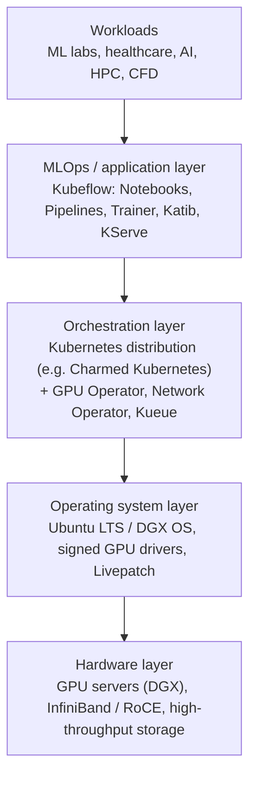
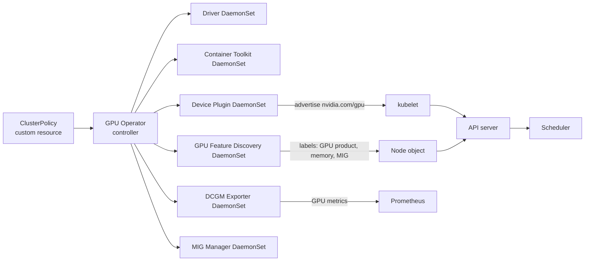
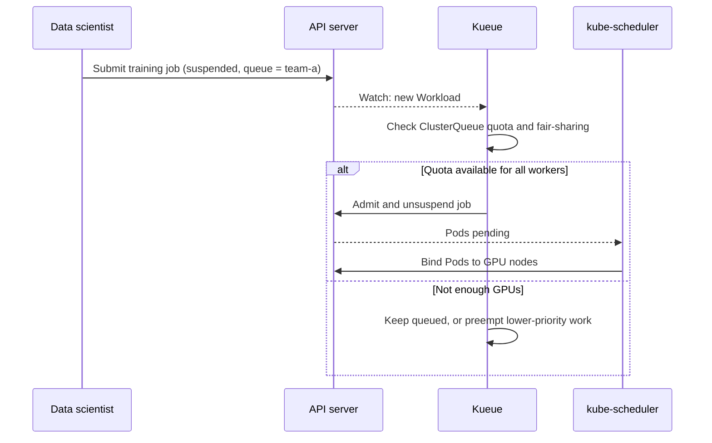
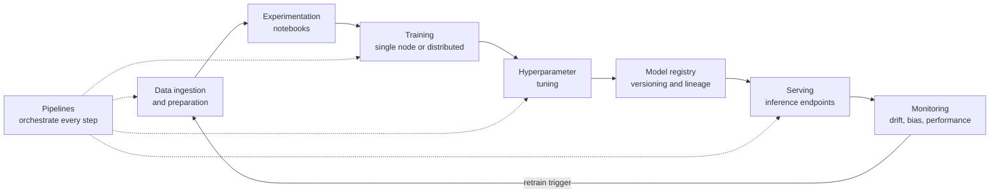
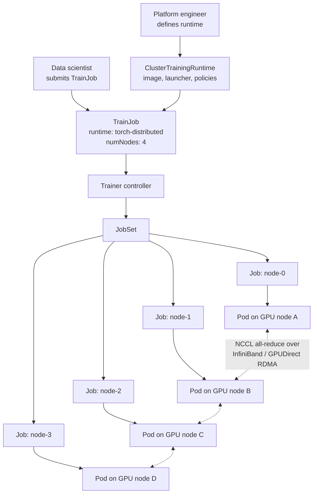
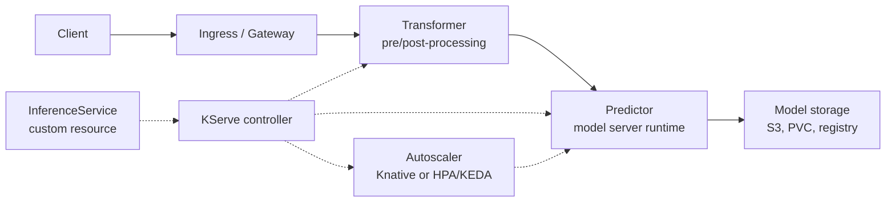
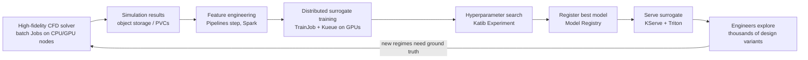
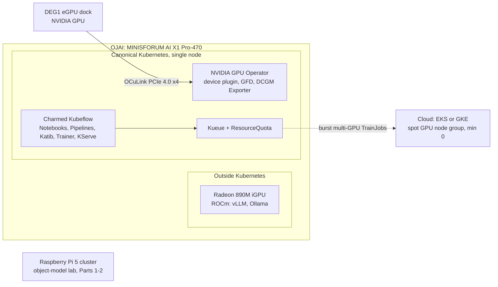

Kubernetes has become the control plane for machine learning: GPUs are scheduled as extended resources, training runs become Jobs, model servers become Deployments, and MLOps platforms such as Kubeflow extend the API with custom resources. Part 3 moves beyond the Raspberry Pi cluster to explain how a production AI/ML stack is layered, from GPU hardware and the operating system through Kubernetes and the GPU Operator, to Kubeflow, Kueue, KServe and NVIDIA Triton. It uses the Canonical and NVIDIA "Run AI at Scale" whitepaper as a guide, updates it to late 2026, and ends with affordable ways to build the same stack in the cloud or on a mini PC with an NVIDIA eGPU.

<!--more-->



------

* TOC
{:toc}
------

## Introduction

Part 1[^1] built a 4-node Raspberry Pi 5 cluster and explored the control plane, container runtimes and Flannel networking. Part 2[^2] worked through the declarative object model: Namespaces, Pods, labels, ReplicaSets, Deployments and the reconciliation loop that keeps the current state aligned with the desired state.

This part is different. Training and serving modern models needs GPU-class accelerators, high-bandwidth networking and large storage, none of which a Pi cluster provides. So instead of hands-on commands, this post is a conceptual tour of **how Kubernetes and its ecosystem run AI/ML workloads at scale**, structured around the Canonical and NVIDIA whitepaper *Run AI at Scale: Build Your Performant ML Stack with NVIDIA DGX and Kubeflow*[^3].

> The whitepaper was published in July 2023. Several products it names have since been renamed, relicensed or superseded. Those changes are called out throughout this post and summarised in [What has changed since 2023](#what-has-changed-since-2023).
{:.note}

The key idea carries over directly from Part 2: every layer of an ML platform is expressed as Kubernetes objects and controllers. A GPU is an extended resource the scheduler counts, a training run is a Job (or a custom `TrainJob`), a model server is a Deployment behind a Service, and a team is a Namespace with a quota.

## Why ML is hard to scale

The whitepaper argues that most AI initiatives that stall do so because of hardware and software limits, not because of the models themselves. It lists nine challenges that grow sharper as an organisation moves from a few experiments to production. Each one maps onto a capability that Kubernetes, or a project built on it, provides.

| Challenge (whitepaper) | What makes it hard | Kubernetes-ecosystem answer |
|---|---|---|
| Deploying to production | Every framework has its own serving story | Standardised serving with KServe `InferenceService` and runtimes such as Triton |
| Data volumes | Petabyte-scale, mixed structured and unstructured data | PersistentVolumes, CSI drivers, object storage, GPUDirect Storage |
| Powerful, reliable computing | ML needs massively parallel compute | GPUs exposed as extended resources via device plugins / DRA |
| Team management | Many people sharing expensive hardware | Namespaces, RBAC, ResourceQuota, Kubeflow Profiles, Kueue |
| Security without downtime | Training can run for weeks; reboots are costly | Livepatch kernel updates, rolling node upgrades, checkpointing |
| Portability | Workstation → data centre → cloud → edge | The same Kubernetes API everywhere; conformant distributions |
| Monitoring | More models in production, more to watch | Prometheus, DCGM exporter for GPU metrics, model monitoring |
| Model tuning and optimisation | Large hyperparameter search spaces | Katib experiments, pipeline-driven experimentation |
| Skills shortage | Too few people who can do ML *and* operations | Opinionated platforms (Kubeflow, managed offerings) that hide plumbing |

> Several of these figures are vendor framing. For example, the "35% enterprise AI adoption in 2022" figure comes from the IBM Global AI Adoption Index 2022[^4], which surveyed companies in general rather than enterprises only.
{:.note}

## The layered AI stack

The whitepaper describes an enterprise AI stack in layers. Each layer has a distinct job, and the value comes from how well they integrate.

The rest of this post walks up the stack from the bottom.

## Hardware infrastructure layer

The whitepaper identifies three hardware requirements for ML: **compute**, **storage** and **networking**.

### Compute

Training is dominated by dense linear algebra, so it parallelises extremely well. GPUs with specialised matrix units (NVIDIA Tensor Cores) outperform general-purpose CPUs by large margins on these workloads.

Demand is growing faster than general-purpose hardware improves. The whitepaper cites Sevilla et al.[^5], who found that the training compute of large-scale models doubled roughly every **9.9 months** between late 2015 and 2022, while Moore's Law implies a doubling about every two years. Their estimate for regular-scale models over the same period was even faster, at around 5.7 months.

If compute per model doubles every $T_d$ months, the growth factor over $t$ months is:

$$
\text{growth}(t) = 2^{\,t / T_d}
$$

Over the seven years from 2015 to 2022, $T_d = 9.9$ gives $2^{84/9.9} \approx 360\times$, while a two-year doubling gives only $2^{84/24} \approx 11\times$. That gap is why purpose-built accelerator infrastructure, rather than general-purpose servers, became the norm.

### NVIDIA DGX systems

NVIDIA DGX systems are integrated GPU servers designed as building blocks for AI clusters. In 2023 the whitepaper referred to the **DGX A100** and **DGX H100**. The current generation is based on **Blackwell** (DGX B200, DGX B300 and rack-scale GB300 NVL72 systems), and NVIDIA announced in January 2026 that its next platform, **Vera Rubin**, was in full production.

> The specific hardware generation matters less than the pattern: multiple GPUs per node, a high-bandwidth GPU-to-GPU fabric inside the node (NVLink), and a high-bandwidth, low-latency network between nodes.
{:.ok}

### Storage

ML datasets often run to petabytes and mix tables, text, images, video and audio. The storage layer must deliver data fast enough to keep GPUs busy, otherwise expensive accelerators sit idle waiting for input. **GPUDirect Storage** creates a direct path between storage and GPU memory, bypassing the CPU bounce buffer.

In Kubernetes terms, storage reaches workloads through PersistentVolumes provisioned by CSI drivers, or through object stores (S3-compatible) that training code reads directly.

### Networking

Distributed training exchanges gradients between GPUs on every step, so the network can easily become the bottleneck. DGX clusters use **InfiniBand** (or RoCE Ethernet) with **GPUDirect RDMA**, which lets a network adapter read and write GPU memory directly. The collective communication library **NCCL** uses these paths for operations such as all-reduce.

On Kubernetes, the NVIDIA **Network Operator** plays the same role for RDMA-capable NICs that the GPU Operator plays for GPUs.

## Operating system layer

The whitepaper stresses that the OS is easy to overlook but is the bridge between hardware and software. It manages hardware resources, hosts the drivers and libraries that frameworks need, and underpins the security of the whole stack.

- **Ubuntu LTS and DGX OS.** NVIDIA's DGX OS is based on Ubuntu, and Canonical certifies Ubuntu on NVIDIA hardware. Long-term-support releases give a predictable patch cadence.
- **Signed drivers.** Packaging GPU drivers as signed kernel modules keeps Secure Boot intact.
- **Livepatch.** Canonical's Livepatch[^6] applies critical kernel security fixes without a reboot. This addresses the whitepaper's "security without downtime" challenge, because a training run that takes weeks should not have to restart for a kernel CVE.

> Livepatch reduces reboots but does not remove them entirely. Training jobs should still **checkpoint** regularly so that a node failure or a planned upgrade only costs the work since the last checkpoint.
{:.note}

## Orchestration layer: Kubernetes for AI

The whitepaper calls the Kubernetes distribution (Charmed Kubernetes in Canonical's stack) the third piece of the puzzle. Kubeflow depends on Kubernetes for resource management, workflow management and horizontal scaling. This is where the object model from Part 2 becomes the foundation of an AI platform.

### How Kubernetes sees a GPU

Out of the box, the kubelet only knows about CPU, memory and ephemeral storage. Accelerators are added through the **device plugin framework**[^7], which Part 1 listed among the cluster add-ons:

1. A device plugin runs on each GPU node, usually as a **DaemonSet**.
2. It registers with the kubelet and advertises an **extended resource**, such as `nvidia.com/gpu`, with a count.
3. The kubelet reports the count in the Node object's capacity and allocatable fields.
4. A Pod requests GPUs in its resource limits. The scheduler only places it on a node with enough free GPUs.
5. When the container starts, the kubelet asks the plugin which devices to attach, and the container runtime injects them.

Extended resources are whole numbers and cannot be overcommitted. A Pod either gets an entire GPU or none at all[^8].

### The NVIDIA GPU Operator

Installing drivers, the container toolkit and the device plugin by hand on every node does not scale. The **NVIDIA GPU Operator**[^9] uses the operator pattern from Part 2 to manage all of it through a single custom resource (`ClusterPolicy`), and it deploys each component as a DaemonSet.

| Component | Purpose |
|---|---|
| Driver | Installs the NVIDIA kernel driver in a container, so nodes need no pre-installed driver |
| Container Toolkit | Lets containerd or CRI-O inject GPU devices and libraries into containers |
| Device Plugin | Advertises `nvidia.com/gpu` to the kubelet |
| GPU Feature Discovery | Labels nodes with GPU model, memory, CUDA version and MIG capability |
| DCGM Exporter | Publishes GPU utilisation, memory, temperature and error metrics for Prometheus |
| MIG Manager | Partitions supported GPUs into Multi-Instance GPU slices |

The labels from GPU Feature Discovery work with the node selectors, affinity rules and taints covered in Part 2. Administrators typically taint GPU nodes so that only workloads that tolerate the taint and request a GPU are scheduled there.

### Sharing GPUs

A whole GPU per Pod is wasteful for notebooks, small models and light inference. There are three common sharing strategies:

| Strategy | Isolation | Typical use |
|---|---|---|
| **Multi-Instance GPU (MIG)** | Hardware partitions with dedicated memory and compute | Multi-tenant inference, notebooks on A100/H100/Blackwell-class GPUs |
| **Time-slicing** | None: processes take turns on the whole GPU | Development and bursty, low-priority work |
| **Multi-Process Service (MPS)** | Partial: shared context with configurable limits | Many small concurrent inference processes |

### Dynamic Resource Allocation (DRA)

The device-plugin model only offers an anonymous count ("give me one GPU"). **Dynamic Resource Allocation** reached general availability in Kubernetes v1.34[^10]. It lets workloads claim devices by their attributes through `ResourceClaim` objects, for example a GPU with at least a certain amount of memory, or a specific MIG profile, and it lets device drivers publish rich descriptions of what they offer. Device plugins remain supported, but DRA is the direction for accelerator scheduling.

### Multi-tenancy and quotas

The whitepaper's "team management" challenge is solved with the same objects introduced in Part 2:

- **Namespaces** give each team or user an isolated scope. Kubeflow maps each user **Profile** to a namespace.
- **RBAC** Roles and RoleBindings control who can create notebooks, jobs and model servers in each namespace.
- **ResourceQuota** caps total consumption per namespace, including accelerators. For extended resources only the `requests.` prefix is allowed, so a quota on `requests.nvidia.com/gpu` limits how many GPUs a team can hold at once[^11].
- **PriorityClass** and preemption let production inference displace low-priority experiments when capacity runs short.

### Batch scheduling with Kueue

The default scheduler places Pods one at a time. That is a poor fit for ML batch work, for two reasons:

- A distributed training job needs **all** of its workers to start together (gang scheduling). Starting half of them wastes GPUs while they wait for the rest.
- Teams want **queues** and fair sharing of a fixed GPU budget, not a first-come, first-served race.

**Kueue**[^12] is a Kubernetes SIG project that adds job-level queueing on top of the standard scheduler. A job is created in a suspended state. Kueue admits it only when its whole quota can be satisfied, then the normal scheduler places the Pods.

| Kueue object | Role |
|---|---|
| `ResourceFlavor` | Describes a class of nodes, such as a GPU model or spot instances |
| `ClusterQueue` | Holds a quota per flavor and defines borrowing and preemption rules |
| `LocalQueue` | A namespace's entry point into a ClusterQueue |
| `Workload` | Kueue's internal representation of a job awaiting admission |

Kueue integrates with plain Jobs, JobSets, Kubeflow training jobs, Ray and other workload types, so it complements an MLOps platform rather than replacing it.

## Application layer: MLOps on Kubernetes

The whitepaper argues that infrastructure only delivers value when the right software runs on top of it. MLOps platforms automate the end-to-end ML lifecycle so that data scientists can focus on data science. Its Figure 1 lists the core capabilities of an effective MLOps platform: infrastructure management, workflow automation, model training and deployment, portability, monitoring, and model lifecycle governance at the centre.

### The ML lifecycle

### Kubeflow

Kubeflow is an open-source, Kubernetes-native ML platform and one of the most widely used MLOps projects. Since release 1.11 (December 2025) the upstream distribution has been branded the **Kubeflow AI Reference Platform**, and the current release is **26.03** (March 2026), which supports Kubernetes 1.34 and later[^13].

Each Kubeflow component is a set of custom resources and controllers, which is the extension mechanism from Part 2 applied to ML:

| Lifecycle stage | Kubeflow component | Key custom resources |
|---|---|---|
| Experimentation | **Notebooks** (Jupyter, VS Code, RStudio servers) | `Notebook` |
| Workflow automation | **Pipelines** (KFP), running on Argo Workflows | Pipeline runs as Argo `Workflow` |
| Training | **Trainer** (v2) | `TrainJob`, `TrainingRuntime`, `ClusterTrainingRuntime` |
| Hyperparameter tuning | **Katib** | `Experiment`, `Suggestion`, `Trial` |
| Model registry | **Model Registry** | Registered models, versions and artifacts |
| Serving | **KServe** | `InferenceService`, `ServingRuntime` |
| Data processing | **Spark Operator** | `SparkApplication` |
| Multi-tenancy | **Profiles** and central dashboard | `Profile` |

### Charmed Kubeflow

Charmed Kubeflow is Canonical's distribution of Kubeflow. It packages each component as a **Juju charm**, an operator that handles installation, configuration, upgrades and integration between components. Canonical's 1.10 and 1.11 releases are currently supported, with a further 1.11 update in the candidate channel[^14].

According to the whitepaper, Charmed Kubeflow is certified under the NVIDIA DGX-Ready Software programme. It can be deployed on any cloud, data centre or workstation, and it integrates with Triton, Argo and an MPI operator for distributed training. Canonical also offers enterprise support and a managed Kubeflow service.

### Pipelines and workflow automation

Kubeflow Pipelines turns an ML workflow into a directed acyclic graph of containerised steps: data validation, feature engineering, training, evaluation, registration and deployment. Each step runs as its own Pod, so steps can use different images and resource requests. For example, a CPU-only preprocessing step can feed a GPU training step.

Pipelines bring:

- **Reproducibility**: every run records its parameters, inputs, outputs and artifacts.
- **Caching**: steps whose inputs have not changed can be skipped on re-runs.
- **Lineage**: you can trace which data and code produced which model.

The whitepaper also mentions Argo directly as a way to manage and scale complex AI/ML workflows. Argo Workflows is the engine underneath Kubeflow Pipelines.

### Distributed training

When a model or dataset outgrows a single GPU, training is spread across many workers:

- **Data parallelism**: each worker holds a full model replica, processes a different slice of each batch, and gradients are averaged with an all-reduce.
- **Model, tensor and pipeline parallelism**: the model itself is split across GPUs when it does not fit in one GPU's memory.
- **Sharded approaches** (for example PyTorch FSDP or DeepSpeed ZeRO) split optimiser state, gradients and parameters across workers.

In 2023 the whitepaper referred to an **MPI operator** for distributed training, and Kubeflow then had separate custom resources per framework (`TFJob`, `PyTorchJob`, `MPIJob` and so on). **Kubeflow Trainer v2**, first released in July 2025, replaces these with a single `TrainJob` API[^15]:

- Platform engineers define reusable **training runtimes** (for example PyTorch, DeepSpeed or MPI-based) that encode images, launchers and scheduling policies.
- Data scientists submit a `TrainJob` that references a runtime and states only what is specific to their run, such as the number of nodes and the training code.
- Under the hood, Trainer creates a **JobSet**[^16], a Kubernetes SIG API that manages a group of Jobs as one unit, which in turn creates the worker Pods.

> Distributed training needs every worker running at the same time. Pair Trainer with **Kueue** for all-or-nothing admission, and taint GPU nodes so that unrelated Pods cannot fragment their capacity.
{:.ok}

### Hyperparameter tuning with Katib

The whitepaper notes that reaching high benchmarks requires extensive hyperparameter tuning. Katib automates this. An `Experiment` defines:

- the **objective** to optimise (for example, validation accuracy)
- the **search space** of hyperparameters
- the **search algorithm**: grid, random, Bayesian optimisation, Hyperband, CMA-ES and others
- **early stopping** rules that kill unpromising trials
- how many trials to run in **parallel**

Katib launches each trial as a separate training job, collects its metrics, and feeds them back into the algorithm to choose the next set of parameters. Because trials are ordinary Kubernetes workloads, they are subject to the same namespaces, quotas and Kueue queues as everything else.

## Model serving and inference

Model serving is the step the whitepaper singles out as most in need of standardisation. Without it, data science teams spend their time hand-building deployment plumbing for every model and framework.

### KServe

**KServe** provides a single custom resource, `InferenceService`, that describes a model endpoint declaratively[^17]. Its controller turns that into the Deployments, Services, routing and autoscaling needed to serve it.

- **Predictor**: the model server itself. A `ServingRuntime` decides which server is used for which model format (scikit-learn, XGBoost, PyTorch, TensorFlow, ONNX, Triton, LLM runtimes such as vLLM).
- **Transformer**: optional pre- and post-processing, such as tokenisation or feature lookup.
- **Deployment modes**: *serverless* mode uses Knative to scale on request load, including **scale-to-zero** for idle models. *Raw deployment* mode uses plain Deployments with the Horizontal Pod Autoscaler.
- **Rollouts**: canary traffic splitting between model versions, using the same rolling-update ideas as Deployments in Part 2.

This is what the whitepaper means by serverless workloads on NVIDIA hardware: compute is allocated per model based on demand, without manual provisioning.

### NVIDIA Triton, now NVIDIA Dynamo-Triton

The whitepaper highlights **NVIDIA Triton Inference Server** as the open-source serving engine in the stack. Since March 2025 Triton has been part of the **NVIDIA Dynamo** platform and is now branded **NVIDIA Dynamo-Triton**, although the repository and container images still use the Triton name[^18].

Triton's main capabilities:

- **Multi-framework backends**: TensorRT, PyTorch, ONNX Runtime, TensorFlow, Python and others behind a single HTTP/gRPC API.
- **Dynamic batching**: individual requests are grouped into batches on the server to raise GPU utilisation.
- **Concurrent model execution**: multiple models, or multiple instances of one model, share a GPU.
- **Model ensembles**: chains of models (for example, preprocessing → model → postprocessing) run as one pipeline inside the server.
- **Metrics**: Prometheus-format metrics for latency, throughput and GPU usage.

On Kubernetes, Triton usually runs as a KServe `ServingRuntime` or as a standalone Deployment scaled by the Horizontal Pod Autoscaler on custom metrics.

### Seldon Core

> The whitepaper lists **Seldon Core** as a model-serving option alongside Triton. Note that since January 2024, new releases of Seldon Core (v1 and v2) are published under the **Business Source License 1.1**, which restricts production use without a commercial licence[^19]. Seldon's MLServer inference server remains Apache 2.0. For a fully open-source, Kubeflow-native stack, KServe is now the usual choice.
{:.note}

## Monitoring and observability

Monitoring for ML has two layers, and both run on Kubernetes:

1. **Infrastructure monitoring.** Prometheus scrapes cluster, node and Pod metrics. The **DCGM Exporter**[^20] adds GPU utilisation, memory, power, temperature and ECC errors. Grafana dashboards and alert rules spot idle GPUs (wasted money) or saturated ones (bottlenecks).
2. **Model monitoring.** Model servers expose request rates, latency and error metrics. Separate tooling watches prediction distributions for **data drift** and **concept drift**, and checks fairness and **bias**. A drift alert can trigger a pipeline that retrains and redeploys the model, closing the lifecycle loop shown earlier.

> The whitepaper's goal of keeping monitoring costs under control at scale depends on automation: alerts and anomaly detection instead of people watching dashboards, and autoscaling that frees GPUs when models are idle.
{:.ok}

## Portability: hybrid, multi-cloud and edge

AI work rarely stays in one place. Data scientists prototype on workstations, train on on-premises GPU clusters or in the cloud, and deploy inference in data centres or at the edge. Because every layer above the operating system is expressed as Kubernetes objects, the same pipeline definitions, `TrainJob`s and `InferenceService`s can move between conformant clusters. Only the infrastructure-specific pieces change: storage classes, GPU node pools and ingress.

The whitepaper notes that Canonical's stack also runs on NVIDIA's edge platform (EGX at the time of writing), so the same tooling can push trained models out to inference sites close to the data.

## Use case: computational fluid dynamics

The whitepaper uses **computational fluid dynamics (CFD)** to show the full stack in action. CFD predicts how liquids and gases flow by numerically solving fluid equations over a mesh of many small 3D cells. It is used in aerospace (aerodynamics and turbulence), automotive (aerodynamics, engine and exhaust flows), pharmaceuticals (process equipment and devices that interact with blood and air), architecture (ventilation, HVAC and wind loads) and environmental science (pollutant dispersion).

Traditional CFD is accurate but slow and expensive. ML **surrogate models**, trained on simulation results, can predict flow fields in a fraction of the time, so engineers can explore many more designs per simulation budget. Training those surrogates is itself demanding: the data volumes are large, and feature engineering needs expertise in both ML and fluid dynamics.

The diagram shows how each stage maps onto the stack described above:

The whitepaper lists other workloads that fit the same stack:

- **Image analysis**: large image datasets and GPU-heavy deep-learning training and inference.
- **Genomics**: a single genome sequence can take up to about 200 GB, demanding high memory and throughput.
- **Smart cities**: many heterogeneous data sources, including cameras, IoT sensors, mobile devices and public records.

## What has changed since 2023

| Whitepaper (July 2023) | Status in November 2026 |
|---|---|
| NVIDIA DGX A100 / H100 | Blackwell-generation DGX B200 / B300 and GB300 NVL72; Vera Rubin announced as in full production in January 2026 |
| NVIDIA Triton Inference Server | Part of the NVIDIA Dynamo platform since March 2025, branded **Dynamo-Triton** |
| Seldon Core as an open-source serving option | Business Source License 1.1 since January 2024; MLServer remains Apache 2.0 |
| Framework-specific training operators (TFJob, PyTorchJob, MPI operator) | **Kubeflow Trainer v2** with a single `TrainJob` API built on JobSet |
| Kubeflow (version not stated) | Branded **Kubeflow AI Reference Platform** since 1.11; current release 26.03 requires Kubernetes 1.34+ |
| GPUs via device plugins only | **Dynamic Resource Allocation** GA since Kubernetes v1.34; device plugins still supported |
| Job queueing not discussed | **Kueue** is the Kubernetes SIG standard for batch admission, quotas and fair sharing |
| Kubernetes releases of 2023 | Supported lines are v1.35–v1.37; v1.37 was released in August 2026[^21] |

## Key takeaways

- An AI platform is a **stack**. Hardware, operating system, Kubernetes and MLOps tooling each solve part of the scaling problem, and none of them is enough alone.
- **Kubernetes is the integration point.** GPUs become extended resources or DRA claims, the GPU Operator manages drivers through DaemonSets, and namespaces and quotas share expensive hardware between teams.
- **Batch ML needs more than the default scheduler.** Kueue adds queueing, quotas and all-or-nothing admission for distributed training.
- **Kubeflow is Kubernetes extended for ML.** Notebooks, Pipelines, Trainer, Katib, Model Registry and KServe are custom resources reconciled by controllers, exactly the pattern from Part 2.
- **Serving is standardised** through KServe's `InferenceService`, with runtimes such as Dynamo-Triton handling batching and multi-framework execution.
- **Vendor documents age quickly.** Check product names, licences and version requirements against current upstream documentation before adopting a design.

## Building an affordable AI/ML lab

A DGX cluster is out of reach for a home lab, and the Raspberry Pi 5 cluster from Parts 1 and 2 cannot run this stack: it has no NVIDIA GPU, Kubeflow's arm64 support is still incomplete, and current Kubeflow releases need Kubernetes 1.34 or later.

This section looks at more practical ways to learn the whitepaper's architecture, first in the cloud and then on my own workstation.

### Options compared

| Option | Fit with the whitepaper's stack | Main catch |
|---|---|---|
| **AWS EKS with spot L4 GPU nodes** | Very close: x86, NVIDIA GPU Operator, Kueue and Kubeflow all run | Spot capacity can be reclaimed |
| **GKE with spot L4 GPU nodes** | Very close; Vertex AI Pipelines can also run Kubeflow Pipelines as a managed service | Spot capacity can be reclaimed; check GPU availability in your region |
| **Specialist GPU clouds** (Jarvislabs, RunPod, Lambda) | Partial: Kubernetes only where you get a full VM | Many offerings are containers, not VMs |
| **x86 PC with an NVIDIA GPU** | Closest you can own: Ubuntu, GPU Operator, Charmed Kubeflow | Single node; power and noise |
| **NVIDIA Jetson Orin Nano Super** | Weak: 8 GB shared memory, arm64, and not supported by the GPU Operator[^22] | Edge inference only |
| **NVIDIA DGX Spark** (GB10 Grace Blackwell) | A small DGX: DGX OS, and two units can be clustered over 200 GbE[^23] | arm64, so Kubeflow image support still has gaps |
| **AMD Ryzen AI Max+ 395** (e.g. Framework Desktop 128 GB) | Not the NVIDIA stack: uses ROCm and the AMD GPU Operator | Different tooling from the whitepaper |

### The cloud path

For occasional GPU work, renting usually beats buying. If $P$ is the purchase cost of a GPU and $r$ the hourly rate for a comparable cloud GPU, the break-even point in GPU-hours is:

$$
h_{\text{break-even}} = \frac{P}{r}
$$

For a lab that uses GPUs only a few hours a month, that point is typically years away.

The shape of a cost-efficient cloud lab follows directly from Part 3:

- A small **CPU node group** that always runs, for the control plane, Kubeflow and other platform services.
- An **L4 GPU node group on spot instances with a minimum size of zero**, so GPU nodes exist only while work is running.
- **Kueue** in front of training Jobs, so queued work triggers the autoscaler and multi-tenancy rules apply as they would on a real platform.
- Upstream Kubeflow manifests or **Charmed Kubeflow on EKS**. The separate "Kubeflow on AWS" distribution has not been actively maintained since late 2023; its last release targeted Kubeflow 1.7[^24].
- A few hours on a specialist cloud for the occasional multi-GPU or H100 distributed-training experiment.

### The on-premises path: my OJAI workstation with an eGPU

My AI workstation, OJAI, is a MINISFORUM AI X1 Pro-470 mini PC:

- an AMD Ryzen AI 9 HX 470 with 12 cores and 128 GB of DDR5
- a Radeon 890M integrated GPU and an XDNA 2 NPU
- Ubuntu 24.04 LTS on the 6.17 OEM kernel, with ROCm 7.2

The 890M already runs vLLM and Ollama for local LLMs, as covered in my ROCm[^25] and Gemma 4[^26] posts.

It also has an OCuLink port, and a MINISFORUM DEG1 eGPU dock connects a full-size graphics card over **PCIe 4.0 x4**[^27]. Adding an NVIDIA card to the dock turns OJAI into a single-node version of the whitepaper's stack. The 890M stays outside Kubernetes as the ROCm machine for LLMs.

**Mapping OJAI onto the whitepaper's layers:**

| Whitepaper layer | DGX reference | OJAI equivalent |
|---|---|---|
| Hardware | DGX: Tensor Core GPUs, InfiniBand | X1 Pro-470 + DEG1 + one NVIDIA GPU |
| Operating system | Ubuntu LTS / DGX OS, signed drivers, Livepatch | Ubuntu 24.04 LTS on the 6.17 OEM kernel, Canonical-signed NVIDIA modules, Livepatch through free personal Ubuntu Pro |
| Kubernetes | Charmed Kubernetes | Canonical Kubernetes, single node |
| GPU enablement | Drivers and device plugin | NVIDIA GPU Operator, using the host-installed driver |
| MLOps | Charmed Kubeflow | Charmed Kubeflow 1.11 |
| Serving | Triton | KServe with Dynamo-Triton or vLLM (CUDA) runtimes |
| Monitoring | — | DCGM Exporter, Prometheus, Grafana |

#### Choosing the NVIDIA card

For ML, VRAM matters more than raw speed.

| Card | VRAM | Notes |
|---|---|---|
| **RTX 5060 Ti 16GB** | 16 GB | A sensible starting point for learning the stack; low power and short enough for the DEG1 |
| RTX 5070 Ti | 16 GB | Faster, but no more VRAM |
| RTX PRO 4000 Blackwell | 24 GB | Low-power single-slot card, but no MIG |
| RTX PRO 4500 Blackwell | 32 GB | The smallest RTX PRO Blackwell card with MIG support, with two instances[^28] |
| RTX 5090 | 32 GB | The DEG1 is rated up to an RTX 4090, so check power and size |

The RTX 5060 Ti 16GB is the sensible starting point. GeForce cards do not support MIG, but GPU time-slicing still lets several notebooks and jobs share one GPU. That is enough to practise the namespace, quota and queueing patterns covered earlier.

#### Things to get right

- **OCuLink is cold-plug.** Power the dock and connect it before booting, and shut down fully before disconnecting.
- **Bandwidth is lower than a desktop slot.** PCIe 4.0 x4 gives about 8 GB/s. Model loading and host-to-GPU transfers are slower, but once data is on the GPU, training and inference speed are mostly unaffected.
- **Keep the display on the iGPU.** The NVIDIA card runs headless as a pure compute device, so the desktop never consumes its VRAM.
- **Keep the OEM kernel.** Canonical publishes signed, prebuilt NVIDIA 580 modules for the 6.17 OEM kernel flavour[^29]. They work with Secure Boot and avoid DKMS rebuilds. Because the host already has a working driver, the GPU Operator is configured not to install its own.
- **ROCm and CUDA coexist.** The `amdgpu` and `nvidia` kernel drivers and their user-space stacks are independent. ROCm-specific environment variables belong in the vLLM and Ollama service definitions, not in Kubernetes workloads.
- **Rebalance unified memory.** With a large BIOS UMA framebuffer for the iGPU, the operating system sees much less of the 128 GB. Charmed Kubeflow needs at least 32 GB of RAM[^30] before any workloads run, while the NVIDIA card has its own VRAM. Two BIOS profiles work well: a **Kubeflow profile** with a small UMA (8–16 GB), which leaves about 110 GB for Kubernetes, and an **LLM profile** with a large UMA for big models on the 890M.
- **The kubelet changes kernel defaults.** Unless `protectKernelDefaults` is enabled, the kubelet sets `vm.overcommit_memory=1` for the whole machine while it runs.

#### Build order

1. Canonical Kubernetes on a single node, at the version the Charmed Kubeflow 1.11 documentation pins (currently 1.32, with Juju 3.6)[^30].
2. The NVIDIA GPU Operator with the host driver. It adds the container toolkit, device plugin, GPU Feature Discovery and DCGM Exporter, with time-slicing so the GPU can be shared.
3. Charmed Kubeflow 1.11, with two Profiles acting as two "teams", each with a GPU quota.
4. Kueue, using a release that supports the installed Kubernetes version, to queue training work against the single GPU.
5. KServe with Triton for ONNX and TensorRT models, and a vLLM runtime for a quantised LLM that fits in 16 GB. Comparing it with vLLM-ROCm on the 890M is a natural experiment.
6. Prometheus and Grafana with GPU metrics, and Livepatch.

#### What a single eGPU cannot reproduce

- **No multi-node distributed training:** a single GPU means no NCCL over InfiniBand and no GPUDirect RDMA.
- **No MIG** on GeForce cards.
- **Size limits:** 16 GB of VRAM and an x4 link limit model size and data rate.

The hybrid approach fills these gaps. OJAI handles day-to-day experimentation, and the same manifests go to a cloud spot GPU node group for the occasional multi-GPU run. The Raspberry Pi cluster stays as the object-model lab from Parts 1 and 2.

[^1]: [Kubernetes on Raspberry Pi 5 : Part1 - Cluster](){:target="_blank" rel="noopener noreferrer"}

[^2]: [Kubernetes on Raspberry Pi 5 : Part 2 - Object Model](){:target="_blank" rel="noopener noreferrer"}

[^3]: Canonical and NVIDIA, *Run AI at Scale: Build Your Performant ML Stack with NVIDIA DGX and Kubeflow*, whitepaper, July 2023. See also [Canonical and NVIDIA](https://ubuntu.com/nvidia){:target="_blank" rel="noopener noreferrer"}

[^4]: [IBM Global AI Adoption Index 2022](https://www.ibm.com/downloads/cas/GVAGA3JP){:target="_blank" rel="noopener noreferrer"}

[^5]: [Sevilla et al., Compute Trends Across Three Eras of Machine Learning, arXiv:2202.05924](https://arxiv.org/abs/2202.05924){:target="_blank" rel="noopener noreferrer"}

[^6]: [Canonical Livepatch Service](https://ubuntu.com/security/livepatch){:target="_blank" rel="noopener noreferrer"}

[^7]: [Device Plugins \| Kubernetes](https://kubernetes.io/docs/concepts/extend-kubernetes/compute-storage-net/device-plugins/){:target="_blank" rel="noopener noreferrer"}

[^8]: [Schedule GPUs \| Kubernetes](https://kubernetes.io/docs/tasks/manage-gpus/scheduling-gpus/){:target="_blank" rel="noopener noreferrer"}

[^9]: [NVIDIA GPU Operator documentation](https://docs.nvidia.com/datacenter/cloud-native/gpu-operator/latest/index.html){:target="_blank" rel="noopener noreferrer"}

[^10]: [Kubernetes v1.34: DRA has graduated to GA](https://kubernetes.io/blog/2025/09/01/kubernetes-v1-34-dra-updates/){:target="_blank" rel="noopener noreferrer"}

[^11]: [Resource Quotas \| Kubernetes](https://kubernetes.io/docs/concepts/policy/resource-quotas/){:target="_blank" rel="noopener noreferrer"}

[^12]: [Kueue](https://kueue.sigs.k8s.io/){:target="_blank" rel="noopener noreferrer"}

[^13]: [Kubeflow manifests releases](https://github.com/kubeflow/manifests/releases){:target="_blank" rel="noopener noreferrer"}

[^14]: [Charmed Kubeflow supported versions](https://documentation.ubuntu.com/charmed-kubeflow/latest/reference/supported-versions/){:target="_blank" rel="noopener noreferrer"}

[^15]: [Migrating to Kubeflow Trainer v2](https://www.kubeflow.org/docs/components/trainer/operator-guides/migration/){:target="_blank" rel="noopener noreferrer"}

[^16]: [JobSet](https://jobset.sigs.k8s.io/){:target="_blank" rel="noopener noreferrer"}

[^17]: [KServe documentation](https://kserve.github.io/website/){:target="_blank" rel="noopener noreferrer"}

[^18]: [Triton Inference Server on GitHub](https://github.com/triton-inference-server/server){:target="_blank" rel="noopener noreferrer"}

[^19]: [KServe issue #3380: Seldon licence change notice](https://github.com/kserve/kserve/issues/3380){:target="_blank" rel="noopener noreferrer"}

[^20]: [NVIDIA DCGM Exporter](https://github.com/NVIDIA/dcgm-exporter){:target="_blank" rel="noopener noreferrer"}

[^21]: [Kubernetes Releases](https://kubernetes.io/releases/){:target="_blank" rel="noopener noreferrer"}

[^22]: [GPU Operator: Jetson support, issue #1453](https://github.com/NVIDIA/gpu-operator/issues/1453){:target="_blank" rel="noopener noreferrer"}

[^23]: [NVIDIA DGX Spark 64GB launches, built to be clustered \| Back2Gaming](https://www.back2gaming.com/news/nvidia-dgx-spark-64gb-launches-at-us4999-built-to-be-clustered/){:target="_blank" rel="noopener noreferrer"}

[^24]: [Kubeflow website PR #3641: Kubeflow on AWS maintenance status](https://github.com/kubeflow/website/pull/3641){:target="_blank" rel="noopener noreferrer"}

[^25]: [ROCm containers on the Radeon 890M](){:target="_blank" rel="noopener noreferrer"}

[^26]: [Gemma 4 26B A4B on the Radeon 890M](){:target="_blank" rel="noopener noreferrer"}

[^27]: [Minisforum AI X1 Pro with Ryzen AI 9 HX 470 review \| Notebookcheck](https://www.notebookcheck.net/Minisforum-AI-X1-Pro-with-Ryzen-AI-9-HX-470-review-Mini-PC-upgrade-for-office-gaming-AI-with-RAM-bottleneck.1240710.0.html){:target="_blank" rel="noopener noreferrer"}

[^28]: [MIG supported GPUs \| NVIDIA](https://docs.nvidia.com/datacenter/tesla/mig-user-guide/latest/supported-gpus.html){:target="_blank" rel="noopener noreferrer"}

[^29]: [linux-modules-nvidia-580-oem-24.04 \| UbuntuUpdates](https://ubuntuupdates.org/package/core/noble/restricted/updates/linux-modules-nvidia-580-oem-24.04){:target="_blank" rel="noopener noreferrer"}

[^30]: [Charmed Kubeflow: Get started](https://documentation.ubuntu.com/charmed-kubeflow/latest/tutorial/get-started/){:target="_blank" rel="noopener noreferrer"}

{:gtxt: .message color="green"}
{:ytxt: .message color="yellow"}
{:rtxt: .message color="red"}