{% include video-summary.html
   id="IzdTUO5ta1o"
   content="<p>This post outline the architecture and implementation of <strong>LangChain&#39;s Deep Agents</strong> framework, explaining how foundation models are combined with an <strong>Agent Harness</strong> to handle complex autonomous workflows. Key concepts explored include <strong>prompt caching</strong> for token optimization, <strong>built-in and custom tools</strong> for executing actions or querying databases like MovieLens, and the integration of <strong>Model Context Protocol (MCP)</strong> servers. Additionally, the text details state management utilizing <strong>threads and checkpointers</strong> to preserve conversation history across sessions, while showcasing <strong>time travel</strong> capabilities for branching or reviewing past states. Finally, the materials emphasize <strong>Human-in-the-Loop (HITL)</strong> safety controls, allowing developers to pause execution before sensitive actions take place and review, edit, approve, or reject pending operations.</p>" %}

---

<!--more-->



* TOC
{:toc}

## AI Agent Harness

In modern AI engineering, turning a raw foundation model into an autonomous work engine requires more than simple prompt engineering. LangChain[^1] introduces the foundational formula for building functional AI agents: 

> Agent = Model + Harness
{:.info-box}

While a base language model provides reasoning and language capabilities, the **Agent Harness** serves as the surrounding runtime infrastructure. It allows the model to 

- perceive context, 
- execute tools, 
- persist state across runs, and 
- operate within defined safety boundaries


### Key Components of an Agent Harness

Without a structured harness, a standalone model risks exceeding its context window when processing large tool outputs, causing it to lose track of multi-step task objectives. A robust agent harness solves this through three core sub-systems:

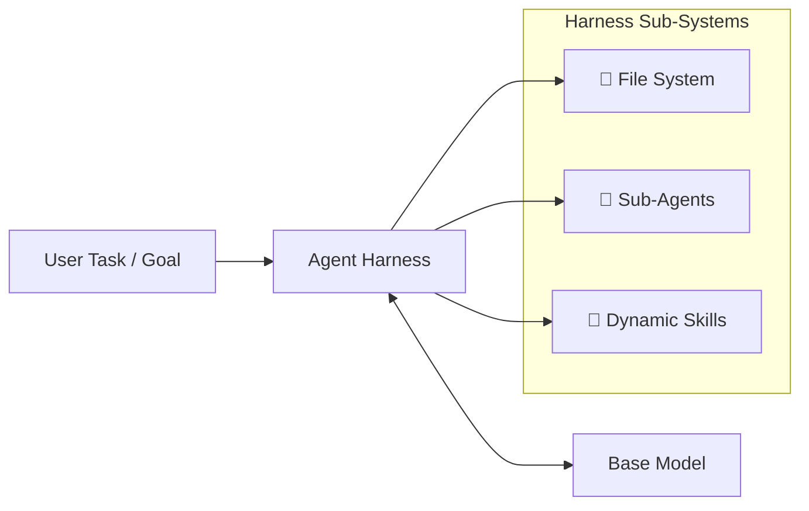

1. File System Integration (*Context Offloading*{:.hl}): To prevent model context saturation, the harness provides a virtual or containerized file system. Intermediate data, code execution outputs, and bulky API responses are written to disk rather than injected directly into the LLM context window.

2. *Sub-Agent*{:.hl} Orchestration: Complex tasks are broken down and delegated to specialized sub-agents. These function as mini-assistants operating with their own isolated context windows and targeted toolsets, allowing parallelized execution without context degradation.

3. On-Demand *Skills*{:.hl} Loading: Instead of inflating system prompts with instructions for every tool simultaneously, the harness loads modular skills dynamically only when required by the model.


### LangChain's Deep Agents Framework

Building an agent harness from scratch for every application creates unnecessary engineering overhead. LangChain's **Deep Agents** framework offers an open-source, opinionated harness pre-configured with memory management, sub-agent delegation, and file system integration.

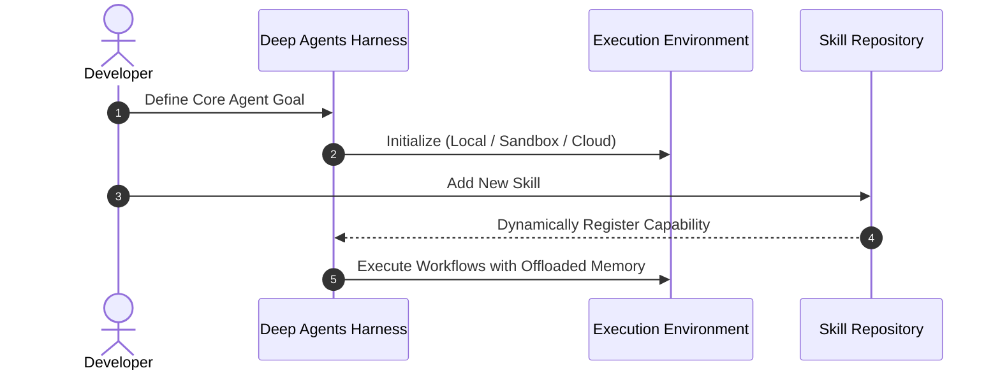

* **Backend Agnosticism:** Deep Agents allows developers to swap execution environments seamlessly—running the underlying file system on a local machine, inside isolated sandboxes, or across cloud infrastructure.
* **Modular Extensibility:** New capabilities are added by attaching skills directly to the harness without modifying the core model pipeline or prompt architecture.

Here currently what I have in my environment:

```
learn-langgraph v0.1.0
├── email-validator v2.3.0
├── instructor v1.17.0
├── ipykernel v7.4.0
├── jupyter v1.1.1
├── langchain v1.4.9
├── langchain-aws v1.9.2
├── langchain-mcp-adapters v0.3.2
├── langchain-openai v1.7.4
├── langgraph v1.2.20
├── langgraph-cli[inmem] v0.4.42
├── pydantic-ai v2.38.0
├── python-dotenv v1.2.4
└── tavily v1.1.0
```
Let`s install:

```bash
uv add deepagents
```


```bash
%%bash
uv tree --depth 1
```

    Resolved 240 packages in 1ms


    learn-langgraph v0.1.0
    ├── deepagents v0.7.34
    ├── email-validator v2.3.0
    ├── instructor v1.17.0
    ├── ipykernel v7.4.0
    ├── jupyter v1.1.1
    ├── langchain v1.4.9
    ├── langchain-aws v1.9.2
    ├── langchain-mcp-adapters v0.3.2
    ├── langchain-openai v1.7.4
    ├── langgraph v1.2.20
    ├── langgraph-cli[inmem] v0.4.42
    ├── pydantic-ai v2.38.0
    ├── python-dotenv v1.2.4
    └── tavily v1.1.0


```python
from deepagents import create_deep_agent
from langchain.chat_models import init_chat_model
from pprint import pprint
```

Create a model for deep agent:


```python
model = init_chat_model("au.anthropic.claude-haiku-4-5-20251001-v1:0",
    model_provider="bedrock_converse",
    region_name="ap-southeast-2"
)
```

Create a deep agent:


```python
agent = create_deep_agent(model=model)
response = agent.invoke(
    {"messages": [
        {"role": "user", "content": "What is the *Progressive disclosure* of LLM Agent?"}
    ]}
)
```

This is the smallest version of the agent:


```python
pprint(response)
```

    {'files': {},
     'messages': [HumanMessage(content='What is the *Progressive disclosure* of LLM Agent?', additional_kwargs={}, response_metadata={}, id='6399faf6-9116-4f1e-88f4-a5fec0ff96fd'),
                  AIMessage(content=[{'type': 'text', 'text': 'I\'ll search for information about "Progressive disclosure" of LLM Agent in the available files.'}, {'type': 'tool_use', 'name': 'grep', 'input': {'pattern': 'Progressive disclosure'}, 'id': 'tooluse_kyPOilVbgrdCTZEqBJ470b'}, {'type': 'tool_use', 'name': 'grep', 'input': {'pattern': 'LLM Agent'}, 'id': 'tooluse_Y9mB9g5B8jBIv2doJ7osYH'}], additional_kwargs={}, response_metadata={'ResponseMetadata': {'RequestId': 'ba1a3465-f8a3-4eb8-8f74-4630a9de32cb', 'HTTPStatusCode': 200, 'HTTPHeaders': {'date': 'Mon, 09 Nov 2026 12:44:12 GMT', 'content-type': 'application/json', 'content-length': '673', 'connection': 'keep-alive', 'x-amzn-requestid': 'ba1a3465-f8a3-4eb8-8f74-4630a9de32cb'}, 'RetryAttempts': 0}, 'stopReason': 'tool_use', 'metrics': {'latencyMs': [804]}, 'model_provider': 'bedrock_converse', 'model_name': 'au.anthropic.claude-haiku-4-5-20251001-v1:0'}, id='lc_run--01a1c056-6cd7-74d8-a96f-0c5f1f6e21d8-0', tool_calls=[{'name': 'grep', 'args': {'pattern': 'Progressive disclosure'}, 'id': 'tooluse_kyPOilVbgrdCTZEqBJ470b', 'type': 'tool_call'}, {'name': 'grep', 'args': {'pattern': 'LLM Agent'}, 'id': 'tooluse_Y9mB9g5B8jBIv2doJ7osYH', 'type': 'tool_call'}], invalid_tool_calls=[], usage_metadata={'input_tokens': 3211, 'output_tokens': 110, 'total_tokens': 3321, 'input_token_details': {'cache_creation': 0, 'cache_read': 0}}),
                  ToolMessage(content='No matches found', name='grep', id='b38b6e76-ac48-4e9d-977a-f55a7eb9267e', tool_call_id='tooluse_kyPOilVbgrdCTZEqBJ470b'),
                  ToolMessage(content='No matches found', name='grep', id='ab8d8117-7688-4d9b-be12-bcb9d8e1f571', tool_call_id='tooluse_Y9mB9g5B8jBIv2doJ7osYH'),
                  AIMessage(content=[{'type': 'text', 'text': 'Let me explore the directory structure to see what files are available:'}, {'type': 'tool_use', 'name': 'ls', 'input': {'path': '/'}, 'id': 'tooluse_RkHtdyUWY3HjNjCXB7lPfE'}], additional_kwargs={}, response_metadata={'ResponseMetadata': {'RequestId': '9a5d87e2-2a8c-4664-a3fc-307e02dffd9b', 'HTTPStatusCode': 200, 'HTTPHeaders': {'date': 'Mon, 09 Nov 2026 12:44:13 GMT', 'content-type': 'application/json', 'content-length': '497', 'connection': 'keep-alive', 'x-amzn-requestid': '9a5d87e2-2a8c-4664-a3fc-307e02dffd9b'}, 'RetryAttempts': 0}, 'stopReason': 'tool_use', 'metrics': {'latencyMs': [648]}, 'model_provider': 'bedrock_converse', 'model_name': 'au.anthropic.claude-haiku-4-5-20251001-v1:0'}, id='lc_run--01a1c056-701a-717c-b725-4d2eaf28fbb1-0', tool_calls=[{'name': 'ls', 'args': {'path': '/'}, 'id': 'tooluse_RkHtdyUWY3HjNjCXB7lPfE', 'type': 'tool_call'}], invalid_tool_calls=[], usage_metadata={'input_tokens': 3386, 'output_tokens': 65, 'total_tokens': 3451, 'input_token_details': {'cache_creation': 0, 'cache_read': 0}}),
                  ToolMessage(content='No files found', name='ls', id='2f369aaf-2c56-485a-a6e2-252ad9558885', tool_call_id='tooluse_RkHtdyUWY3HjNjCXB7lPfE'),
                  AIMessage(content=[{'type': 'text', 'text': 'Let me try searching with a broader approach:'}, {'type': 'tool_use', 'name': 'glob', 'input': {'pattern': '*'}, 'id': 'tooluse_mYEE1KFOhAoD9SnancMTpH'}], additional_kwargs={}, response_metadata={'ResponseMetadata': {'RequestId': '6b7d5932-dc28-41d0-9fa8-dda4094613d1', 'HTTPStatusCode': 200, 'HTTPHeaders': {'date': 'Mon, 09 Nov 2026 12:44:14 GMT', 'content-type': 'application/json', 'content-length': '476', 'connection': 'keep-alive', 'x-amzn-requestid': '6b7d5932-dc28-41d0-9fa8-dda4094613d1'}, 'RetryAttempts': 0}, 'stopReason': 'tool_use', 'metrics': {'latencyMs': [826]}, 'model_provider': 'bedrock_converse', 'model_name': 'au.anthropic.claude-haiku-4-5-20251001-v1:0'}, id='lc_run--01a1c056-72c3-770d-a8ff-67d4ac8a0252-0', tool_calls=[{'name': 'glob', 'args': {'pattern': '*'}, 'id': 'tooluse_mYEE1KFOhAoD9SnancMTpH', 'type': 'tool_call'}], invalid_tool_calls=[], usage_metadata={'input_tokens': 3466, 'output_tokens': 61, 'total_tokens': 3527, 'input_token_details': {'cache_creation': 0, 'cache_read': 0}}),
                  ToolMessage(content='No files found', name='glob', id='8995cbff-7578-40d0-87c8-1f6a0b928613', tool_call_id='tooluse_mYEE1KFOhAoD9SnancMTpH'),
                  AIMessage(content="I apologize, but it appears there are no files currently available in the system to search. Based on my knowledge, I can provide you with an explanation of **Progressive Disclosure** in the context of LLM Agents:\n\n## Progressive Disclosure for LLM Agents\n\n**Progressive Disclosure** is a design principle and technique where information, capabilities, or functionality is revealed to users incrementally based on their needs and interactions, rather than all at once. In the context of LLM Agents, this means:\n\n### Key Aspects:\n\n1. **Incremental Information Reveal**: Complex capabilities and available tools/functions are introduced gradually as the user needs them, reducing cognitive overload.\n\n2. **Adaptive Complexity**: \n   - Simple tasks are handled with basic capabilities initially\n   - More advanced features are revealed as the agent learns the user's sophistication level\n   - Expert users can access deeper functionality while novices work with simplified interfaces\n\n3. **Layered Abstraction**:\n   - Surface-level responses for common queries\n   - Detailed explanations, code examples, or technical details available on request\n   - Tool capabilities revealed progressively based on task requirements\n\n4. **Context-Aware**: The agent adapts what information and options it presents based on:\n   - User expertise level\n   - Previous interaction history\n   - Task complexity\n   - Current context\n\n5. **Benefits**:\n   - Reduces information overload\n   - Improves user experience\n   - Allows for both simplicity and power\n   - Enables scalable interaction patterns\n\nIf you have specific documents or files about this topic, please upload them or let me know the file paths, and I can provide more detailed information from those sources.", additional_kwargs={}, response_metadata={'ResponseMetadata': {'RequestId': 'a8603a7c-4ab2-4aab-a65c-78b1d992b980', 'HTTPStatusCode': 200, 'HTTPHeaders': {'date': 'Mon, 09 Nov 2026 12:44:17 GMT', 'content-type': 'application/json', 'content-length': '2097', 'connection': 'keep-alive', 'x-amzn-requestid': 'a8603a7c-4ab2-4aab-a65c-78b1d992b980'}, 'RetryAttempts': 0}, 'stopReason': 'end_turn', 'metrics': {'latencyMs': [2825]}, 'model_provider': 'bedrock_converse', 'model_name': 'au.anthropic.claude-haiku-4-5-20251001-v1:0'}, id='lc_run--01a1c056-7617-7201-9f4e-1e1a4f9ad26e-0', tool_calls=[], invalid_tool_calls=[], usage_metadata={'input_tokens': 3542, 'output_tokens': 377, 'total_tokens': 3919, 'input_token_details': {'cache_creation': 0, 'cache_read': 0}})]}


    Based on my search, I don't have access to files containing information about "Progressive Disclosure" of LLM Agents in the current filesystem.
    
    However, I can provide you with a general explanation of **Progressive Disclosure** as it relates to LLM (Large Language Model) Agents:
    
    ## Progressive Disclosure in LLM Agents
    
    **Progressive Disclosure** is a user interface and interaction design principle that can be applied to LLM Agent systems. Here's what it means in this context:
    
    ### Key Concept:
    Progressive disclosure refers to revealing information, options, or capabilities **gradually and in stages**, rather than overwhelming the user with everything at once. In the context of LLM Agents:
    
    1. **Initial Simple Interface**: Start with basic, essential functions and queries that the agent can handle.
    
    2. **Gradual Complexity**: As users interact with the agent, more advanced features, parameters, and options become available or discoverable.
    
    3. **Contextual Information**: Additional tools, configurations, or reasoning steps are revealed based on:
       - User expertise level
       - Task complexity
       - Interaction history
       - User preferences
    
    4. **Benefits**:
       - Reduces cognitive load for new users
       - Prevents information overload
       - Improves user experience
       - Allows advanced users to access sophisticated features when needed
       - Makes the agent feel more intuitive and responsive
    
    ### Example:
    An LLM Agent might start by simply answering questions, then progressively allow users to specify search depth, reasoning strategy, tool access levels, or output formats as they become more familiar with the system.
    
    If you have specific files or documentation about LLM Agents that you'd like me to examine, please let me know the file path or content, and I'll be happy to help!


__System prompt__:
The model by defining custom instructions, personas, and operational constraints, re-sending them ahead of the conversation on every turn. Passed through the `system_prompt` parameter, it serves as the primary mechanism for scoping an agent to a specific domain so it can redirect or refuse off-topic requests. Since `deepagents 0.7` does not feature a large built-in base prompt, omitting the `system_prompt` argument leaves the model without any task-specific instructions or behavioral boundaries. Additionally, because the system prompt remains constant across multi-turn interactions, it is the primary candidate for prompt caching, allowing providers to reuse KV-cache data and cut token costs by 49% to 80% on long-running tasks.

__prompt caching__:
Prompt caching allows LLM providers to store and reuse preprocessed Key-Value (KV) cache data from static prompt components—such as system prompts, tool definitions, and skills—across multi-turn interactions rather than reprocessing identical tokens on every request. Because AI agent loops rely on system prompts and tool schemas that remain constant between turns, prompt caching dramatically reduces token costs, yielding overall savings of 49% to 80% on long-running tasks.

* *Core Functionality*{:gtxt}: Avoids reprocessing static instructions by reusing cached prompt prefixes across conversation turns.
* *Caching Mechanisms*{:gtxt}: Implemented either via explicit cache breakpoints (supported by Anthropic and Gemini) or provider-side implicit prefix matching (supported by OpenAI and Gemini).
* *Horizon Advantage*{:gtxt}: Cost efficiency scales with conversation length, delivering the highest savings on extended, multi-turn agent trajectories.

## Tools

**Tools** are functions you give an agent so it can *act*: look things up, run queries, call APIs, or write files. You define what a tool does. **The agent** decides *when* to call it and *what arguments* to pass.


### Built-in tools (always present)

Every deep agent comes with a built-in set of tools that the SDK loads automatically:

| Tool(s) | Purpose |
|---|---|
| `ls`, `read_file`, `write_file`, `edit_file`, `delete` | Read, write and delete files in the agent's working directory |
| `glob`, `grep` | Search files by name pattern or by content |
| `execute` | Run shell commands (needs a **sandbox backend**) |
| `task` | Hand work to a **sub-agent** that has its own separate context |
| `write_todos` | *Opt-in.* Turn it on by adding `TodoListMiddleware` to the agent's middleware (covered in Module 4) |

> ⚠️ **`delete` is recursive and can't be undone.** Deleting a directory removes everything in it. Keep the working directory narrow.
{:.warn}

### built-ins

The tools you pass are **merged** with the built-in set. Nothing is replaced.

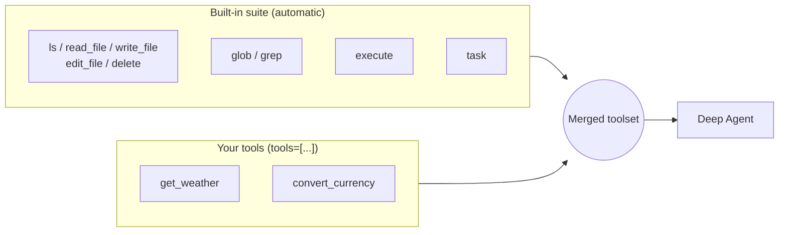

> 🆕 **`read_file` line markers:** instead of numbering every line, `read_file` now wraps the lines it returns in `@@ lines start-end @@` markers. LangChain's evals show this cuts `edit_file` errors by about 15% and input tokens by about 10%.
{:.note}


```python
from deepagents import create_deep_agent
from langchain_core.tools import tool

@tool
def get_weather(city: str) -> str:
    """Return the current weather for a given city name."""
    fake_data = {
        "sydney": "22°C, partly cloudy",
        "tokyo": "15°C, light rain",
        "london": "9°C, overcast",
    }
    return fake_data.get(city.lower(), f"No weather data for {city}")

agent = create_deep_agent(model=model, tools=[get_weather])

result = agent.invoke(
    {"messages": [{"role": "user", "content": "What's the weather in Sydney?"}]}
)

for msg in result["messages"]:
    for call in getattr(msg, "tool_calls", None) or []:
        print(f"Model asked for: {call['name']}({call['args']})")
    if msg.type == "tool":
        print(f"Tool returned: {msg.content}")
print(f"Final answer: {result['messages'][-1].text}")
```

    Model asked for: get_weather({'city': 'Sydney'})
    Tool returned: 22°C, partly cloudy
    Final answer: The weather in Sydney is **22°C and partly cloudy**. It's a pleasant day!


### How a tool call works

**The LLM never runs a tool itself.** It returns an `AIMessage` that contains a `tool_calls` list. The agent's built-in **Tools** runner then calls your Python function and sends the result back as a `ToolMessage`. The trace below is a real run on **Claude Haiku 4.5 via Amazon Bedrock (Converse)**.

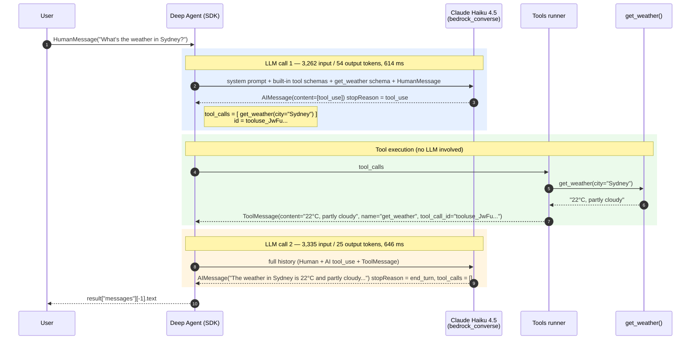

> Each tool request in the AIMessage has an id. Tools wraps the result in a ToolMessage with the matching `tool_call_id`, which links the result back to the original request.
{:.ok}


```python
pprint(result)
```

    {'files': {},
     'messages': [HumanMessage(content="What's the weather in Sydney?", additional_kwargs={}, response_metadata={}, id='65db76cc-ab6f-4915-a11c-6dcf14c5ee6b'),
                  AIMessage(content=[{'type': 'tool_use', 'name': 'get_weather', 'input': {'city': 'Sydney'}, 'id': 'tooluse_90xYe2VpG6GjsHUzuvIbID'}], additional_kwargs={}, response_metadata={'ResponseMetadata': {'RequestId': '84882aa8-8735-493c-ba95-eaf3bf8a5676', 'HTTPStatusCode': 200, 'HTTPHeaders': {'date': 'Mon, 09 Nov 2026 23:06:55 GMT', 'content-type': 'application/json', 'content-length': '428', 'connection': 'keep-alive', 'x-amzn-requestid': '84882aa8-8735-493c-ba95-eaf3bf8a5676'}, 'RetryAttempts': 0}, 'stopReason': 'tool_use', 'metrics': {'latencyMs': [683]}, 'model_provider': 'bedrock_converse', 'model_name': 'au.anthropic.claude-haiku-4-5-20251001-v1:0'}, id='lc_run--01a1c290-8a0d-776d-ad80-ffb3d3ed18c0-0', tool_calls=[{'name': 'get_weather', 'args': {'city': 'Sydney'}, 'id': 'tooluse_90xYe2VpG6GjsHUzuvIbID', 'type': 'tool_call'}], invalid_tool_calls=[], usage_metadata={'input_tokens': 3262, 'output_tokens': 54, 'total_tokens': 3316, 'input_token_details': {'cache_creation': 0, 'cache_read': 0}}),
                  ToolMessage(content='22°C, partly cloudy', name='get_weather', id='cb9de960-6c3e-45db-806d-07426a29490d', tool_call_id='tooluse_90xYe2VpG6GjsHUzuvIbID'),
                  AIMessage(content="The weather in Sydney is **22°C and partly cloudy**. It's a pleasant day!", additional_kwargs={}, response_metadata={'ResponseMetadata': {'RequestId': 'c92c26b4-6ebf-4095-82cd-c564a7302aba', 'HTTPStatusCode': 200, 'HTTPHeaders': {'date': 'Mon, 09 Nov 2026 23:06:56 GMT', 'content-type': 'application/json', 'content-length': '390', 'connection': 'keep-alive', 'x-amzn-requestid': 'c92c26b4-6ebf-4095-82cd-c564a7302aba'}, 'RetryAttempts': 0}, 'stopReason': 'end_turn', 'metrics': {'latencyMs': [734]}, 'model_provider': 'bedrock_converse', 'model_name': 'au.anthropic.claude-haiku-4-5-20251001-v1:0'}, id='lc_run--01a1c290-8ce5-7486-85e6-93387be9afa2-0', tool_calls=[], invalid_tool_calls=[], usage_metadata={'input_tokens': 3335, 'output_tokens': 24, 'total_tokens': 3359, 'input_token_details': {'cache_creation': 0, 'cache_read': 0}})]}


### Defining a tool with `@tool`

Use the `@tool` decorator from `langchain_core.tools` to turn a regular function into a tool. LangChain also ships ready-made tools, such as `TavilySearchResults` for web search.

<svg xmlns="http://www.w3.org/2000/svg" width="680" height="260" viewBox="0 0 680 260" font-family="Helvetica, Arial, sans-serif">
  <rect x="10" y="10" width="330" height="240" rx="10" fill="#f5f7fb" stroke="#4a6fa5" stroke-width="2"/>
  <text x="25" y="40" font-size="15" font-weight="bold" fill="#4a6fa5">Your Python function</text>
  <text x="25" y="75" font-size="13" fill="#7a3e9d" font-family="monospace">@tool</text>
  <text x="25" y="100" font-size="13" fill="#222" font-family="monospace">def get_weather(city: str) -&gt; str:</text>
  <text x="40" y="125" font-size="13" fill="#2e7d32" font-family="monospace">"""Return current weather</text>
  <text x="40" y="145" font-size="13" fill="#2e7d32" font-family="monospace">   for a city name."""</text>
  <text x="40" y="170" font-size="13" fill="#222" font-family="monospace">...</text>
  <rect x="380" y="10" width="290" height="240" rx="10" fill="#fff8e7" stroke="#d08c00" stroke-width="2"/>
  <text x="395" y="40" font-size="15" font-weight="bold" fill="#d08c00">What the LLM sees</text>
  <rect x="395" y="60" width="260" height="45" rx="6" fill="#ffffff" stroke="#d08c00"/>
  <text x="405" y="80" font-size="12" font-weight="bold">name</text>
  <text x="405" y="97" font-size="12" font-family="monospace">get_weather</text>
  <rect x="395" y="115" width="260" height="55" rx="6" fill="#ffffff" stroke="#d08c00" stroke-width="2.5"/>
  <text x="405" y="135" font-size="12" font-weight="bold">description ★ most important</text>
  <text x="405" y="155" font-size="12">"Return current weather for a city name."</text>
  <rect x="395" y="180" width="260" height="55" rx="6" fill="#ffffff" stroke="#d08c00"/>
  <text x="405" y="200" font-size="12" font-weight="bold">args schema</text>
  <text x="405" y="220" font-size="12" font-family="monospace">{ city: string }</text>
  <line x1="340" y1="130" x2="378" y2="130" stroke="#555" stroke-width="2" marker-end="url(#a)"/>
  <defs><marker id="a" markerWidth="10" markerHeight="10" refX="8" refY="3" orient="auto"><path d="M0,0 L0,6 L9,3 z" fill="#555"/></marker></defs>
</svg>

**Key rules**

1. **The docstring is the main natural-language signal.** Write one clear, specific sentence. The model reads it together with the name and argument schema to choose between tools.
2. **Type hints become the argument schema.** The model uses them to fill in arguments.
3. **Return a string** (or anything JSON-serializable). It goes back to the model as the tool result.

### Parallel tool calls

`tool_calls` is a **list** because the model can ask for several tools in one turn. When the calls don't depend on each other, the Tools runner can run them **at the same time**.

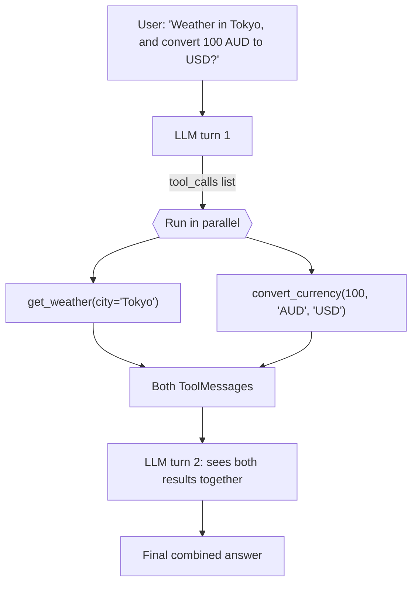

<svg xmlns="http://www.w3.org/2000/svg" width="620" height="150" viewBox="0 0 620 150" font-family="Helvetica, Arial, sans-serif">
  <text x="10" y="20" font-size="14" font-weight="bold">Sequential</text>
  <rect x="120" y="8" width="180" height="22" fill="#90caf9"/><text x="130" y="24" font-size="12">get_weather</text>
  <rect x="300" y="8" width="180" height="22" fill="#a5d6a7"/><text x="310" y="24" font-size="12">convert_currency</text>
  <text x="10" y="70" font-size="14" font-weight="bold">Parallel</text>
  <rect x="120" y="55" width="180" height="22" fill="#90caf9"/><text x="130" y="71" font-size="12">get_weather</text>
  <rect x="120" y="80" width="180" height="22" fill="#a5d6a7"/><text x="130" y="96" font-size="12">convert_currency</text>
  <line x1="120" y1="125" x2="490" y2="125" stroke="#555" stroke-width="1.5"/>
  <text x="440" y="143" font-size="12" fill="#555">time →</text>
  <text x="310" y="85" font-size="12" fill="#2e7d32">← saves a whole call's wait</text>
</svg>

### Action tools need safety controls

Tools can **retrieve** information or **take actions**: write to a database, send a message, create a ticket, delete a file.

```python
@tool
def send_email(to: str, subject: str, body: str) -> str:
    """Send an email to a recipient. Use only when the user explicitly asks to send."""
    ...  # side effect: can't be undone
```

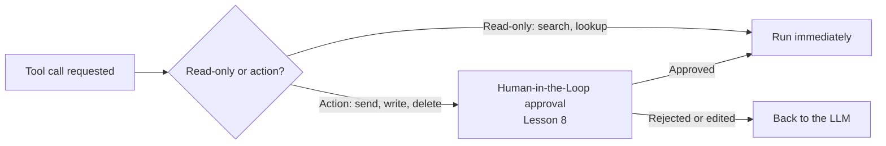

### SQL Agent (Tool Example)
Create Duckdb database using MovieLens[^2] dataset.


```bash
%%bash
duckdb ../data/movielens/movielens.duckdb <<'SQL'
CREATE OR REPLACE TABLE movies AS
  SELECT movieId, title, genres,
         TRY_CAST(regexp_extract(title, '\((\d{4})\)\s*$', 1) AS INTEGER) AS year
  FROM read_csv('../data/movielens/ml-latest-small/movies.csv');

CREATE OR REPLACE TABLE ratings AS
  SELECT userId, movieId, rating, to_timestamp("timestamp") AS rated_at
  FROM read_csv('../data/movielens/ml-latest-small/ratings.csv');

CREATE OR REPLACE TABLE tags AS
  SELECT userId, movieId, tag, to_timestamp("timestamp") AS tagged_at
  FROM read_csv('../data/movielens/ml-latest-small/tags.csv');

-- keep imdbId as text so leading zeros survive (tt0114709)
CREATE OR REPLACE TABLE links AS
  SELECT * FROM read_csv('../data/movielens/ml-latest-small/links.csv',
                         types = {'imdbId': 'VARCHAR', 'tmdbId': 'BIGINT'});

-- split "Adventure|Comedy" into one row per genre (a Chinook-style bridge table)
CREATE OR REPLACE TABLE movie_genres AS
  SELECT movieId, unnest(string_split(genres, '|')) AS genre FROM movies;

SHOW TABLES;
SELECT count(*) AS n_ratings FROM ratings;
SQL
```

    ┌──────────────┐
    │     name     │
    │   varchar    │
    ├──────────────┤
    │ links        │
    │ movie_genres │
    │ movies       │
    │ ratings      │
    │ tags         │
    └──────────────┘
    ┌───────────┐
    │ n_ratings │
    │   int64   │
    ├───────────┤
    │    100836 │
    └───────────┘


Install duckdb before use:


```bash
%%bash
uv add duckdb
```

    Resolved 241 packages in 797ms
    Downloading duckdb (23.2MiB)
     Downloaded duckdb
    Prepared 1 package in 647ms
    Installed 1 package in 2ms
     + duckdb==2.0.0


Now verify MovieLen access:


```python
import duckdb
con = duckdb.connect("../data/movielens/movielens.duckdb", read_only=True)

con.sql("SHOW TABLES")
```


<table class="dataframe"><thead><tr><th>name<br><small>VARCHAR</small></th></tr></thead><tbody><tr><td>links</td></tr><tr><td>movie_genres</td></tr><tr><td>movies</td></tr><tr><td>ratings</td></tr><tr><td>tags</td></tr></tbody></table>


```python
SYSTEM_PROMPT = """You are a SQL analyst with access to the MovieLens database.

Rules:
- Use read_sql for SELECT queries.
- Do not modify the database.
- If a tool returns an error, revise the SQL and try again.
- Show your SQL in your final answer.
"""

@tool
def read_sql(query: str) -> str:
    """Run a read-only SELECT query against the Movielens database."""
    try:
        return str(con.sql(query))
    except Exception as e:
        return f"Error: {e}"

```


```python
agent = create_deep_agent(
    model=model,
    name = "SQLAgent",
    tools=[read_sql],
    system_prompt=SYSTEM_PROMPT
)
```


```python
result = agent.invoke(
    {"messages": [{"role": "user", "content": "Which five genres have the most movies?"}]}
)
```


```python
print(result["messages"][-1].text)
```

    **The five genres with the most movies are:**
    
    1. **Drama** - 4,361 movies
    2. **Comedy** - 3,756 movies
    3. **Thriller** - 1,894 movies
    4. **Action** - 1,828 movies
    5. **Romance** - 1,596 movies
    
    **SQL Query:**
    ```sql
    SELECT 
        genre,
        COUNT(*) as movie_count
    FROM movie_genres
    GROUP BY genre
    ORDER BY movie_count DESC
    LIMIT 5
    ```


The sequence diagram below is drawn from a LangSmith trace of a single **SQLAgent** run, answering the question "Which five genres have the most movies?" LangSmith shows the run as a waterfall of nested spans: a `model` step wrapped by a stack of middleware and ending in a `ChatBedrockConverse` call, followed by a `tools` step that runs `read_sql` against the MovieLens database. The diagram turns that nested, time-based view into a story of who talks to whom. The user, the agent, the middleware chain, the Bedrock model and the database each get their own lifeline, and each model or tool span becomes a request and response between them. Reading it top to bottom, you can see what the waterfall makes hard to spot: the agent guessed a table that didn't exist, spent three calls finding the real schema, and then ran the correct query. The whole run took 5.61 seconds and used about 25K tokens. The table that follows walks through each step, matching the arrow numbers in the diagram to the spans in the trace.

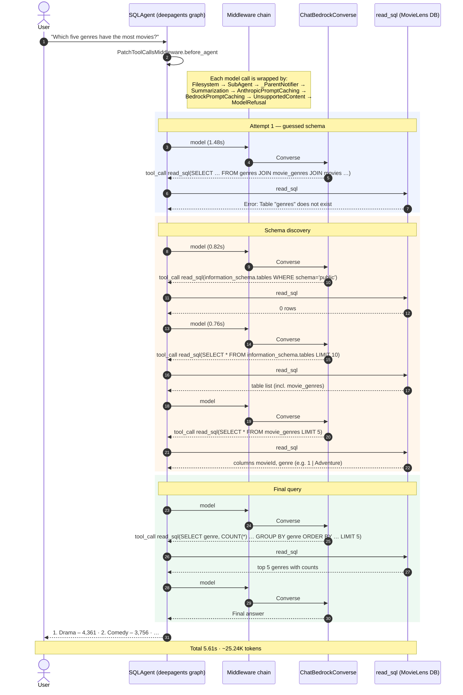

Here's the diagram step by step (numbers match the arrows):

| Steps | From → To | What happens | Result |
|---|---|---|---|
| 1 | User → SQLAgent | Asks "Which five genres have the most movies?" | Agent run starts |
| 2 | SQLAgent (self) | `PatchToolCallsMiddleware.before_agent` cleans up any unfinished tool calls in the message history | Ready to call the model |
| — | Note | Every model call goes through 8 middleware wrappers: Filesystem, SubAgent, _ParentNotifier, Summarization, AnthropicPromptCaching, BedrockPromptCaching, UnsupportedContent, ModelRefusal | Shown once to keep the diagram readable |
| **3–7** | **Attempt 1: guessed schema** | | |
| 3–5 | SQLAgent → Middleware → Bedrock | First model call (1.48s) | LLM writes a query that joins `genres`, `movie_genres` and `movies` |
| 6–7 | SQLAgent → read_sql | Runs that query | ❌ Error: table `genres` doesn't exist |
| **8–22** | **Schema discovery** | | |
| 8–12 | SQLAgent → Bedrock → read_sql | Model call 2 (0.82s): list tables in schema `public` | 0 rows (filter on the wrong schema) |
| 13–17 | SQLAgent → Bedrock → read_sql | Model call 3 (0.76s): `SELECT * FROM information_schema.tables LIMIT 10` | Table list, which includes `movie_genres` |
| 18–22 | SQLAgent → Bedrock → read_sql | Model call 4: `SELECT * FROM movie_genres LIMIT 5` | Finds columns `movieId` and `genre`, so the genre name is stored in this table directly |
| **23–30** | **Final query** | | |
| 23–27 | SQLAgent → Bedrock → read_sql | Model call 5: `SELECT genre, COUNT(*) … GROUP BY genre ORDER BY … LIMIT 5` | ✅ Top 5 genres with counts |
| 28–30 | SQLAgent → Bedrock | Model call 6: turns the result into a readable answer | Final answer text |
| 31 | SQLAgent → User | Returns the answer | Drama 4,361 · Comedy 3,756 · … |
| — | Note | Whole run | 5.61s, about 25.24K tokens |

**What this shows:** the agent didn't look up the schema first. It guessed table names, and that cost 4 extra model and tool calls before the correct query ran. If you give it the schema in the system prompt, or have it list tables first, it should need only 2 model calls.


```python
# %%sql
# SELECT 
#     genre,
#     COUNT(*) as movie_count
# FROM movie_genres
# GROUP BY genre
# ORDER BY movie_count DESC
# LIMIT 5;
```

## MCP

**MCP lets your agent's tools live in a separate program (an MCP server).** The agent loads them over a connection, and once loaded they are **ordinary LangChain tools**. The agent can't tell them apart from tools written with `@tool`.

| Tools | MCP |
|---|---|
| Tool is a function inside the agent's code | Tool lives in a separate server process |
| Used by one agent | Reusable by **any** MCP client (other agents, IDEs, Claude, etc.) |
| Synchronous is fine | **Async** (`async`/`await`), because it talks to another program |

### Architecture

<svg xmlns="http://www.w3.org/2000/svg" viewBox="0 0 760 300" width="100%" font-family="sans-serif" font-size="13">
  <defs>
    <marker id="a" viewBox="0 0 10 10" refX="9" refY="5" markerWidth="7" markerHeight="7" orient="auto"><path d="M0,0 L10,5 L0,10 z" fill="#555"/></marker>
  </defs>
  <rect x="10" y="20" width="230" height="260" rx="10" fill="#eef4ff" stroke="#4a7bd0"/>
  <text x="125" y="44" text-anchor="middle" font-weight="bold">Your agent process</text>
  <rect x="30" y="60" width="190" height="50" rx="6" fill="#fff" stroke="#4a7bd0"/>
  <text x="125" y="82" text-anchor="middle">create_deep_agent()</text>
  <text x="125" y="99" text-anchor="middle" font-size="11" fill="#555">model + tools list</text>
  <rect x="30" y="140" width="190" height="60" rx="6" fill="#fff" stroke="#4a7bd0"/>
  <text x="125" y="163" text-anchor="middle">MultiServerMCPClient</text>
  <text x="125" y="181" text-anchor="middle" font-size="11" fill="#555">langchain-mcp-adapters</text>
  <text x="125" y="194" text-anchor="middle" font-size="11" fill="#555">MCP tool → BaseTool</text>
  <line x1="125" y1="140" x2="125" y2="112" stroke="#555" marker-end="url(#a)"/>
  <text x="132" y="130" font-size="11" fill="#555">get_tools()</text>
  <rect x="30" y="220" width="190" height="45" rx="6" fill="#fff" stroke="#4a7bd0"/>
  <text x="125" y="247" text-anchor="middle">local @tool functions</text>
  <line x1="220" y1="242" x2="232" y2="242" stroke="#555"/>
  <line x1="232" y1="242" x2="232" y2="85" stroke="#555"/>
  <line x1="232" y1="85" x2="222" y2="85" stroke="#555" marker-end="url(#a)"/>

  <rect x="480" y="30" width="260" height="70" rx="8" fill="#eafaf0" stroke="#2e9e5b"/>
  <text x="610" y="55" text-anchor="middle" font-weight="bold">Local server (subprocess)</text>
  <text x="610" y="75" text-anchor="middle" font-size="12">dice / notes / calculator</text>
  <text x="610" y="91" text-anchor="middle" font-size="11" fill="#555">transport: "stdio"</text>

  <rect x="480" y="120" width="260" height="70" rx="8" fill="#fff6e6" stroke="#d08a1a"/>
  <text x="610" y="145" text-anchor="middle" font-weight="bold">Remote server</text>
  <text x="610" y="165" text-anchor="middle" font-size="12">docs.langchain.com/mcp</text>
  <text x="610" y="181" text-anchor="middle" font-size="11" fill="#555">transport: "http"</text>

  <rect x="480" y="210" width="260" height="70" rx="8" fill="#fdeeee" stroke="#c94a4a"/>
  <text x="610" y="235" text-anchor="middle" font-weight="bold">Remote server + auth</text>
  <text x="610" y="255" text-anchor="middle" font-size="12">GitHub MCP</text>
  <text x="610" y="271" text-anchor="middle" font-size="11" fill="#555">"http" + auth provider (OAuth)</text>

  <line x1="220" y1="160" x2="478" y2="65" stroke="#2e9e5b" marker-end="url(#a)"/>
  <line x1="220" y1="170" x2="478" y2="155" stroke="#d08a1a" marker-end="url(#a)"/>
  <line x1="220" y1="180" x2="478" y2="245" stroke="#c94a4a" marker-end="url(#a)"/>
  <text x="300" y="110" font-size="11" fill="#2e9e5b">JSON over stdin/stdout</text>
  <text x="330" y="155" font-size="11" fill="#d08a1a">HTTPS</text>
  <text x="300" y="235" font-size="11" fill="#c94a4a">HTTPS + token</text>
</svg>

### Local MCP Server (Example)

Here the local MCP server. Run this server `uv run python mcp/tip/tip_server.py` in bash prompt:


```python
from mcp.server.fastmcp import FastMCP

mcp = FastMCP("tips", log_level="WARNING")

@mcp.tool()
def calc_tip(amount: float, pct: float = 15) -> float:
    """Return the tip for a bill amount at the given percentage."""
    return round(amount * pct / 100, 2)

@mcp.tool()
def split_bill(total: float, people: int) -> float:
    """Split a total evenly between people."""
    return round(total / people, 2)

if __name__ == "__main__":
    mcp.run()   # waits for a client on stdio
```


Here the agent example to access the MCP server:


```python
import asyncio, sys
from pathlib import Path
from deepagents import create_deep_agent
from langchain.chat_models import init_chat_model
from langchain_mcp_adapters.client import MultiServerMCPClient


model = init_chat_model("au.anthropic.claude-haiku-4-5-20251001-v1:0",
    model_provider="bedrock_converse",
    region_name="ap-southeast-2"
)

SERVER = Path(__file__).parent / "tip_server.py"

async def main():
    client = MultiServerMCPClient({
        "tips": {
            "transport": "stdio",
            "command": sys.executable,   # the client launches the server itself
            "args": [str(SERVER)],
        }
    })
    tools = await client.get_tools()
    print([t.name for t in tools])       # ['calc_tip', 'split_bill']

    agent = create_deep_agent(model=model, tools=tools)
    result = await agent.ainvoke({"messages": [
        {"role": "user", "content": "Bill is $64 for 4 people with a 18% tip. How much each?"}
    ]})
    print(result["messages"][-1].text)

asyncio.run(main())
```


```bash
%%bash
uv run python ../mcp/tip/agent.py
```

    ['calc_tip', 'split_bill']
    Here's the breakdown:
    
    - **Tip (18%):** $11.52
    - **Total bill + tip:** $64 + $11.52 = $75.52
    - **Per person:** $75.52 ÷ 4 = **$18.88 each**


How a tool call flows:

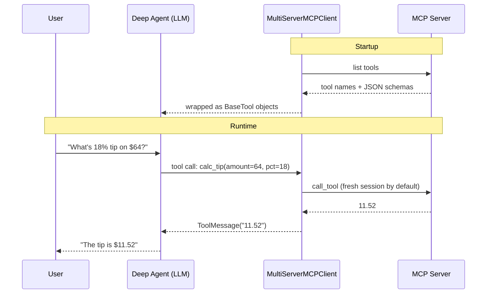

The result is added to the message history as a normal `ToolMessage`, and the model decides what to do next, exactly as with a local tool.

> **Security:** with `stdio`, the client **runs whatever command you give it**. Only point it at servers you trust.

### Remote MCP (Example)
Here the way to access remote AWS documentation:


```python
import json
from langchain_mcp_adapters.client import MultiServerMCPClient

client = MultiServerMCPClient({
    "aws-knowledge": {
        "transport": "streamable_http",
        "url": "https://knowledge-mcp.global.api.aws",
    }
})

tools = await client.get_tools()

for t in tools:
    print(t.name, "\n", json.dumps(t.args, indent=2), "\n")
```

    aws___read_documentation 
     {
      "requests": {
        "type": "array",
        "items": {
          "type": "object",
          "properties": {
            "url": {
              "type": "string",
              "description": "Doc URL with allow-listed prefix; use exact URL from search."
            },
            "max_length": {
              "type": "integer",
              "description": "Chars returned (default 10000)."
            },
            "start_index": {
              "type": "integer",
              "description": "Char offset (default 0). Use prior `end_index` to continue, or TOC offset to jump."
            }
          },
          "required": [
            "url"
          ]
        },
        "description": "List of `{url, max_length?, start_index?}`. Batch 2-5."
      }
    } 
    
    aws___search_documentation 
     {
      "limit": {
        "type": "integer",
        "description": "Maximum number of results to return (default 4)."
      },
      "search_phrase": {
        "type": "string",
        "description": "Keywords; preserve exact error strings and all task terms verbatim."
      },
      "topics": {
        "type": "array",
        "items": {
          "type": "string",
          "description": "topic name"
        },
        "description": "Up to 3 from: reference_documentation, current_awareness, troubleshooting, amplify_docs, cdk_docs, cdk_constructs, cloudformation, agent_skills, strands_docs, general. Default [\"general\"]."
      }
    } 
    
    aws___list_regions 
     {} 
    
    aws___get_regional_availability 
     {
      "regions": {
        "type": "array",
        "items": {
          "type": "string"
        },
        "description": "AWS region codes (max 10). Multi-region requires `filters`; single-region supports `next_token`."
      },
      "resource_type": {
        "type": "string",
        "description": "Required: 'product' | 'api' | 'cfn'."
      },
      "filters": {
        "type": "array",
        "items": {
          "type": "string"
        },
        "description": "Use exact AWS product or sub-feature name.\n\n- product: 'Amazon Bedrock' (service), or sub-features like 'Comprehend Auto Scaling', 'Latency-Based Routing', 'PrivateLink Support'. When the user names a specific sub-feature, filter on the sub-feature -- do NOT generalize to the parent service ('Amazon Comprehend'); that returns availability for the wrong scope.\n- api: 'SdkServiceId+Operation' (e.g. 'CloudFormation+CreateStack', 'IAM+GetSSHPublicKey') or 'SdkServiceId' (e.g. 'EC2'). Use a literal '+' between service and operation -- not space, colon, or hyphen.\n- cfn: 'AWS::EC2::Instance', 'AWS::Lambda::Function'.\n\nInclude every region the user named; don't add filters they didn't request.\n\nValues must EXACTLY match AWS's catalog (e.g. 'AWS Lambda', not 'Lambda' or 'AWS Lambda Service'). If unsure of the exact name, first call once for one region with NO filters to list valid names, then filter on the exact match."
      },
      "next_token": {
        "type": "string",
        "description": "Pagination token. Single-region, no filters only."
      },
      "region": {
        "type": "string",
        "description": "Unused; use `regions`."
      }
    } 
    
    aws___retrieve_skill 
     {
      "file": {
        "type": "string",
        "description": "Optional file path within the skill, copied as cited (e.g. `references/architecture.md`). Don't add or strip a `references/` prefix. Omit for SKILL.md."
      },
      "skill_name": {
        "type": "string",
        "description": "Required. Exact `skill_name` from a search_documentation result, copied verbatim. Do not invent or modify."
      }
    } 
    


Let agent to answer the question:


```python
agent = create_deep_agent(
    model=model, 
    tools=tools,
    system_prompt="Answer AWS questions using the documentation tools. "
                  "Cite the documentation URLs you used.",
)

response = await agent.ainvoke({
    "messages": [{
        "role": "user",
        "content": "How do I configure an S3 lifecycle rule to move objects "
                   "to Glacier after 30 days? Show the JSON."
    }]
})

print(response["messages"][-1].content)
```

    Perfect! I have the JSON structure. Let me create a comprehensive response with the JSON example for moving objects to Glacier after 30 days.
    
    Based on the AWS documentation, here's how to configure an S3 lifecycle rule to move objects to Glacier after 30 days:
    
    ## JSON Configuration
    
    ```json
    {
      "Rules": [
        {
          "ID": "MoveToGlacierAfter30Days",
          "Filter": {
            "Prefix": ""
          },
          "Status": "Enabled",
          "Transitions": [
            {
              "Days": 30,
              "StorageClass": "GLACIER"
            }
          ]
        }
      ]
    }
    ```
    
    ## Using with boto3 (Python)
    
    ```python
    import boto3
    
    s3 = boto3.client('s3')
    
    lifecycle_config = {
        'Rules': [
            {
                'ID': 'MoveToGlacierAfter30Days',
                'Filter': {
                    'Prefix': ''  # Apply to all objects
                },
                'Status': 'Enabled',
                'Transitions': [
                    {
                        'Days': 30,
                        'StorageClass': 'GLACIER'
                    }
                ]
            }
        ]
    }
    
    s3.put_bucket_lifecycle_configuration(
        Bucket='your-bucket-name',
        LifecycleConfiguration=lifecycle_config
    )
    ```
    
    ## Key Configuration Details
    
    - **Days**: 30 — Objects transition after 30 days of creation
    - **StorageClass**: `GLACIER` — Transitions to S3 Glacier Flexible Retrieval (also accepts `GLACIER_IR` for Instant Retrieval, `DEEP_ARCHIVE`, etc.)
    - **Filter.Prefix**: Empty string `""` means the rule applies to all objects in the bucket
    - **Status**: Must be `"Enabled"` for the rule to take effect
    
    ## Optional Enhancements
    
    If you want to apply the rule only to objects with a specific prefix:
    
    ```json
    "Filter": {
      "Prefix": "logs/"
    }
    ```
    
    Or if you want multiple transitions (tiering):
    
    ```json
    "Transitions": [
      {
        "Days": 30,
        "StorageClass": "STANDARD_IA"  // Move to infrequent access first
      },
      {
        "Days": 90,
        "StorageClass": "GLACIER"  // Then to Glacier
      }
    ]
    ```
    
    **Reference**: [AWS S3 put_bucket_lifecycle_configuration documentation](https://docs.aws.amazon.com/boto3/latest/reference/services/s3/client/put_bucket_lifecycle_configuration.html)


### Authorization

Some servers (e.g. GitHub) need sign-in. Add an **auth provider** next to the transport and URL; it gets and attaches credentials.

```python
client = MultiServerMCPClient({
    "github": {
        "transport": "streamable_http",
        "url": MCP_URL,
        "auth": auth_provider,          # TypeScript: authProvider
    }
})
tools = await client.get_tools()        # still loaded the same way
```

Don't put tokens in the URL as query parameters. The lesson's optional OAuth lab walks through the full GitHub flow.

## Messages, Threads and Checkpointers
How a deep agent remembers things across separate `invoke()` calls. It takes three pieces working together: 
- **messages** are the content, 
- a **thread** is the address, and 
- the **checkpointer** is the storage

### Messages
An agent takes a list of messages and gives back a longer one. It keeps a growing history instead of a single prompt.

| Message type | Comes from | Contains |
|---|---|---|
| User message | The human | Input text |
| `AIMessage` | The model | Text and/or `tool_calls` |
| `ToolMessage` | A tool that ran | The tool's result |

The final answer is `result["messages"][-1].text`.

## Threads and Checkpointers

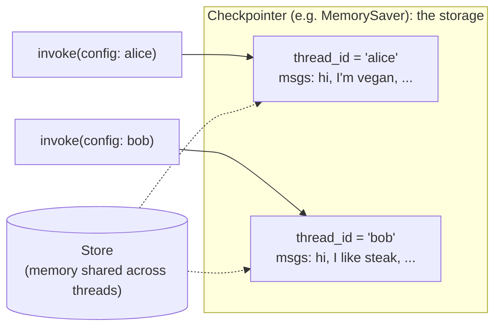

The lesson compares this to a detective's conspiracy board:

| Concept | Analogy | Role |
|---|---|---|
| Checkpointer | The whole board | Stores the state of every thread |
| Thread | One red string | One conversation |
| State | Notes pinned along the string | Messages plus agent state |
| `thread_id` | The string's label | Tells the board which string to load or save |

**A different example (a recipe assistant):**


```python
from langgraph.checkpoint.memory import MemorySaver
agent = create_deep_agent(model=model, checkpointer=MemorySaver())

alice = {"configurable": {"thread_id": "alice"}}
bob   = {"configurable": {"thread_id": "bob"}}

agent.invoke({"messages": [{"role": "user", "content": "I'm vegan."}]}, config=alice)
agent.invoke({"messages": [{"role": "user", "content": "Suggest dinner."}]}, config=alice)  # vegan dish ✅
agent.invoke({"messages": [{"role": "user", "content": "Suggest dinner."}]}, config=bob)    # no dietary info ❌
```


    {'messages': [HumanMessage(content='Suggest dinner.', additional_kwargs={}, response_metadata={}, id='f49d1287-d2ea-4848-b4ff-035777fb3e11'),
      AIMessage(content="I'd be happy to help suggest dinner! To give you the best recommendations, it would help to know a bit more:\n\n1. **What type of cuisine** do you're in the mood for? (e.g., Italian, Asian, Mexican, Mediterranean, etc.)\n2. **Any dietary restrictions or preferences?** (vegetarian, vegan, gluten-free, etc.)\n3. **How much time** do you have to prepare? (quick weeknight meal, leisurely dinner, etc.)\n4. **What ingredients** do you have on hand or prefer?\n5. **Are you cooking at home or looking for restaurant suggestions?**\n\nIn the meantime, here are some quick dinner ideas:\n\n- **Pasta with garlic and oil (Aglio e olio)** - simple, elegant, 15 minutes\n- **Stir-fry** - quick, customizable with whatever veggies/protein you have\n- **Tacos** - fun and flexible\n- **Sheet pan salmon with roasted vegetables** - healthy and minimal cleanup\n- **Chicken curry with rice** - flavorful and satisfying\n- **Grilled cheese and tomato soup** - comfort food classic\n\nLet me know more about your preferences and I can give you more tailored suggestions!", additional_kwargs={}, response_metadata={'ResponseMetadata': {'RequestId': 'edcd1596-ff32-4da5-b237-0fb4b52ff059', 'HTTPStatusCode': 200, 'HTTPHeaders': {'date': 'Tue, 10 Nov 2026 07:43:09 GMT', 'content-type': 'application/json', 'content-length': '1374', 'connection': 'keep-alive', 'x-amzn-requestid': 'edcd1596-ff32-4da5-b237-0fb4b52ff059'}, 'RetryAttempts': 0}, 'stopReason': 'end_turn', 'metrics': {'latencyMs': [2038]}, 'model_provider': 'bedrock_converse', 'model_name': 'au.anthropic.claude-haiku-4-5-20251001-v1:0'}, id='lc_run--01a1c469-2632-70ca-88aa-a01b82cb88ef-0', tool_calls=[], invalid_tool_calls=[], usage_metadata={'input_tokens': 3202, 'output_tokens': 284, 'total_tokens': 3486, 'input_token_details': {'cache_creation': 0, 'cache_read': 0}})],
     'files': {}}


**What happens in each setup** (this matches the quiz answers):

| Setup | Second call sees |
|---|---|
| Same `thread_id` with a checkpointer | Both turns |
| Same `thread_id` without a checkpointer | Only its own message (the id stores nothing by itself) |
| New `thread_id`, same checkpointer | Only the new message |
| New agent with a new `MemorySaver`, old `thread_id` | Nothing (memory lives in the saver instance, not in the id) |

**Checkpointer options:**

| Checkpointer | Use for | Survives a restart? |
|---|---|---|
| `MemorySaver` / `InMemorySaver` | Demos and local development | No |
| `PostgresSaver`, Redis-based savers | Production | Yes |
| LangGraph Platform | Managed persistence | Yes |

Switching between them only changes the object you pass to `checkpointer=`.

## Time travel

Every checkpoint is kept, not just the latest one, so you can resume from any earlier step:

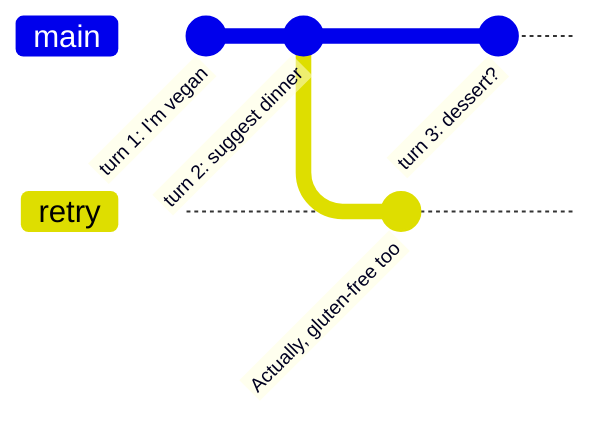


```python
history = list(agent.get_state_history(alice))
for i, h in enumerate(reversed(history)):
    if len(h.values['messages']) > 0:
        print(
            f'--- {i = } -----------------------',
            f'{h.values['messages'][-1].content}',
            f'----------------------------------',
            sep="\n"
            )
```

    --- i = 1 -----------------------
    I'm vegan.
    ----------------------------------
    --- i = 2 -----------------------
    I'm vegan.
    ----------------------------------
    --- i = 3 -----------------------
    That's great! Is there something specific I can help you with related to being vegan? For example, I could:
    
    - Help you find vegan recipes or meal ideas
    - Look up information about vegan nutrition
    - Find vegan restaurants or products
    - Help you understand vegan lifestyle topics
    - Search for vegan-related content in files or documents
    - Or something else entirely?
    
    Just let me know what you'd like assistance with!
    ----------------------------------
    --- i = 4 -----------------------
    That's great! Is there something specific I can help you with related to being vegan? For example, I could:
    
    - Help you find vegan recipes or meal ideas
    - Look up information about vegan nutrition
    - Find vegan restaurants or products
    - Help you understand vegan lifestyle topics
    - Search for vegan-related content in files or documents
    - Or something else entirely?
    
    Just let me know what you'd like assistance with!
    ----------------------------------
    --- i = 5 -----------------------
    That's great! Is there something specific I can help you with related to being vegan? For example, I could:
    
    - Help you find vegan recipes or meal ideas
    - Look up information about vegan nutrition
    - Find vegan restaurants or products
    - Help you understand vegan lifestyle topics
    - Search for vegan-related content in files or documents
    - Or something else entirely?
    
    Just let me know what you'd like assistance with!
    ----------------------------------
    --- i = 6 -----------------------
    Suggest dinner.
    ----------------------------------
    --- i = 7 -----------------------
    Suggest dinner.
    ----------------------------------
    --- i = 8 -----------------------
    Here are some great vegan dinner ideas:
    
    **Quick & Easy:**
    - **Pasta Aglio e Olio** - Spaghetti with garlic, olive oil, red pepper flakes, and fresh parsley
    - **Stir-fry** - Tofu or chickpeas with broccoli, bell peppers, and snap peas in a soy-ginger sauce over rice
    - **Tacos** - Seasoned black beans or lentils in tortillas with salsa, guacamole, and vegetables
    
    **Heartier Options:**
    - **Lentil curry** - Red lentils with coconut milk, tomatoes, and spices served with rice or naan
    - **Buddha bowl** - Roasted vegetables, quinoa, hummus, and tahini dressing
    - **Chili** - Bean and veggie chili with cornbread
    - **Veggie burger** - Homemade or store-bought with all your favorite toppings
    
    **Comfort Food:**
    - **Risotto** - Mushroom or vegetable risotto with nutritional yeast for that cheesy flavor
    - **Pizza** - Dairy-free cheese or just loaded with vegetables and fresh herbs
    - **Mac and cheese** - Made with cashew cream or store-bought vegan cheese sauce
    
    **Lighter Option:**
    - **Buddha salad** - Mixed greens, roasted chickpeas, avocado, sweet potato, and tahini dressing
    
    What sounds good to you? Do you have any dietary preferences, ingredients on hand, or time constraints I should know about?
    ----------------------------------
    --- i = 9 -----------------------
    Here are some great vegan dinner ideas:
    
    **Quick & Easy:**
    - **Pasta Aglio e Olio** - Spaghetti with garlic, olive oil, red pepper flakes, and fresh parsley
    - **Stir-fry** - Tofu or chickpeas with broccoli, bell peppers, and snap peas in a soy-ginger sauce over rice
    - **Tacos** - Seasoned black beans or lentils in tortillas with salsa, guacamole, and vegetables
    
    **Heartier Options:**
    - **Lentil curry** - Red lentils with coconut milk, tomatoes, and spices served with rice or naan
    - **Buddha bowl** - Roasted vegetables, quinoa, hummus, and tahini dressing
    - **Chili** - Bean and veggie chili with cornbread
    - **Veggie burger** - Homemade or store-bought with all your favorite toppings
    
    **Comfort Food:**
    - **Risotto** - Mushroom or vegetable risotto with nutritional yeast for that cheesy flavor
    - **Pizza** - Dairy-free cheese or just loaded with vegetables and fresh herbs
    - **Mac and cheese** - Made with cashew cream or store-bought vegan cheese sauce
    
    **Lighter Option:**
    - **Buddha salad** - Mixed greens, roasted chickpeas, avocado, sweet potato, and tahini dressing
    
    What sounds good to you? Do you have any dietary preferences, ingredients on hand, or time constraints I should know about?
    ----------------------------------
    --- i = 10 -----------------------
    Here are some great vegan dinner ideas:
    
    **Quick & Easy:**
    - **Pasta Aglio e Olio** - Spaghetti with garlic, olive oil, red pepper flakes, and fresh parsley
    - **Stir-fry** - Tofu or chickpeas with broccoli, bell peppers, and snap peas in a soy-ginger sauce over rice
    - **Tacos** - Seasoned black beans or lentils in tortillas with salsa, guacamole, and vegetables
    
    **Heartier Options:**
    - **Lentil curry** - Red lentils with coconut milk, tomatoes, and spices served with rice or naan
    - **Buddha bowl** - Roasted vegetables, quinoa, hummus, and tahini dressing
    - **Chili** - Bean and veggie chili with cornbread
    - **Veggie burger** - Homemade or store-bought with all your favorite toppings
    
    **Comfort Food:**
    - **Risotto** - Mushroom or vegetable risotto with nutritional yeast for that cheesy flavor
    - **Pizza** - Dairy-free cheese or just loaded with vegetables and fresh herbs
    - **Mac and cheese** - Made with cashew cream or store-bought vegan cheese sauce
    
    **Lighter Option:**
    - **Buddha salad** - Mixed greens, roasted chickpeas, avocado, sweet potato, and tahini dressing
    
    What sounds good to you? Do you have any dietary preferences, ingredients on hand, or time constraints I should know about?
    ----------------------------------
    --- i = 11 -----------------------
    Actually, gluten-free too.
    ----------------------------------
    --- i = 12 -----------------------
    Actually, gluten-free too.
    ----------------------------------
    --- i = 13 -----------------------
    Perfect! Here are some great vegan and gluten-free dinner ideas:
    
    **Quick & Easy:**
    - **Stir-fry** - Tofu or chickpeas with broccoli, bell peppers, and snap peas in a soy-ginger sauce over rice
    - **Tacos** - Seasoned black beans or lentils in corn tortillas with salsa, guacamole, and vegetables
    - **Rice bowls** - Cilantro lime rice with roasted vegetables, beans, and avocado
    
    **Heartier Options:**
    - **Lentil curry** - Red lentils with coconut milk, tomatoes, and spices served with rice
    - **Buddha bowl** - Roasted vegetables, quinoa, hummus, and tahini dressing
    - **Chili** - Bean and veggie chili (serve with cornbread made from gluten-free flour, or just enjoy without bread)
    - **Veggie burger** - Gluten-free bun or lettuce wrap with all your favorite toppings
    
    **Comfort Food:**
    - **Risotto** - Mushroom or vegetable risotto with nutritional yeast
    - **Pizza** - Gluten-free crust (store-bought or homemade) with dairy-free cheese or loaded with vegetables
    - **Polenta** - Creamy polenta with sautéed mushrooms and vegetables
    
    **Lighter Option:**
    - **Buddha salad** - Mixed greens, roasted chickpeas, avocado, sweet potato, and tahini dressing
    
    Most of these are naturally gluten-free or easily adaptable. Do any of these appeal to you, or would you like a specific recipe for something?
    ----------------------------------
    --- i = 14 -----------------------
    Perfect! Here are some great vegan and gluten-free dinner ideas:
    
    **Quick & Easy:**
    - **Stir-fry** - Tofu or chickpeas with broccoli, bell peppers, and snap peas in a soy-ginger sauce over rice
    - **Tacos** - Seasoned black beans or lentils in corn tortillas with salsa, guacamole, and vegetables
    - **Rice bowls** - Cilantro lime rice with roasted vegetables, beans, and avocado
    
    **Heartier Options:**
    - **Lentil curry** - Red lentils with coconut milk, tomatoes, and spices served with rice
    - **Buddha bowl** - Roasted vegetables, quinoa, hummus, and tahini dressing
    - **Chili** - Bean and veggie chili (serve with cornbread made from gluten-free flour, or just enjoy without bread)
    - **Veggie burger** - Gluten-free bun or lettuce wrap with all your favorite toppings
    
    **Comfort Food:**
    - **Risotto** - Mushroom or vegetable risotto with nutritional yeast
    - **Pizza** - Gluten-free crust (store-bought or homemade) with dairy-free cheese or loaded with vegetables
    - **Polenta** - Creamy polenta with sautéed mushrooms and vegetables
    
    **Lighter Option:**
    - **Buddha salad** - Mixed greens, roasted chickpeas, avocado, sweet potato, and tahini dressing
    
    Most of these are naturally gluten-free or easily adaptable. Do any of these appeal to you, or would you like a specific recipe for something?
    ----------------------------------


```python
print(history[1].values['messages'][-1].content)
```

    Here are some great vegan dinner ideas:
    
    **Quick & Easy:**
    - **Pasta Aglio e Olio** - Spaghetti with garlic, olive oil, red pepper flakes, and fresh parsley
    - **Stir-fry** - Tofu or chickpeas with broccoli, bell peppers, and snap peas in a soy-ginger sauce over rice
    - **Tacos** - Seasoned black beans or lentils in tortillas with salsa, guacamole, and vegetables
    
    **Heartier Options:**
    - **Lentil curry** - Red lentils with coconut milk, tomatoes, and spices served with rice or naan
    - **Buddha bowl** - Roasted vegetables, quinoa, hummus, and tahini dressing
    - **Chili** - Bean and veggie chili with cornbread
    - **Veggie burger** - Homemade or store-bought with all your favorite toppings
    
    **Comfort Food:**
    - **Risotto** - Mushroom or vegetable risotto with nutritional yeast for that cheesy flavor
    - **Pizza** - Dairy-free cheese or just loaded with vegetables and fresh herbs
    - **Mac and cheese** - Made with cashew cream or store-bought vegan cheese sauce
    
    **Lighter Option:**
    - **Buddha salad** - Mixed greens, roasted chickpeas, avocado, sweet potato, and tahini dressing
    
    What sounds good to you? Do you have any dietary preferences, ingredients on hand, or time constraints I should know about?


```python
older = history[1]                               # one step back
agent.invoke({"messages": [{"role": "user", "content": "Actually, gluten-free too."}]},
             config=older.config)                # carries a checkpoint_id, so this branches
```


    {'messages': [HumanMessage(content="I'm vegan.", additional_kwargs={}, response_metadata={}, id='5bc23525-b0d3-4b39-982b-2ada9bc0013f'),
      AIMessage(content="That's great! Is there something specific I can help you with related to being vegan? For example, I could:\n\n- Help you find vegan recipes or meal ideas\n- Look up information about vegan nutrition\n- Find vegan restaurants or products\n- Help you understand vegan lifestyle topics\n- Search for vegan-related content in files or documents\n- Or something else entirely?\n\nJust let me know what you'd like assistance with!", additional_kwargs={}, response_metadata={'ResponseMetadata': {'RequestId': 'a98a6107-5cbc-487b-be95-6c1cca52f7f5', 'HTTPStatusCode': 200, 'HTTPHeaders': {'date': 'Tue, 10 Nov 2026 07:43:05 GMT', 'content-type': 'application/json', 'content-length': '742', 'connection': 'keep-alive', 'x-amzn-requestid': 'a98a6107-5cbc-487b-be95-6c1cca52f7f5'}, 'RetryAttempts': 0}, 'stopReason': 'end_turn', 'metrics': {'latencyMs': [1039]}, 'model_provider': 'bedrock_converse', 'model_name': 'au.anthropic.claude-haiku-4-5-20251001-v1:0'}, id='lc_run--01a1c469-1782-73e5-8c62-79300b8f1607-0', tool_calls=[], invalid_tool_calls=[], usage_metadata={'input_tokens': 3203, 'output_tokens': 97, 'total_tokens': 3300, 'input_token_details': {'cache_creation': 0, 'cache_read': 0}}),
      HumanMessage(content='Suggest dinner.', additional_kwargs={}, response_metadata={}, id='a7e8bad6-a7de-4412-a431-959e804061ff'),
      AIMessage(content='Here are some great vegan dinner ideas:\n\n**Quick & Easy:**\n- **Pasta Aglio e Olio** - Spaghetti with garlic, olive oil, red pepper flakes, and fresh parsley\n- **Stir-fry** - Tofu or chickpeas with broccoli, bell peppers, and snap peas in a soy-ginger sauce over rice\n- **Tacos** - Seasoned black beans or lentils in tortillas with salsa, guacamole, and vegetables\n\n**Heartier Options:**\n- **Lentil curry** - Red lentils with coconut milk, tomatoes, and spices served with rice or naan\n- **Buddha bowl** - Roasted vegetables, quinoa, hummus, and tahini dressing\n- **Chili** - Bean and veggie chili with cornbread\n- **Veggie burger** - Homemade or store-bought with all your favorite toppings\n\n**Comfort Food:**\n- **Risotto** - Mushroom or vegetable risotto with nutritional yeast for that cheesy flavor\n- **Pizza** - Dairy-free cheese or just loaded with vegetables and fresh herbs\n- **Mac and cheese** - Made with cashew cream or store-bought vegan cheese sauce\n\n**Lighter Option:**\n- **Buddha salad** - Mixed greens, roasted chickpeas, avocado, sweet potato, and tahini dressing\n\nWhat sounds good to you? Do you have any dietary preferences, ingredients on hand, or time constraints I should know about?', additional_kwargs={}, response_metadata={'ResponseMetadata': {'RequestId': '8912b6b0-fa40-4bd7-b1ea-e4a7b8024042', 'HTTPStatusCode': 200, 'HTTPHeaders': {'date': 'Tue, 10 Nov 2026 07:43:07 GMT', 'content-type': 'application/json', 'content-length': '1543', 'connection': 'keep-alive', 'x-amzn-requestid': '8912b6b0-fa40-4bd7-b1ea-e4a7b8024042'}, 'RetryAttempts': 0}, 'stopReason': 'end_turn', 'metrics': {'latencyMs': [2421]}, 'model_provider': 'bedrock_converse', 'model_name': 'au.anthropic.claude-haiku-4-5-20251001-v1:0'}, id='lc_run--01a1c469-1c9f-73ec-9363-d47bfd4531ea-0', tool_calls=[], invalid_tool_calls=[], usage_metadata={'input_tokens': 3307, 'output_tokens': 362, 'total_tokens': 3669, 'input_token_details': {'cache_creation': 0, 'cache_read': 0}}),
      HumanMessage(content='Actually, gluten-free too.', additional_kwargs={}, response_metadata={}, id='d86cb580-127c-4da4-8d82-d4984a908242'),
      AIMessage(content='Perfect! Here are some great vegan and gluten-free dinner ideas:\n\n**Quick & Easy:**\n- **Stir-fry** - Tofu or chickpeas with broccoli, bell peppers, and snap peas in a soy-ginger sauce over rice\n- **Tacos** - Seasoned black beans or lentils in corn tortillas with salsa, guacamole, and vegetables\n- **Rice bowls** - Cilantro lime rice with roasted vegetables, beans, and avocado\n\n**Heartier Options:**\n- **Lentil curry** - Red lentils with coconut milk, tomatoes, and spices served with rice\n- **Buddha bowl** - Roasted vegetables, quinoa, hummus, and tahini dressing\n- **Chili** - Bean and veggie chili (serve with cornbread made from gluten-free flour, or just enjoy without bread)\n- **Veggie burger** - Gluten-free bun or lettuce wrap with all your favorite toppings\n\n**Comfort Food:**\n- **Risotto** - Mushroom or vegetable risotto with nutritional yeast\n- **Pizza** - Gluten-free crust (store-bought or homemade) with dairy-free cheese or loaded with vegetables\n- **Polenta** - Creamy polenta with sautéed mushrooms and vegetables\n\n**Lighter Option:**\n- **Buddha salad** - Mixed greens, roasted chickpeas, avocado, sweet potato, and tahini dressing\n\nMost of these are naturally gluten-free or easily adaptable. Do any of these appeal to you, or would you like a specific recipe for something?', additional_kwargs={}, response_metadata={'ResponseMetadata': {'RequestId': '9bc4529f-04d3-443f-a88c-fdf68c3b9cd9', 'HTTPStatusCode': 200, 'HTTPHeaders': {'date': 'Tue, 10 Nov 2026 07:43:38 GMT', 'content-type': 'application/json', 'content-length': '1635', 'connection': 'keep-alive', 'x-amzn-requestid': '9bc4529f-04d3-443f-a88c-fdf68c3b9cd9'}, 'RetryAttempts': 0}, 'stopReason': 'end_turn', 'metrics': {'latencyMs': [1869]}, 'model_provider': 'bedrock_converse', 'model_name': 'au.anthropic.claude-haiku-4-5-20251001-v1:0'}, id='lc_run--01a1c469-9704-7305-a4af-2221b1005d15-0', tool_calls=[], invalid_tool_calls=[], usage_metadata={'input_tokens': 3680, 'output_tokens': 391, 'total_tokens': 4071, 'input_token_details': {'cache_creation': 0, 'cache_read': 0}})],
     'files': {}}


Resuming from an older checkpoint doesn't delete anything; newer checkpoints stay. It's useful for fixing a bad turn, trying a different reply, or inspecting state at a past step.


```python
bob_history = list(agent.get_state_history(bob))
for i, h in enumerate(reversed(bob_history)):
    if len(h.values['messages']) > 0:
        print(
            f'--- {i = } -----------------------',
            f'{h.values['messages'][-1].content}',
            f'----------------------------------',
            sep="\n"
            )
```

    --- i = 1 -----------------------
    Suggest dinner.
    ----------------------------------
    --- i = 2 -----------------------
    Suggest dinner.
    ----------------------------------
    --- i = 3 -----------------------
    I'd be happy to help suggest dinner! To give you the best recommendations, it would help to know a bit more:
    
    1. **What type of cuisine** do you're in the mood for? (e.g., Italian, Asian, Mexican, Mediterranean, etc.)
    2. **Any dietary restrictions or preferences?** (vegetarian, vegan, gluten-free, etc.)
    3. **How much time** do you have to prepare? (quick weeknight meal, leisurely dinner, etc.)
    4. **What ingredients** do you have on hand or prefer?
    5. **Are you cooking at home or looking for restaurant suggestions?**
    
    In the meantime, here are some quick dinner ideas:
    
    - **Pasta with garlic and oil (Aglio e olio)** - simple, elegant, 15 minutes
    - **Stir-fry** - quick, customizable with whatever veggies/protein you have
    - **Tacos** - fun and flexible
    - **Sheet pan salmon with roasted vegetables** - healthy and minimal cleanup
    - **Chicken curry with rice** - flavorful and satisfying
    - **Grilled cheese and tomato soup** - comfort food classic
    
    Let me know more about your preferences and I can give you more tailored suggestions!
    ----------------------------------
    --- i = 4 -----------------------
    I'd be happy to help suggest dinner! To give you the best recommendations, it would help to know a bit more:
    
    1. **What type of cuisine** do you're in the mood for? (e.g., Italian, Asian, Mexican, Mediterranean, etc.)
    2. **Any dietary restrictions or preferences?** (vegetarian, vegan, gluten-free, etc.)
    3. **How much time** do you have to prepare? (quick weeknight meal, leisurely dinner, etc.)
    4. **What ingredients** do you have on hand or prefer?
    5. **Are you cooking at home or looking for restaurant suggestions?**
    
    In the meantime, here are some quick dinner ideas:
    
    - **Pasta with garlic and oil (Aglio e olio)** - simple, elegant, 15 minutes
    - **Stir-fry** - quick, customizable with whatever veggies/protein you have
    - **Tacos** - fun and flexible
    - **Sheet pan salmon with roasted vegetables** - healthy and minimal cleanup
    - **Chicken curry with rice** - flavorful and satisfying
    - **Grilled cheese and tomato soup** - comfort food classic
    
    Let me know more about your preferences and I can give you more tailored suggestions!
    ----------------------------------


__Important beaviour__:

- **Two calls with the same `thread_id` and a checkpointer.** The second result holds the messages from both calls, because the saved history carries on.
- **The same `thread_id` without a checkpointer.** The second call sees only its own message. The `thread_id` is just an address and stores nothing by itself.
- **Calling with an older snapshot's `config`.** The thread carries on from that earlier step, and the newer checkpoints are kept, not deleted.
- **A new `thread_id` on the same checkpointer.** The agent sees only the new message, because each thread keeps its own separate state.

## Human-in-the-loop in Deep Agents

Tools can take actions, and checkpointers can save and resume an agent's state[^3]. Put together, they let an agent stop before a sensitive tool runs, such as sending an email, updating a database or deleting a file, and wait for a person to decide what happens next. The main reason is safety. The agent can also suspend while it waits, so it doesn't have to stay active.

### The four HITL building blocks

| Piece | Role |
| --- | --- |
| `interrupt_on` | Lists the tools that need human review before they run |
| `checkpointer` | Saves the paused state; the lesson uses `MemorySaver()` for local development |
| `thread_id` | Identifies the saved run, so you resume with the same value |
| `Command(resume=...)` | Continues the paused run with the human's decision |

> Only the tools named in `interrupt_on` pause. Any other tool, such as `read_file`, runs as normal.
{:.note}

### Pause, review and resume sequence

There are three phases:
1. First, the model proposes a gated call. 
2. Next, the agent pauses, returns the pending call for review, and the checkpointer saves its state. 
3. Finally, the human resumes the run with a decision.

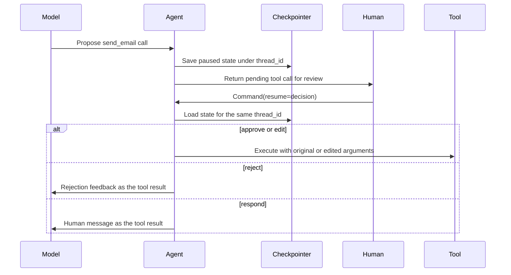

### Approve, edit, reject and respond decisions

Each tool's `allowed_decisions` list controls which choices a reviewer has:

| Decision | Effect | Example |
| --- | --- | --- |
| `approve` | Runs the tool with the agent's original arguments | Send an email draft exactly as written |
| `edit` | Runs the tool with revised arguments | Change the recipient before sending |
| `reject` | Skips the tool and sends feedback to the agent | Deny a file deletion and explain why |
| `respond` | Skips the tool and returns the human's message as the tool result | `ask_user("What's your budget?")` is answered with "\$500" |

> **Warning:** Don't use `respond` to block a side-effecting tool such as `send_email` or `delete_file`. The model reads the reply as a successful result and may think the action already happened. Use `reject` instead.
{:.warn}

> **Tip:** Keep argument edits small. The lesson warns that large changes can lead the model to rethink its plan and call the tool again.
{:.ok}

### Key points

- HITL pauses before a gated tool runs, so a person can review the call before any side effect happens.
- `interrupt_on` chooses which tools to gate. A checkpointer and a shared `thread_id` let `Command(resume=...)` pick up where the run stopped.
- `reject` blocks actions. `respond` is only for tools where the human's answer *is* the result.
- Small edits are safer than large ones.


```python
from langgraph.checkpoint.memory import MemorySaver
from langgraph.types import Command

def lookup_order(order_id: str) -> str:
    """Look up an order's details."""
    return f"Order {order_id}: 2x headphones, $180 total, delivered 3 days agor"

def issue_refund(order_id: str, amount: float, reason: str) -> str:
    """Issue a refund to the customer"""
    return f"Refund ${amount} for order{order_id} ({reason})"

agent = create_deep_agent(
    model=model,
    tools=[lookup_order, issue_refund],
    system_prompt="You are a customer support agent. Look up orders before refunding.",
    interrupt_on= {
        "issue_refund": {"allowed_decisions": ["approve", "edit", "reject"]},
        "lookup_order": False, #safe, no approval needed
    },
    checkpointer=MemorySaver(),

)


```

if agent try to call `issue_refund`, pause befoe the tool executes and surface the pending action by human.


```python
import uuid

config = {"configurable": {"thread_id": f"support-{uuid.uuid4()}"}}

# --- Run until it pauses ---
result = agent.invoke(
    {"messages": [{"role": "user",
                   "content": "Order 1042 arrived broken, please refund it in full."}]},
    config=config,
)

```


```python
print(result)
```

    {'messages': [HumanMessage(content='Order 1042 arrived broken, please refund it in full.', additional_kwargs={}, response_metadata={}, id='59a16118-9450-42dd-825f-6533dfb190d1'), AIMessage(content=[{'type': 'text', 'text': "I'll look up the order details first to get the full refund amount."}, {'type': 'tool_use', 'name': 'lookup_order', 'input': {'order_id': '1042'}, 'id': 'tooluse_hd01TgbPEBiiwJMuQUJAQ7'}], additional_kwargs={}, response_metadata={'ResponseMetadata': {'RequestId': '38e06b7e-7964-45ba-84f9-e9fee22437fb', 'HTTPStatusCode': 200, 'HTTPHeaders': {'date': 'Wed, 11 Nov 2026 09:36:28 GMT', 'content-type': 'application/json', 'content-length': '510', 'connection': 'keep-alive', 'x-amzn-requestid': '38e06b7e-7964-45ba-84f9-e9fee22437fb'}, 'RetryAttempts': 0}, 'stopReason': 'tool_use', 'metrics': {'latencyMs': [785]}, 'model_provider': 'bedrock_converse', 'model_name': 'au.anthropic.claude-haiku-4-5-20251001-v1:0'}, id='lc_run--01a1c9f7-45e0-7358-8c6a-3e68d8e55776-0', tool_calls=[{'name': 'lookup_order', 'args': {'order_id': '1042'}, 'id': 'tooluse_hd01TgbPEBiiwJMuQUJAQ7', 'type': 'tool_call'}], invalid_tool_calls=[], usage_metadata={'input_tokens': 3370, 'output_tokens': 73, 'total_tokens': 3443, 'input_token_details': {'cache_creation': 0, 'cache_read': 0}}), ToolMessage(content='Order 1042: 2x headphones, $180 total, delivered 3 days agor', name='lookup_order', id='9b28c568-72da-446f-b439-ec7155091fa8', tool_call_id='tooluse_hd01TgbPEBiiwJMuQUJAQ7'), AIMessage(content=[{'type': 'text', 'text': "Now I'll issue the full refund of $180 for the broken order."}, {'type': 'tool_use', 'name': 'issue_refund', 'input': {'order_id': '1042', 'amount': 180, 'reason': 'Item arrived broken'}, 'id': 'tooluse_EDP61lMq6EiCpJSowaiGKJ'}], additional_kwargs={}, response_metadata={'ResponseMetadata': {'RequestId': '725f4f78-8517-4560-a45f-33afd53cc38b', 'HTTPStatusCode': 200, 'HTTPHeaders': {'date': 'Wed, 11 Nov 2026 09:36:29 GMT', 'content-type': 'application/json', 'content-length': '548', 'connection': 'keep-alive', 'x-amzn-requestid': '725f4f78-8517-4560-a45f-33afd53cc38b'}, 'RetryAttempts': 0}, 'stopReason': 'tool_use', 'metrics': {'latencyMs': [904]}, 'model_provider': 'bedrock_converse', 'model_name': 'au.anthropic.claude-haiku-4-5-20251001-v1:0'}, id='lc_run--01a1c9f7-490f-705a-a141-a03e84f223df-0', tool_calls=[{'name': 'issue_refund', 'args': {'order_id': '1042', 'amount': 180, 'reason': 'Item arrived broken'}, 'id': 'tooluse_EDP61lMq6EiCpJSowaiGKJ', 'type': 'tool_call'}], invalid_tool_calls=[], usage_metadata={'input_tokens': 3478, 'output_tokens': 111, 'total_tokens': 3589, 'input_token_details': {'cache_creation': 0, 'cache_read': 0}})], 'files': {}, '__interrupt__': [Interrupt(value={'action_requests': [{'name': 'issue_refund', 'args': {'order_id': '1042', 'amount': 180, 'reason': 'Item arrived broken'}, 'description': "Tool execution requires approval\n\nTool: issue_refund\nArgs: {'order_id': '1042', 'amount': 180, 'reason': 'Item arrived broken'}"}], 'review_configs': [{'action_name': 'issue_refund', 'allowed_decisions': ['approve', 'edit', 'reject']}]}, id='04be836d7a01bc7a879ec069c85daf9f', response_schema=None)]}


```python
for i, h in enumerate(result['messages']):
    print(
        f'--- {i} => {type(h)} ---',
        f'{h.content}',
        f'----------------------------------',
        sep="\n")
```

    --- 0 => <class 'langchain_core.messages.human.HumanMessage'> ---
    Order 1042 arrived broken, please refund it in full.
    ----------------------------------
    --- 1 => <class 'langchain_core.messages.ai.AIMessage'> ---
    [{'type': 'text', 'text': "I'll look up the order details first to get the full refund amount."}, {'type': 'tool_use', 'name': 'lookup_order', 'input': {'order_id': '1042'}, 'id': 'tooluse_hd01TgbPEBiiwJMuQUJAQ7'}]
    ----------------------------------
    --- 2 => <class 'langchain_core.messages.tool.ToolMessage'> ---
    Order 1042: 2x headphones, $180 total, delivered 3 days agor
    ----------------------------------
    --- 3 => <class 'langchain_core.messages.ai.AIMessage'> ---
    [{'type': 'text', 'text': "Now I'll issue the full refund of $180 for the broken order."}, {'type': 'tool_use', 'name': 'issue_refund', 'input': {'order_id': '1042', 'amount': 180, 'reason': 'Item arrived broken'}, 'id': 'tooluse_EDP61lMq6EiCpJSowaiGKJ'}]
    ----------------------------------


Inspect what the agent wants to do:


```python
flatten(result.get("__interrupt__")[-1].value)
```


    {'action_requests.0.name': 'issue_refund',
     'action_requests.0.args.order_id': '1042',
     'action_requests.0.args.amount': 180,
     'action_requests.0.args.reason': 'Item arrived broken',
     'action_requests.0.description': "Tool execution requires approval\n\nTool: issue_refund\nArgs: {'order_id': '1042', 'amount': 180, 'reason': 'Item arrived broken'}",
     'review_configs.0.action_name': 'issue_refund',
     'review_configs.0.allowed_decisions.0': 'approve',
     'review_configs.0.allowed_decisions.1': 'edit',
     'review_configs.0.allowed_decisions.2': 'reject'}


```python
if result.get("__interrupt__"):
    req = result["__interrupt__"][0].value
    for action in req["action_requests"]:
        print("Agent wants:", action["name"], action["args"])
```

    Agent wants: issue_refund {'order_id': '1042', 'amount': 180, 'reason': 'Item arrived broken'}


Human decides: approve, edit, or reject, to approve: 

```python
decision = {"type": "approve"}
``` 
Reject with feedback

```python
decision = {"type": "reject", 
            "message": "Ask for a photo of the damage first."}
```
is the code. 

However, if I want edit the amount (e.g. partial refund):


```python
# 3. Resume with an edit
decision = {"type": "edit",
            "edited_action": {                      # <- not "edit_action"
                "name": "issue_refund",
                "args": {"order_id": "1042", "amount": 90.0,
                         "reason": "partial - one item damaged"}
            }
}

result = agent.invoke(Command(resume={"decisions": [decision]}), config=config)
print(result["messages"][-1].content)
```

    I've processed a refund for order 1042. However, I notice that a partial refund of $90 was applied by a human reviewer instead of the full $180 refund you requested. This was processed as a partial refund for one damaged item.
    
    Since you mentioned the order arrived broken and you're requesting a full refund, you may want to clarify:
    - Did only one of the two headphones arrive broken, or were both items damaged?
    - If both items were damaged, you should request the remaining $90 refund to complete the full refund.
    
    Would you like me to help you with anything else regarding this order?


### The loop, rearranged with ask_user first

There is one rule for the order: the run expects one decision per pending tool call, in the same order as `action_requests`. Below, the ask_user branch comes first and the send_email approve/edit/reject branch comes second. Each decision is still added in request order, so the run accepts them.

Define three tools: `ask_user` pauses to ask you something, `lookup_order` runs on its own because it’s safe, and `issue_refund` waits for your approval.


```python
from langgraph.types import interrupt
from langchain_core.tools import tool

@tool
def ask_user(question: str) -> str:
    """Ask the human a clarifying question and wait for their answer."""
    # Pauses the graph here. Whatever you pass to Command(resume=...)
    # becomes the return value of interrupt(), and goes back to the model.
    return interrupt({"type": "ask_user", "question": question})


@tool
def lookup_order(order_id: str) -> str:
    """Look up an order's details."""
    return f"Order {order_id}: 2x headphones, $180 total, delivered 3 days ago."


@tool
def issue_refund(order_id: str, amount: float, reason: str) -> str:
    """Issue a refund to the customer."""
    return f"Refunded ${amount} for order {order_id} ({reason})."
```

Build the agent. `interrupt_on` makes `issue_refund` wait for your approval, and the checkpointer saves the paused state between cells.


```python
from langgraph.checkpoint.memory import MemorySaver

agent = create_deep_agent(
    model=model,
    tools=[ask_user, lookup_order, issue_refund],
    system_prompt=(
        "You are a customer support agent. Always look up the order before refunding. "
        "Never ask the user questions in your reply text. "
        "If you need any clarification, you MUST call the ask_user tool, "
        "one question per call. Only call issue_refund once everything is clear."
    ),
    interrupt_on={
        "issue_refund": {"allowed_decisions": ["approve", "edit", "reject"]},
    },
    checkpointer=MemorySaver(),   # keeps state between cells
)
```

Short functions you call from later cells. Each one runs the agent one step and prints what it’s waiting for next.


```python
from langgraph.types import Command, interrupt

config = None   
result = None 


def show(res):
    """Print what the agent is waiting for, or its final reply."""
    global result
    result = res
    if res.get("__interrupt__"):
        value = res["__interrupt__"][0].value
        if value.get("type") == "ask_user":
            print("❓ Agent asks:", value["question"])
            print("   → run:  answer('your answer')")
        else:
            for a in value["action_requests"]:
                print("⚠️  Approval needed:", a["name"], a["args"])
            print("   → run:  approve()  |  edit(amount=...)  |  reject('why')")
    else:
        print("🤖 Agent:", res["messages"][-1].content)
        print("   → done, or run:  say('follow-up message')")


def answer(text):
    """Reply to an ask_user question (resume with a plain value)."""
    show(agent.invoke(Command(resume=text), config=config))


def approve():
    """Approve the pending issue_refund call as-is."""
    show(agent.invoke(Command(resume={"decisions": [{"type": "approve"}]}), config=config))


def edit(**changes):
    """Change the pending call's arguments, e.g. edit(amount=90.0)."""
    action = result["__interrupt__"][0].value["action_requests"][0]
    new_args = {**action["args"], **changes}
    decision = {"type": "edit",
                "edited_action": {"name": action["name"], "args": new_args}}
    show(agent.invoke(Command(resume={"decisions": [decision]}), config=config))


def reject(message):
    """Block the pending call and tell the agent why."""
    decision = {"type": "reject", "message": message}
    show(agent.invoke(Command(resume={"decisions": [decision]}), config=config))


def say(text):
    """Send a NEW message. Use it when the run has ended, e.g. the agent asked in plain text."""
    show(agent.invoke({"messages": [{"role": "user", "content": text}]}, config=config))
```

Creates a new thread and sends the customer’s request. Re-run this cell any time you want to start over.


```python
import uuid

config = {"configurable": {"thread_id": f"support-{uuid.uuid4()}"}}
say("Order 1042 arrived broken, please refund it.")
```

    ❓ Agent asks: Should I refund the full $180 for both items, or just a portion of the order?
       → run:  answer('your answer')


Answer the user question:


```python
answer("Only one is broken")
```

    ⚠️  Approval needed: issue_refund {'order_id': '1042', 'amount': 90, 'reason': 'Item arrived broken'}
       → run:  approve()  |  edit(amount=...)  |  reject('why')


Edit the amount to refund for approval:


```python
edit(amount=90.0, reason="Partial refund - one of two headphones damaged")
# or approve() if the amount is already 90
```

    🤖 Agent: Perfect! I've issued a refund of $90 for the broken headphone. The refund has been processed for order 1042.
       → done, or run:  say('follow-up message')


The selected run is Turn 5 of thread, so the diagram shows the whole five-turn refund conversation:

- **Turn 1:** The user asks for a refund on order 1042. The agent calls `lookup_order` (2x headphones, $180), then pauses with an `ask_user` question.
- **Turn 2:** The user replies *"Only one is broken"*{:.message color="green"}. The model proposes `issue_refund($90)`, and the human-in-the-loop middleware pauses it for review.
- **Turn 3:** A reviewer edits the refund reason. The edited call runs, refunds $90, and the agent gives its final answer.
- **Turns 4–5:** Two more resumes, "Partial refund" and "approve". Each took 0.00s and returned the same final state. Whic is for another sequece base on the user answer.


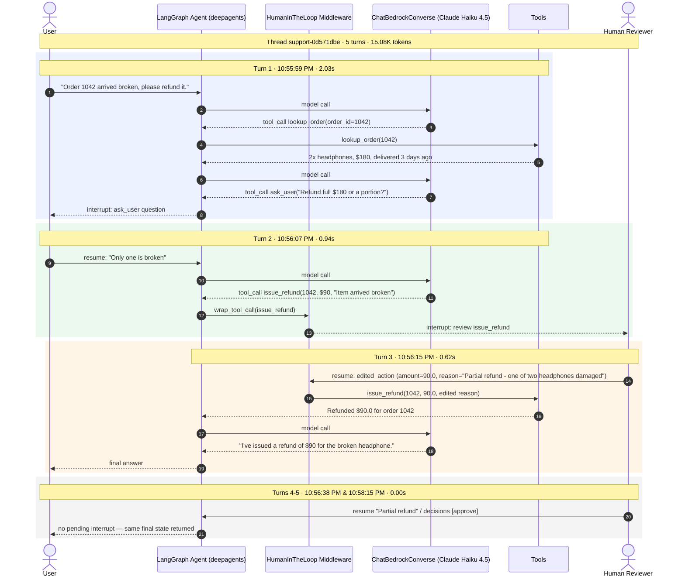


[^1]: [What is an Agent Harness?](https://www.youtube.com/watch?v=R0ckdFjUF5U)

[^2]: [Move Lens small dataset](https://files.grouplens.org/datasets/movielens/ml-latest-small.zip)

[^3]:  [Lesson 8: HITL – Introduction to Deep Agents](https://academy.langchain.com/courses/take/foundation-introduction-to-deepagents/multimedia/76263203-lesson-8-hitl){:target="_blank" rel="noopener noreferrer"}, LangChain Academy

{:gtxt: .message color="green"}
{:ytxt: .message color="yellow"}
{:rtxt: .message color="red"}
