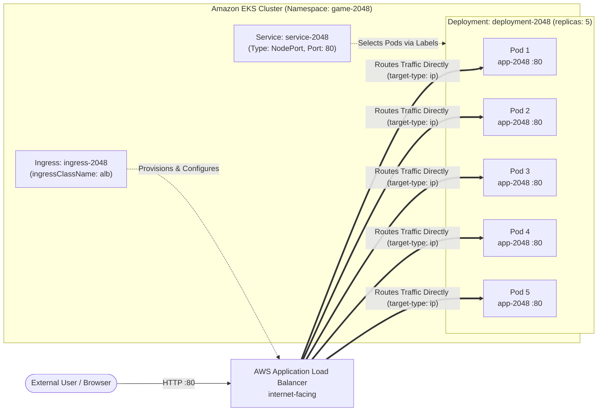
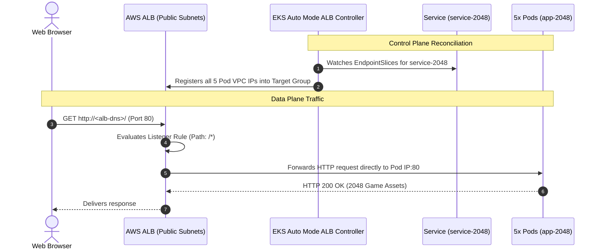

<!--more-->




* TOC
{:toc}


## EKS Quickstart

> **Note:** This is a hands-on guide focused on practical Kubernetes operations using Amazon EKS. To better understand the Kubernetes (K8s) commands and operations demonstrated here, I recommend reviewing the [Amazon EKS Quickstart Guide][1] before proceeding.
{:.info-box}

I am following the AWS EKS tutorial[^1] to create the first cluster and verify my environment:


```bash
echo $AWS_DEFAULT_REGION
```

    ap-southeast-2


cluster configuration:


```bash
cat > ../eks/example1/cluster-config.yaml <<EOF
apiVersion: eksctl.io/v1alpha5
kind: ClusterConfig

metadata:
  name: web-quickstart
  region: ${AWS_DEFAULT_REGION}

autoModeConfig:
  enabled: true
EOF
```

create the cluster


```bash
eksctl create cluster -f ../eks/example1/cluster-config.yaml
```

    ]11;?\2026-11-19 09:14:22 [ℹ]  eksctl version 0.231.0
    2026-11-19 09:14:22 [ℹ]  using region ap-southeast-2
    2026-11-19 09:14:22 [ℹ]  setting availability zones to [ap-southeast-2a ap-southeast-2b ap-southeast-2c]
    2026-11-19 09:14:22 [ℹ]  subnets for ap-southeast-2a - public:192.168.0.0/19 private:192.168.96.0/19
    2026-11-19 09:14:22 [ℹ]  subnets for ap-southeast-2b - public:192.168.32.0/19 private:192.168.128.0/19
    2026-11-19 09:14:22 [ℹ]  subnets for ap-southeast-2c - public:192.168.64.0/19 private:192.168.160.0/19
    2026-11-19 09:14:22 [ℹ]  using Kubernetes version 1.34
    2026-11-19 09:14:22 [ℹ]  creating EKS cluster "web-quickstart" in "ap-southeast-2" region with 
    2026-11-19 09:14:22 [ℹ]  if you encounter any issues, check CloudFormation console or try 'eksctl utils describe-stacks --region=ap-southeast-2 --cluster=web-quickstart'
    2026-11-19 09:14:22 [ℹ]  Kubernetes API endpoint access will use default of {publicAccess=true, privateAccess=false} for cluster "web-quickstart" in "ap-southeast-2"
    2026-11-19 09:14:22 [ℹ]  CloudWatch logging will not be enabled for cluster "web-quickstart" in "ap-southeast-2"
    2026-11-19 09:14:22 [ℹ]  you can enable it with 'eksctl utils update-cluster-logging --enable-types={SPECIFY-YOUR-LOG-TYPES-HERE (e.g. all)} --region=ap-southeast-2 --cluster=web-quickstart'
    2026-11-19 09:14:22 [ℹ]  default addons metrics-server were not specified, will install them as EKS addons
    2026-11-19 09:14:22 [ℹ]  
    2 sequential tasks: { create cluster control plane "web-quickstart", 
        2 sequential sub-tasks: { 
            no tasks,
            wait for control plane to become ready,
        } 
    }
    2026-11-19 09:14:22 [ℹ]  building cluster stack "eksctl-web-quickstart-cluster"
    2026-11-19 09:14:22 [ℹ]  deploying stack "eksctl-web-quickstart-cluster"
    2026-11-19 09:14:52 [ℹ]  waiting for CloudFormation stack "eksctl-web-quickstart-cluster"
    2026-11-19 09:15:22 [ℹ]  waiting for CloudFormation stack "eksctl-web-quickstart-cluster"
    2026-11-19 09:16:23 [ℹ]  waiting for CloudFormation stack "eksctl-web-quickstart-cluster"
    2026-11-19 09:17:23 [ℹ]  waiting for CloudFormation stack "eksctl-web-quickstart-cluster"
    2026-11-19 09:18:23 [ℹ]  waiting for CloudFormation stack "eksctl-web-quickstart-cluster"
    2026-11-19 09:19:23 [ℹ]  waiting for CloudFormation stack "eksctl-web-quickstart-cluster"
    2026-11-19 09:20:23 [ℹ]  waiting for CloudFormation stack "eksctl-web-quickstart-cluster"
    2026-11-19 09:21:23 [ℹ]  waiting for CloudFormation stack "eksctl-web-quickstart-cluster"
    2026-11-19 09:22:23 [ℹ]  waiting for CloudFormation stack "eksctl-web-quickstart-cluster"
    2026-11-19 09:23:23 [ℹ]  waiting for CloudFormation stack "eksctl-web-quickstart-cluster"
    2026-11-19 09:24:23 [ℹ]  waiting for CloudFormation stack "eksctl-web-quickstart-cluster"
    2026-11-19 09:26:24 [ℹ]  waiting for the control plane to become ready
    2026-11-19 09:26:25 [✔]  saved kubeconfig as "/home/ojitha/.kube/config"
    2026-11-19 09:26:25 [ℹ]  no tasks
    2026-11-19 09:26:25 [✔]  all EKS cluster resources for "web-quickstart" have been created
    2026-11-19 09:26:25 [ℹ]  creating addon: metrics-server
    2026-11-19 09:26:25 [ℹ]  successfully created addon: metrics-server
    2026-11-19 09:26:25 [✖]  getting Kubernetes version on EKS cluster: error running `kubectl version`: exit status 1 (check 'kubectl version')
    2026-11-19 09:26:25 [ℹ]  cluster should be functional despite missing (or misconfigured) client binaries
    2026-11-19 09:26:25 [✔]  EKS cluster "web-quickstart" in "ap-southeast-2" region is ready
    


Verify the cluster has been created:


```bash
eksctl get cluster --region ${AWS_DEFAULT_REGION}
```

    ]11;?\NAME		REGION		EKSCTL CREATED
    web-quickstart	ap-southeast-2	True


Before use kubectl, configure.


```bash
export KUBECONFIG=~/.kube/config
```

check the current configuration


```bash
aws eks update-kubeconfig --name web-quickstart --region ${AWS_DEFAULT_REGION}
```

    Added new context arn:aws:eks:ap-southeast-2:053018632062:cluster/web-quickstart to /home/ojitha/.kube/config


Find all the existing contexts. The `*` one is the current context.


```bash
kubectl config get-contexts
```

    CURRENT   NAME                                                                     CLUSTER                                                          AUTHINFO                                                                 NAMESPACE
              arn:aws:eks:ap-southeast-2:053018632062:cluster/web-quickstart           arn:aws:eks:ap-southeast-2:053018632062:cluster/web-quickstart   arn:aws:eks:ap-southeast-2:053018632062:cluster/web-quickstart           
    *         aws-go-sdk-1795040062311599190@web-quickstart.ap-southeast-2.eksctl.io   web-quickstart.ap-southeast-2.eksctl.io                          aws-go-sdk-1795040062311599190@web-quickstart.ap-southeast-2.eksctl.io   
              default                                                                  default                                                          default                                                                  


Verify the current context only:


```bash
kubectl config current-context
```

    aws-go-sdk-1795040062311599190@web-quickstart.ap-southeast-2.eksctl.io


```bash
kubectl config view --minify
```

    apiVersion: v1
    clusters:
    - cluster:
        certificate-authority-data: DATA+OMITTED
        server: https://2FFD1647198B8D25C9D9E94FAFBAD544.gr7.ap-southeast-2.eks.amazonaws.com
      name: web-quickstart.ap-southeast-2.eksctl.io
    contexts:
    - context:
        cluster: web-quickstart.ap-southeast-2.eksctl.io
        user: aws-go-sdk-1795040062311599190@web-quickstart.ap-southeast-2.eksctl.io
      name: aws-go-sdk-1795040062311599190@web-quickstart.ap-southeast-2.eksctl.io
    current-context: aws-go-sdk-1795040062311599190@web-quickstart.ap-southeast-2.eksctl.io
    kind: Config
    preferences: {}
    users:
    - name: aws-go-sdk-1795040062311599190@web-quickstart.ap-southeast-2.eksctl.io
      user:
        exec:
          apiVersion: client.authentication.k8s.io/v1beta1
          args:
          - eks
          - get-token
          - --output
          - json
          - --cluster-name
          - web-quickstart
          - --region
          - ap-southeast-2
          command: aws
          env:
          - name: AWS_STS_REGIONAL_ENDPOINTS
            value: regional
          - name: AWS_PROFILE
            value: dev
          interactiveMode: IfAvailable
          provideClusterInfo: false


```bash
# Test connectivity
kubectl get svc

```

    NAME         TYPE        CLUSTER-IP   EXTERNAL-IP   PORT(S)   AGE
    kubernetes   ClusterIP   10.100.0.1   <none>        443/TCP   17m


Create a Kubernetes IngressClass for EKS Auto Mode[^1]:


```bash
cat > ../eks/example1/ingressclass.yaml <<EOF
apiVersion: networking.k8s.io/v1
kind: IngressClass
metadata:
  name: alb
  annotations:
    ingressclass.kubernetes.io/is-default-class: "true"
spec:
  controller: eks.amazonaws.com/alb
EOF
```

Apply the IngressClass to your cluster:


```bash
kubectl apply -f ../eks/example1/ingressclass.yaml --validate=false
```

    ingressclass.networking.k8s.io/alb created


get ingress


```bash
kubectl get ingress -n game-2048
```

    NAME           CLASS   HOSTS   ADDRESS                                                                       PORTS   AGE
    ingress-2048   alb     *       k8s-game2048-ingress2-9d85330077-559727851.ap-southeast-2.elb.amazonaws.com   80      111m


As explained in the AWS documentation[^1], the steps to deploy the popular "2048 game" as a sample application within the cluster are as follows. 

**Create the namespace**


```bash
kubectl create namespace game-2048 --save-config
```

    namespace/game-2048 created


verify the namespace


```bash
kubectl get namespaces
```

    NAME              STATUS   AGE
    default           Active   125m
    game-2048         Active   101m
    kube-node-lease   Active   125m
    kube-public       Active   125m
    kube-system       Active   125m


Describe the namespace:


```bash
kubectl describe namespace game-2048
```

    Name:         game-2048
    Labels:       kubernetes.io/metadata.name=game-2048
    Annotations:  <none>
    Status:       Active
    
    No resource quota.
    
    No LimitRange resource.


```bash
kubectl get all -n game-2048
```

    NAME                                 READY   STATUS    RESTARTS   AGE
    pod/deployment-2048-fdb9d778-4dlbv   1/1     Running   0          73m
    pod/deployment-2048-fdb9d778-mqnc5   1/1     Running   0          73m
    pod/deployment-2048-fdb9d778-z45m7   1/1     Running   0          73m
    
    NAME                   TYPE       CLUSTER-IP       EXTERNAL-IP   PORT(S)        AGE
    service/service-2048   NodePort   10.100.192.217   <none>        80:30310/TCP   102m
    
    NAME                              READY   UP-TO-DATE   AVAILABLE   AGE
    deployment.apps/deployment-2048   3/3     3            3           102m
    
    NAME                                         DESIRED   CURRENT   READY   AGE
    replicaset.apps/deployment-2048-7bf64bccb7   0         0         0       102m
    replicaset.apps/deployment-2048-fdb9d778     3         3         3       73m


**Deploy the 2048 Game Sample application**


```bash
kubectl apply -n game-2048 -f https://raw.githubusercontent.com/kubernetes-sigs/aws-load-balancer-controller/v2.8.0/docs/examples/2048/2048_full.yaml
```

    namespace/game-2048 configured
    deployment.apps/deployment-2048 created
    service/service-2048 created
    ingress.networking.k8s.io/ingress-2048 created


This manifest[^2] deploys and exposes the `game-2048` app within its namespace by creating a **Deployment**, a **Service** (`service-2048` on port 80), and an **Ingress** (`ingress-2048` with HTTP routing and internet-facing ALB annotations).


### Architecture & Traffic Flow

When applied to an **Amazon EKS Auto Mode** cluster, this manifest provisions and connects four Kubernetes resources inside an isolated namespace, leveraging EKS Auto Mode's built-in load balancing capability (`controller: eks.amazonaws.com/alb`)[cite: 1] to expose the application via an AWS Application Load Balancer (ALB)[cite: 1]:



### Detailed Manifest Breakdown

#### 1. Namespace (`game-2048`)
```yaml
apiVersion: v1
kind: Namespace
metadata:
  name: game-2048
```
* **Logical Isolation:** Creates a dedicated virtual boundary (`game-2048`) within the EKS cluster so that all application workloads, services, and ingress rules remain isolated from system components and other applications.
* **Resource Scoping:** Every subsequent object in the manifest defines `namespace: game-2048`, ensuring clean lifecycle management and scoped access control.


#### 2. Deployment (`deployment-2048`)
```yaml
apiVersion: apps/v1
kind: Deployment
metadata:
  namespace: game-2048
  name: deployment-2048
spec:
  selector:
    matchLabels:
      app.kubernetes.io/name: app-2048
  replicas: 5
  template:
    metadata:
      labels:
        app.kubernetes.io/name: app-2048
    spec:
      containers:
        - image: public.ecr.aws/l6m2t8p7/docker-2048:latest
          imagePullPolicy: Always
          name: app-2048
          ports:
            - containerPort: 80
```

* **High Availability (`replicas: 5`):** Instructs the Kubernetes Deployment controller (via an underlying ReplicaSet) to maintain **5 identical Pods** running continuously. In EKS Auto Mode, compute nodes are automatically provisioned and scaled to accommodate these Pods[cite: 1].
* **Label Matching (`selector` & `labels`):** Uses `app.kubernetes.io/name: app-2048` to bind the Deployment controller to the Pods defined in the Pod template.
* **Container Specification:** Pulls the 2048 web application image from Amazon ECR Public (`public.ecr.aws/l6m2t8p7/docker-2048:latest`) with `imagePullPolicy: Always` and exposes HTTP traffic on **port 80**.


#### 3. Service (`service-2048`)
```yaml
apiVersion: v1
kind: Service
metadata:
  namespace: game-2048
  name: service-2048
spec:
  ports:
    - port: 80
      targetPort: 80
      protocol: TCP
  type: NodePort
  selector:
    app.kubernetes.io/name: app-2048
```

* **Dynamic Endpoint Discovery:** Watches for healthy Pods matching `app.kubernetes.io/name: app-2048` and tracks their VPC IP addresses in Kubernetes `EndpointSlice` objects.
* **Port Mapping (`type: NodePort`):** Creates an internal ClusterIP on port `80` forwarding to container `targetPort: 80` over TCP, while allocating a static port (`30000–32767`) across cluster nodes.
* **Integration with ALB:** When paired with the Ingress annotation `target-type: ip`, the Service acts primarily as the **target registry**—allowing the EKS Auto Mode load balancer controller to read the backing Pod IPs directly rather than routing traffic through node ports.


#### 4. Ingress (`ingress-2048`)
```yaml
apiVersion: networking.k8s.io/v1
kind: Ingress
metadata:
  namespace: game-2048
  name: ingress-2048
  annotations:
    alb.ingress.kubernetes.io/scheme: internet-facing
    alb.ingress.kubernetes.io/target-type: ip
spec:
  ingressClassName: alb
  rules:
    - http:
        paths:
          - path: /
            pathType: Prefix
            backend:
              service:
                name: service-2048
                port:
                  number: 80
```

* **Controller Binding (`ingressClassName: alb`):** Links this Ingress resource to the `alb` `IngressClass` (`controller: eks.amazonaws.com/alb`) created earlier in your setup[cite: 1], prompting AWS to provision and manage an **Application Load Balancer**[cite: 1].
* **ALB Annotations:**
  * `alb.ingress.kubernetes.io/scheme: internet-facing`: Places the ALB in your VPC's public subnets and generates a public DNS endpoint (`*.ap-southeast-2.elb.amazonaws.com`) reachable over the internet[cite: 1].
  * `alb.ingress.kubernetes.io/target-type: ip`: Registers each Pod's VPC IP address directly as a target in the AWS Target Group, bypassing `kube-proxy` node-port hops for lower latency.
* **HTTP Routing Rules (`path: /`, `pathType: Prefix`):** Directs all incoming HTTP traffic (`/*`) arriving on port `80` to `service-2048`[cite: 1].


### Control Plane & Request Lifecycle



check the pods created for this application:


```bash
kubectl get pods -n game-2048
```

    NAME                             READY   STATUS    RESTARTS   AGE
    deployment-2048-fdb9d778-4dlbv   1/1     Running   0          77m
    deployment-2048-fdb9d778-mqnc5   1/1     Running   0          77m
    deployment-2048-fdb9d778-z45m7   1/1     Running   0          77m


```bash
kubectl describe pod -n game-2048 deployment-2048-fdb9d778-z45m7
```

    Name:             deployment-2048-fdb9d778-z45m7
    Namespace:        game-2048
    Priority:         0
    Service Account:  default
    Node:             i-0c78e23f81aa0e8be/192.168.134.67
    Start Time:       Thu, 19 Nov 2026 10:15:42 +1100
    Labels:           app.kubernetes.io/name=app-2048
                      pod-template-hash=fdb9d778
    Annotations:      <none>
    Status:           Running
    IP:               192.168.157.103
    IPs:
      IP:           192.168.157.103
    Controlled By:  ReplicaSet/deployment-2048-fdb9d778
    Containers:
      app-2048:
        Container ID:   containerd://68ce20daef6ae06351726c2c954057dc87a9a1db89a77e04b66beac6d413fe29
        Image:          public.ecr.aws/l6m2t8p7/docker-2048:latest
        Image ID:       public.ecr.aws/l6m2t8p7/docker-2048@sha256:338a89c44a060734afb446950fbbcd804a005daf7af38def7c496967fa4ab965
        Port:           80/TCP
        Host Port:      0/TCP
        State:          Running
          Started:      Thu, 19 Nov 2026 10:15:44 +1100
        Ready:          True
        Restart Count:  0
        Environment:    <none>
        Mounts:
          /var/lib/2048 from game-data (rw)
          /var/run/secrets/kubernetes.io/serviceaccount from kube-api-access-smf7q (ro)
    Conditions:
      Type                        Status
      PodReadyToStartContainers   True 
      Initialized                 True 
      Ready                       True 
      ContainersReady             True 
      PodScheduled                True 
    Volumes:
      game-data:
        Type:       PersistentVolumeClaim (a reference to a PersistentVolumeClaim in the same namespace)
        ClaimName:  game-data-pvc
        ReadOnly:   false
      kube-api-access-smf7q:
        Type:                    Projected (a volume that contains injected data from multiple sources)
        TokenExpirationSeconds:  3607
        ConfigMapName:           kube-root-ca.crt
        ConfigMapOptional:       <nil>
        DownwardAPI:             true
    QoS Class:                   BestEffort
    Node-Selectors:              <none>
    Tolerations:                 node.kubernetes.io/not-ready:NoExecute op=Exists for 300s
                                 node.kubernetes.io/unreachable:NoExecute op=Exists for 300s
    Events:                      <none>


**Access the application**
You alrady know the ingress (above), use the above `ADDRESS` that in the browser to get to the application. For example, in this case `http://k8s-game2048-ingress2-9d85330077-559727851.ap-southeast-2.elb.amazonaws.com/`.

Execute inside the pod:


```bash
kubectl exec -n game-2048 deployment-2048-fdb9d778-z45m7 -- ls
```

    bin
    dev
    etc
    home
    lib
    media
    mnt
    opt
    proc
    root
    run
    sbin
    srv
    sys
    tmp
    usr
    var


Port forwarding (`http://localhost:8080`):
```bash
kubectl port-forward -n game-2048 deployment-2048-fdb9d778-z45m7 8080:80
```

    Forwarding from 127.0.0.1:8080 -> 80
    Forwarding from [::1]:8080 -> 80
    Handling connection for 8080
    Handling connection for 8080
    Handling connection for 8080
    Handling connection for 8080
    Handling connection for 8080
    Handling connection for 8080


```bash
kubectl get pod -n game-2048 deployment-2048-fdb9d778-z45m7 -o wide
```

    NAME                             READY   STATUS    RESTARTS   AGE    IP                NODE                  NOMINATED NODE   READINESS GATES
    deployment-2048-fdb9d778-z45m7   1/1     Running   0          103m   192.168.157.103   i-0c78e23f81aa0e8be   <none>           <none>


Persist game data:


```bash
cat > ../eks/example1/storage-class.yaml <<EOF
apiVersion: storage.k8s.io/v1
kind: StorageClass
metadata:
  name: auto-ebs-sc
  annotations:
    storageclass.kubernetes.io/is-default-class: "true"
provisioner: ebs.csi.eks.amazonaws.com
volumeBindingMode: WaitForFirstConsumer
parameters:
  type: gp3
  encrypted: "true"
EOF
```


```bash
kubectl apply -f ../eks/example1/storage-class.yaml
```

    storageclass.storage.k8s.io/auto-ebs-sc created


Check if your EBS volume has been successfully provisioned:


```bash
kubectl get pvc -n game-2048
```

    NAME            STATUS   VOLUME                                     CAPACITY   ACCESS MODES   STORAGECLASS   VOLUMEATTRIBUTESCLASS   AGE
    game-data-pvc   Bound    pvc-0b27ef9c-b857-4900-8d35-7760db67f8e0   10Gi       RWO            auto-ebs-sc    <unset>                 27m


Create a Persistent Volume Claim (PVC) to request storage for your game data:


```bash
cat > ../eks/example1/ebs-pvc.yaml <<EOF
apiVersion: v1
kind: PersistentVolumeClaim
metadata:
  name: game-data-pvc
  namespace: game-2048
spec:
  accessModes:
    - ReadWriteOnce
  resources:
    requests:
      storage: 10Gi
  storageClassName: auto-ebs-sc
EOF
```


```bash
kubectl apply -f ../eks/example1/ebs-pvc.yaml
```

    persistentvolumeclaim/game-data-pvc created


verify the pvc


```bash
kubectl get pv
```

    NAME                                       CAPACITY   ACCESS MODES   RECLAIM POLICY   STATUS   CLAIM                     STORAGECLASS   VOLUMEATTRIBUTESCLASS   REASON   AGE
    pvc-0b27ef9c-b857-4900-8d35-7760db67f8e0   10Gi       RWO            Delete           Bound    game-2048/game-data-pvc   auto-ebs-sc    <unset>                          24m


Update the 2048 game deployment to use this PVC for storing data


```bash
cat > ../eks/example1/ebs-deployment.yaml <<EOF
apiVersion: apps/v1
kind: Deployment
metadata:
  namespace: game-2048
  name: deployment-2048
spec:
  replicas: 3  # Adjust the number of replicas as needed
  selector:
    matchLabels:
      app.kubernetes.io/name: app-2048
  template:
    metadata:
      labels:
        app.kubernetes.io/name: app-2048
    spec:
      containers:
        - name: app-2048
          image: public.ecr.aws/l6m2t8p7/docker-2048:latest
          imagePullPolicy: Always
          ports:
            - containerPort: 80
          volumeMounts:
            - name: game-data
              mountPath: /var/lib/2048
      volumes:
        - name: game-data
          persistentVolumeClaim:
            claimName: game-data-pvc
EOF
```


```bash
kubectl apply -f ../eks/example1/ebs-deployment.yaml
```

    deployment.apps/deployment-2048 configured


Confirm that your updated deployment with 3 replicas is healthy and running across the cluster nodes:


```bash
kubectl get deployment -n game-2048
```

    NAME              READY   UP-TO-DATE   AVAILABLE   AGE
    deployment-2048   3/3     3            3           54m


```bash
kubectl get pods -n game-2048 -o wide
```

    NAME                             READY   STATUS    RESTARTS   AGE    IP                NODE                  NOMINATED NODE   READINESS GATES
    deployment-2048-fdb9d778-4dlbv   1/1     Running   0          121m   192.168.157.101   i-0c78e23f81aa0e8be   <none>           <none>
    deployment-2048-fdb9d778-mqnc5   1/1     Running   0          121m   192.168.157.102   i-0c78e23f81aa0e8be   <none>           <none>
    deployment-2048-fdb9d778-z45m7   1/1     Running   0          121m   192.168.157.103   i-0c78e23f81aa0e8be   <none>           <none>


You can create events using the following command by hitting the ingress:


```bash
curl -I http://$(kubectl get ingress ingress-2048 -n game-2048 -o jsonpath='{.status.loadBalancer.ingress[0].hostname}')
```

    HTTP/1.1 200 OK
    Date: Thu, 19 Nov 2026 01:15:42 GMT
    Content-Type: text/html
    Content-Length: 3988
    Connection: keep-alive
    Server: nginx
    Last-Modified: Wed, 06 Oct 2021 17:35:37 GMT
    ETag: "615dde69-f94"
    Accept-Ranges: bytes
    


View logs for a specific 2048 pod `kubectl logs -n game-2048 <POD_NAME> --tail=50`:


```bash
kubectl logs -n game-2048 deployment-2048-fdb9d778-4dlbv --tail=50
```

> Note that the public.ecr.aws/l6m2t8p7/docker-2048:latest image runs a lightweight static web server whose normal HTTP 200 access logs are either disabled or silent unless an error occurs, or buffered until traffic arrives.
{:.warn}


```bash
kubectl logs -n game-2048 deployment/deployment-2048 --tail=50
```

    Found 3 pods, using pod/deployment-2048-fdb9d778-4dlbv


Inspect detailed event history for troubleshooting


```bash
kubectl describe deployment deployment-2048 -n game-2048
```

    Name:                   deployment-2048
    Namespace:              game-2048
    CreationTimestamp:      Thu, 19 Nov 2026 09:46:26 +1100
    Labels:                 <none>
    Annotations:            deployment.kubernetes.io/revision: 2
    Selector:               app.kubernetes.io/name=app-2048
    Replicas:               3 desired | 3 updated | 3 total | 3 available | 0 unavailable
    StrategyType:           RollingUpdate
    MinReadySeconds:        0
    RollingUpdateStrategy:  25% max unavailable, 25% max surge
    Pod Template:
      Labels:  app.kubernetes.io/name=app-2048
      Containers:
       app-2048:
        Image:        public.ecr.aws/l6m2t8p7/docker-2048:latest
        Port:         80/TCP
        Host Port:    0/TCP
        Environment:  <none>
        Mounts:
          /var/lib/2048 from game-data (rw)
      Volumes:
       game-data:
        Type:          PersistentVolumeClaim (a reference to a PersistentVolumeClaim in the same namespace)
        ClaimName:     game-data-pvc
        ReadOnly:      false
      Node-Selectors:  <none>
      Tolerations:     <none>
    Conditions:
      Type           Status  Reason
      ----           ------  ------
      Available      True    MinimumReplicasAvailable
      Progressing    True    NewReplicaSetAvailable
    OldReplicaSets:  deployment-2048-7bf64bccb7 (0/0 replicas created)
    NewReplicaSet:   deployment-2048-fdb9d778 (3/3 replicas created)
    Events:
      Type    Reason             Age   From                   Message
      ----    ------             ----  ----                   -------
      Normal  ScalingReplicaSet  56m   deployment-controller  Scaled up replica set deployment-2048-7bf64bccb7 from 0 to 5
      Normal  ScalingReplicaSet  27m   deployment-controller  Scaled down replica set deployment-2048-7bf64bccb7 from 5 to 3
      Normal  ScalingReplicaSet  27m   deployment-controller  Scaled up replica set deployment-2048-fdb9d778 from 0 to 1
      Normal  ScalingReplicaSet  27m   deployment-controller  Scaled down replica set deployment-2048-7bf64bccb7 from 3 to 2
      Normal  ScalingReplicaSet  27m   deployment-controller  Scaled up replica set deployment-2048-fdb9d778 from 1 to 2
      Normal  ScalingReplicaSet  27m   deployment-controller  Scaled down replica set deployment-2048-7bf64bccb7 from 2 to 1
      Normal  ScalingReplicaSet  27m   deployment-controller  Scaled up replica set deployment-2048-fdb9d778 from 2 to 3
      Normal  ScalingReplicaSet  27m   deployment-controller  Scaled down replica set deployment-2048-7bf64bccb7 from 1 to 0


## Clean up


```bash
eksctl delete cluster -f  ../eks/example1/cluster-config.yaml
```

    ]11;?\2026-11-19 00:45:30 [ℹ]  deleting EKS cluster "web-quickstart"
    2026-11-19 00:45:30 [ℹ]  deleted 0 Fargate profile(s)
    2026-11-19 00:45:31 [ℹ]  cleaning up AWS load balancers created by Kubernetes objects of Kind Service, Ingress, or Gateway
    2026-11-19 00:45:32 [ℹ]  1 task: { delete cluster control plane "web-quickstart" [async] }
    2026-11-19 00:45:32 [ℹ]  will delete stack "eksctl-web-quickstart-cluster"
    2026-11-19 00:45:32 [✔]  all cluster resources were deleted
    


[^1]: [Quickstart: Deploy a web app and store data - Amazon EKS](https://docs.aws.amazon.com/eks/latest/userguide/quickstart.html#_configure_the_cluster)

[^2]: [ 2048 Game Sample application](https://raw.githubusercontent.com/kubernetes-sigs/aws-load-balancer-controller/v2.8.0/docs/examples/2048/2048_full.yaml)
